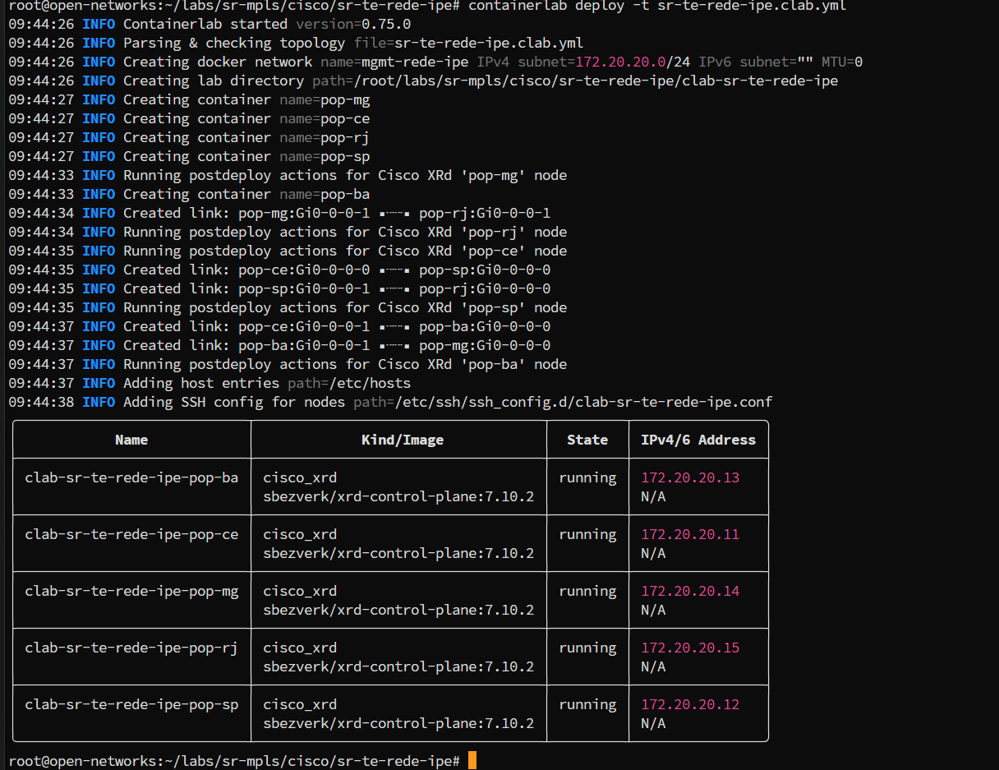
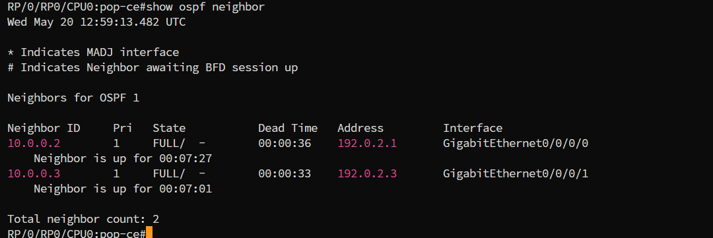
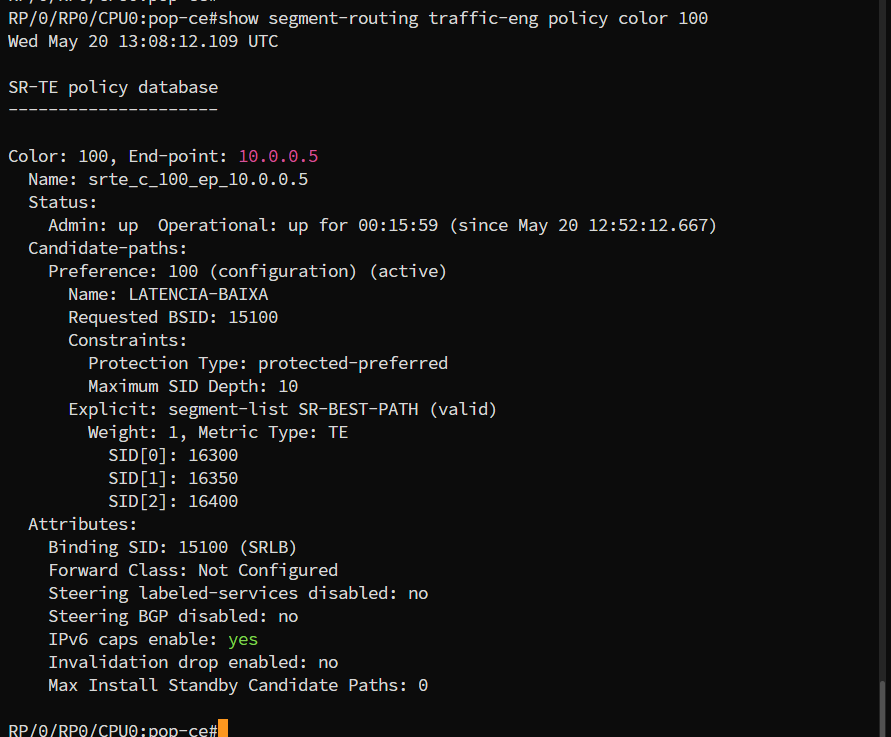
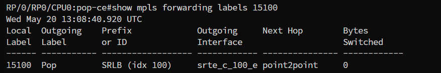
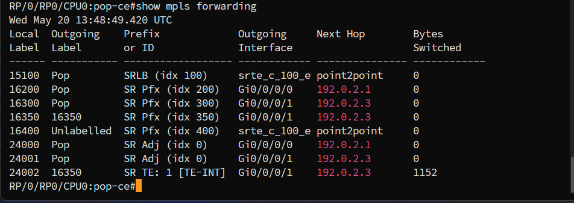

> Uso interno - material em desenvolvimento.

# SR-TE aplicado à Rede Ipê - CE → RJ

> **Pré-requisito:** leia o `base.md` e o `te_basic.md` antes de continuar. Este lab aplica os mesmos conceitos do lab anterior a um cenário inspirado na topologia real da Rede Ipê.

---

## O que este lab demonstra

A Rede Ipê ([Panorama Rede Ipê](https://redeipe.rnp.br/panorama)) conecta instituições de ensino e pesquisa em todo o Brasil. O caminho natural do IGP entre Fortaleza (CE) e Rio de Janeiro (RJ) passa pelo hub central em São Paulo (SP), com latência total de aproximadamente 40ms.

Para tráfego sensível a latência (Ex: videoconferências e VoIP entre a UFC e a UFRJ) esse caminho não é o ideal. Existe um caminho alternativo passando por Salvador (BA) e Belo Horizonte (MG) com latência total de aproximadamente 26ms, mas o IGP jamais o escolheria porque seu custo métrico é maior.

O SR-TE resolve isso sem tocar no IGP. A SR Policy configurada no PoP-CE força o tráfego de vídeo e VoIP pelo caminho CE → BA → MG → RJ, enquanto o tráfego best-effort (SSH, downloads) continua seguindo o caminho padrão CE → SP → RJ.

Os dois caminhos coexistem. O IGP não é alterado. Apenas o headend é configurado.

> **Aviso:** As informações tratadas nesse lab não necessariamente refletem a realidade da Rede Ipê.

---

## Conceitos aplicados neste lab

| **Waypoint:** Um nó intermediário explicitamente incluído no Segment List pelo operador. O SR-TE usa o Node-SID do waypoint para instruir o headend a encaminhar o pacote por aquele nó, independente do que o IGP escolheria. Neste lab, PoP-BA e PoP-MG são waypoints.

| **DSCP EF (Expedited Forwarding):** Marcação de QoS para tráfego de baixa latência. Em um cenário real, a SR Policy seria associada a um Color BGP e o tráfego seria direcionado automaticamente com base na marcação DSCP. Neste lab, o steering é feito via rota estática para simplificação.

| **Métricas OSPF como proxy de latência:** O XRd não simula latência real de enlace. As métricas OSPF são configuradas de forma que o IGP eleja o caminho CE → SP → RJ como best-path - mesmo que esse caminho tenha maior latência real. Isso reproduz o comportamento de uma rede onde SP é o hub central com menor custo de roteamento.

| **SRGB compartilhado:** Todos os PoPs usam o mesmo SRGB (16000–23999). O label de cada PoP é calculado como `16000 + SID index`. O headend empilha os labels dos waypoints e do destino para construir o caminho completo.

---

## Topologia


Figura 1: Topologia SR-TE entre CE e RJ na Rede Ipê. O caminho em destaque (CE → BA → MG → RJ) é o caminho de menor latência forçado pela SR Policy. O caminho padrão (CE → SP → RJ) continua ativo para tráfego best-effort.

---

**Tabela 1 - Nodes da topologia:**
Papel, endereçamento e SIDs de cada PoP

| Node    | Papel       | Localização    | Loopback0    | SID index | Label |
|---------|-------------|----------------|--------------|-----------|-------|
| PoP-CE  | Headend     | Fortaleza      | 10.0.0.1/32  | 100       | 16100 |
| PoP-SP  | Hub IGP     | São Paulo      | 10.0.0.2/32  | 200       | 16200 |
| PoP-BA  | Waypoint 1  | Salvador       | 10.0.0.3/32  | 300       | 16300 |
| PoP-MG  | Waypoint 2  | Belo Horizonte | 10.0.0.4/32  | 350       | 16350 |
| PoP-RJ  | Egress      | Rio de Janeiro | 10.0.0.5/32  | 400       | 16400 |

**Tabela 2 - Enlaces e métricas:**
Endereçamento, custo OSPF e delay simulado por enlace

| Enlace          | IP A           | IP B           | Métrica OSPF | Delay real |
|-----------------|----------------|----------------|--------------|------------|
| PoP-CE ↔ PoP-SP | 192.0.2.0/31   | 192.0.2.1/31   | 10           | ~30ms      |
| PoP-CE ↔ PoP-BA | 192.0.2.2/31   | 192.0.2.3/31   | 20           | ~8ms       |
| PoP-SP ↔ PoP-RJ | 192.0.2.4/31   | 192.0.2.5/31   | 10           | ~10ms      |
| PoP-BA ↔ PoP-MG | 192.0.2.6/31   | 192.0.2.7/31   | 8            | ~8ms       |
| PoP-MG ↔ PoP-RJ | 192.0.2.8/31   | 192.0.2.9/31   | 10           | ~10ms      |

As métricas OSPF são intencionalmente inversas ao delay real. O caminho via SP tem custo baixo (20) para que o IGP o prefira, reproduzindo o comportamento de rede onde SP é o hub central. O caminho via BA/MG tem custo alto (38) e só é usado quando forçado pela SR Policy.

**Caminho IGP best-path:** CE → SP → RJ - custo total **20**, delay ~40ms. Usado para tráfego best-effort.

**Caminho SR-TE:** CE → BA → MG → RJ - custo total **38**, delay ~26ms. Forçado pela SR Policy para tráfego de vídeo e VoIP.

---

## Deploy

Siga o `base.md` para instalar Docker, Containerlab e baixar a imagem antes de continuar.

### 1. Criar a pasta do lab

```bash
mkdir -p ~/labs/sr-mpls/cisco/sr-te-rede-ipe
cd ~/labs/sr-mpls/cisco/sr-te-rede-ipe
```

### 2. Criar o arquivo de topologia

```bash
nano sr-te-rede-ipe.clab.yml
```

Cole o conteúdo abaixo e salve:

```yaml
name: sr-te-rede-ipe

mgmt:
  network: mgmt-rede-ipe
  ipv4-subnet: 172.20.20.0/24

topology:
  kinds:
    cisco_xrd:
      image: sbezverk/xrd-control-plane:7.10.2

  nodes:
    pop-ce:
      kind: cisco_xrd
      mgmt-ipv4: 172.20.20.11
    pop-sp:
      kind: cisco_xrd
      mgmt-ipv4: 172.20.20.12
    pop-ba:
      kind: cisco_xrd
      mgmt-ipv4: 172.20.20.13
    pop-mg:
      kind: cisco_xrd
      mgmt-ipv4: 172.20.20.14
    pop-rj:
      kind: cisco_xrd
      mgmt-ipv4: 172.20.20.15

  links:
    - endpoints: ["pop-ce:Gi0-0-0-0", "pop-sp:Gi0-0-0-0"]
    - endpoints: ["pop-ce:Gi0-0-0-1", "pop-ba:Gi0-0-0-0"]
    - endpoints: ["pop-sp:Gi0-0-0-1", "pop-rj:Gi0-0-0-0"]
    - endpoints: ["pop-ba:Gi0-0-0-1", "pop-mg:Gi0-0-0-0"]
    - endpoints: ["pop-mg:Gi0-0-0-1", "pop-rj:Gi0-0-0-1"]
```

### 3. Subir o lab

```bash
containerlab deploy -t sr-te-rede-ipe.clab.yml
```

Resultado esperado:



---

## Configuração

Credenciais de acesso: usuário `clab` / senha `clab@123`

**Tabela 3 - IPs de acesso por node**

| Node   | IP de acesso |
|--------|--------------|
| PoP-CE | 172.20.20.11 |
| PoP-SP | 172.20.20.12 |
| PoP-BA | 172.20.20.13 |
| PoP-MG | 172.20.20.14 |
| PoP-RJ | 172.20.20.15 |

Abra um terminal para cada node. A SR Policy é configurada **apenas no PoP-CE**. Os demais recebem apenas a base SR-MPLS com as métricas OSPF ajustadas.

---

### PoP-CE - Headend

O Segment List `[16300, 16350, 16400]` instrui o tráfego a passar por PoP-BA (Salvador) e PoP-MG (BH) antes de chegar em PoP-RJ. A rota estática direciona o tráfego para a loopback de PoP-RJ dentro da SR Policy, simulando o steering de tráfego de vídeo/VoIP.

```bash
ssh clab@172.20.20.11
```

```
configure
hostname pop-ce
segment-routing global-block 16000 23999
segment-routing local-block  15000 15999
!
interface Loopback0
 ipv4 address 10.0.0.1 255.255.255.255
!
interface GigabitEthernet0/0/0/0
 description pop-ce to pop-sp
 ipv4 address 192.0.2.0 255.255.255.254
 no shutdown
!
interface GigabitEthernet0/0/0/1
 description pop-ce to pop-ba
 ipv4 address 192.0.2.2 255.255.255.254
 no shutdown
!
router ospf 1
 router-id 10.0.0.1
 segment-routing mpls
 segment-routing sr-prefer
 area 0
  segment-routing mpls
  interface Loopback0
   passive enable
   prefix-sid index 100
  !
  interface GigabitEthernet0/0/0/0
   network point-to-point
   cost 10
  !
  interface GigabitEthernet0/0/0/1
   network point-to-point
   cost 20
  !
 !
!
segment-routing
 traffic-eng
  segment-list SR-BEST-PATH
   index 10 mpls label 16300
   index 20 mpls label 16350
   index 30 mpls label 16400
  !
  policy LATENCIA-BAIXA
   color 100 end-point ipv4 10.0.0.5
   binding-sid mpls 15100
   candidate-paths
    preference 100
     explicit segment-list SR-BEST-PATH
    !
   !
  !
 !
!
router static
 address-family ipv4 unicast
  10.0.0.5/32 sr-policy srte_c_100_ep_10.0.0.5
 !
!
commit
end
```

---

### PoP-SP - Hub IGP

PoP-SP é o hub natural do IGP. Não participa da SR Policy - apenas encaminha tráfego best-effort entre CE e RJ pelo caminho padrão.

```bash
ssh clab@172.20.20.12
```

```
configure
hostname pop-sp
segment-routing global-block 16000 23999
segment-routing local-block  15000 15999
!
interface Loopback0
 ipv4 address 10.0.0.2 255.255.255.255
!
interface GigabitEthernet0/0/0/0
 description pop-sp to pop-ce
 ipv4 address 192.0.2.1 255.255.255.254
 no shutdown
!
interface GigabitEthernet0/0/0/1
 description pop-sp to pop-rj
 ipv4 address 192.0.2.4 255.255.255.254
 no shutdown
!
router ospf 1
 router-id 10.0.0.2
 segment-routing mpls
 segment-routing sr-prefer
 area 0
  segment-routing mpls
  interface Loopback0
   passive enable
   prefix-sid index 200
  !
  interface GigabitEthernet0/0/0/0
   network point-to-point
   cost 10
  !
  interface GigabitEthernet0/0/0/1
   network point-to-point
   cost 10
  !
 !
!
commit
end
```

---

### PoP-BA - Waypoint 1

PoP-BA é o primeiro waypoint do caminho SR-TE. Processa o label **16300** (seu próprio SID), faz pop e encaminha para PoP-MG.

```bash
ssh clab@172.20.20.13
```

```
configure
hostname pop-ba
segment-routing global-block 16000 23999
segment-routing local-block  15000 15999
!
interface Loopback0
 ipv4 address 10.0.0.3 255.255.255.255
!
interface GigabitEthernet0/0/0/0
 description pop-ba to pop-ce
 ipv4 address 192.0.2.3 255.255.255.254
 no shutdown
!
interface GigabitEthernet0/0/0/1
 description pop-ba to pop-mg
 ipv4 address 192.0.2.6 255.255.255.254
 no shutdown
!
router ospf 1
 router-id 10.0.0.3
 segment-routing mpls
 segment-routing sr-prefer
 area 0
  segment-routing mpls
  interface Loopback0
   passive enable
   prefix-sid index 300
  !
  interface GigabitEthernet0/0/0/0
   network point-to-point
   cost 20
  !
  interface GigabitEthernet0/0/0/1
   network point-to-point
   cost 8
  !
 !
!
commit
end
```

---

### PoP-MG - Waypoint 2

PoP-MG é o segundo waypoint. Processa o label **16350** e encaminha para PoP-RJ.

```bash
ssh clab@172.20.20.14
```

```
configure
hostname pop-mg
segment-routing global-block 16000 23999
segment-routing local-block  15000 15999
!
interface Loopback0
 ipv4 address 10.0.0.4 255.255.255.255
!
interface GigabitEthernet0/0/0/0
 description pop-mg to pop-ba
 ipv4 address 192.0.2.7 255.255.255.254
 no shutdown
!
interface GigabitEthernet0/0/0/1
 description pop-mg to pop-rj
 ipv4 address 192.0.2.8 255.255.255.254
 no shutdown
!
router ospf 1
 router-id 10.0.0.4
 segment-routing mpls
 segment-routing sr-prefer
 area 0
  segment-routing mpls
  interface Loopback0
   passive enable
   prefix-sid index 350
  !
  interface GigabitEthernet0/0/0/0
   network point-to-point
   cost 8
  !
  interface GigabitEthernet0/0/0/1
   network point-to-point
   cost 10
  !
 !
!
commit
end
```

---

### PoP-RJ - Egress

PoP-RJ é o destino da SR Policy.

```bash
ssh clab@172.20.20.15
```

```
configure
hostname pop-rj
segment-routing global-block 16000 23999
segment-routing local-block  15000 15999
!
interface Loopback0
 ipv4 address 10.0.0.5 255.255.255.255
!
interface GigabitEthernet0/0/0/0
 description pop-rj to pop-sp
 ipv4 address 192.0.2.5 255.255.255.254
 no shutdown
!
interface GigabitEthernet0/0/0/1
 description pop-rj to pop-mg
 ipv4 address 192.0.2.9 255.255.255.254
 no shutdown
!
router ospf 1
 router-id 10.0.0.5
 segment-routing mpls
 segment-routing sr-prefer
 area 0
  segment-routing mpls
  interface Loopback0
   passive enable
   prefix-sid index 400
  !
  interface GigabitEthernet0/0/0/0
   network point-to-point
   cost 10
  !
  interface GigabitEthernet0/0/0/1
   network point-to-point
   cost 10
  !
 !
!
commit
end
```

---

## Validação

Execute os comandos abaixo em **PoP-CE**, na ordem.

### Base SR-MPLS

**Vizinhos OSPF**

```
show ospf neighbor
```



> Esperado: PoP-SP e PoP-BA em estado `FULL`.


**LFIB populada**

```
show mpls forwarding
```


> Esperado: entradas para todos os labels com next-hop e interface corretos. Observe que `16400` (PoP-RJ) aponta para **PoP-SP** - esse é o caminho IGP padrão, antes da SR Policy agir.


---

### SR-TE

**SR Policy ativa**

```
show segment-routing traffic-eng policy color 100
```

> Esperado: `Admin: up, Oper: up` com Segment List `[16300, 16350, 16400]` ativo.


**Binding-SID na LFIB**

```
show mpls forwarding labels 15100
```


> Esperado: label `15100` mapeado para o Segment List da policy.


**TE forçado - MPLS forwarding**

```
show mpls forwarding
```

> Observe a entrada do label `16400` (PoP-RJ): o next-hop aponta para `srte_c_100_e` (a SR Policy), não para PoP-SP como o IGP escolheria. A linha `SR TE: 1 [TE-INT]` com bytes switched na interface `Gi0/0/0/1` evidencia tráfego real percorrendo o caminho forçado.

**Caminho SR-TE confirmado**

```
traceroute 10.0.0.5 source 10.0.0.1
```


> Esperado: caminho passa por **PoP-BA** e **PoP-MG**, nunca por PoP-SP. A rota estática aponta `10.0.0.5/32` diretamente para a SR Policy, portanto o traceroute comum já reflete o caminho forçado pelo TE - não o IGP.

**Nota:** O comando `traceroute sr-mpls policy name` requer MPLS OAM, indisponível na imagem `sbezverk/xrd-control-plane:7.10.2`. Os comandos acima são equivalentes para fins de validação.

---

## Derrubar o lab

```bash
cd ~/labs/sr-mpls/cisco/sr-te-rede-ipe
containerlab destroy -t sr-te-rede-ipe.clab.yml
```

---

## Conclusão

Este lab traduz o conceito do `te_basic.md` para um cenário concreto da Rede Ipê. O problema é real: o IGP escolhe São Paulo como hub porque é o caminho de menor custo métrico, mas não é o de menor latência. Para aplicações como videoconferências entre UFC e UFRJ, 40ms versus 26ms é uma diferença perceptível.

O SR-TE resolve isso sem reconfigurar o IGP, sem sinalizar estado nos nós intermediários e sem impactar o tráfego best-effort que continua pelo caminho padrão. PoP-SP não foi tocado. PoP-BA e PoP-MG não sabem que existe uma policy. O PoP-CE, como headend, carrega toda a inteligência de encaminhamento no próprio pacote.

Esse modelo se aplica diretamente a outros corredores da Rede Ipê onde latência importa: transmissões científicas em tempo real, colaboração entre laboratórios, aplicações de telemedicina entre instituições de pesquisa.

---

## Referências

- [Panorama Rede Ipê](https://redeipe.rnp.br/panorama)
- [Containerlab XRd Kind](https://containerlab.dev/manual/kinds/xrd/)
- [RFC 9256 - Segment Routing Policy Architecture](https://datatracker.ietf.org/doc/html/rfc9256)
- [Cisco IOS-XR SR-TE Configuration Guide](https://www.cisco.com/c/en/us/td/docs/iosxr/cisco8000/segment-routing/710x/configuration/guide/b-segment-routing-cg-cisco8000-710x/configure-sr-te-policies.html)
- [Segment Routing Traffic Engineering Tutorial](https://www.segment-routing.net/tutorials/2017-03-06-segment-routing-traffic-engineering-srte/)
- [EANTC Transport & Cloud Networks Interop 2024](https://eantc.de/wp-content/uploads/2023/12/EANTC-MPLSSDNInterop2024-TestReport-v1.3.pdf)

---

> **Aviso:** A imagem `sbezverk/xrd-control-plane:7.10.2` utilizada neste lab não é oficial da Cisco. Trata-se de uma imagem de terceiro disponibilizada publicamente no Docker Hub para fins educacionais. Sua disponibilidade não é garantida e pode ser removida a qualquer momento. Esta imagem não deve ser utilizada fora de ambientes de teste isolados.