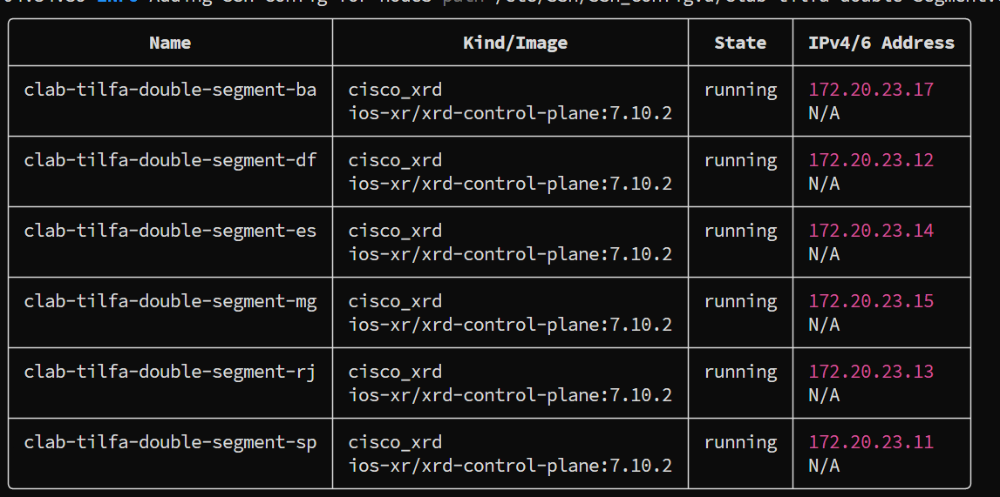

# TI-LFA Double-Segment

## Contexto

Continuação direta do [single-segment](../single-segment/single-segment.md) - mesma rede, mesmos seis PoPs, mesmo PLR (SP) protegendo o mesmo link (SP-DF) para o mesmo destino final (ES). A única mudança é um único parâmetro: o custo do enlace MG-BA sobe de `10` para `1000`.

Essa mudança é suficiente para quebrar a interseção entre P-space e Q-space que existia no single-segment. Quando isso acontece, não existe mais um único PQ-node - o backup precisa "costurar" um nó do P-space a um nó do Q-space usando um enlace explícito entre os dois, endereçado por um **Adjacency-SID**. Dois labels adicionais em vez de um: por isso *double*-segment.

---

## Este lab

Mesma topologia física do single-segment - anel SP-RJ-MG-BA-DF-SP com o pendant ES atrás de DF. Muda só um número: o enlace MG-BA sobe de custo 10 para **1000**. Todos os demais enlaces, incluindo o link protegido SP-DF, seguem custo 10.

### Por que o double-segment aparece

Refazendo o cálculo de P-space (estendido, via o vizinho RJ) e Q-space com o novo custo:

**P-space estendido(SP, SP-DF)** - inalterado em relação ao single-segment, porque nenhum caminho relevante *a partir de SP ou de RJ* passa pelo enlace MG-BA:

| Nó | Caminho mais curto | No P-space? |
|---|---|:-:|
| RJ | `SP-RJ` (10) | **sim** (direto) |
| MG | `SP-RJ-MG` (20) | **sim** (direto) |
| BA | de SP: `SP-DF-BA` (20, usa o link protegido). De RJ: `RJ-SP-DF-BA` (30, usa o link) contra `RJ-MG-BA` (1010) | **não** - o caminho mais curto de RJ até BA também acaba usando o link protegido, já que `RJ-MG-BA` ficou caro demais com o novo custo |

**Q-space(ES, SP-DF)** - aqui o custo 1000 em MG-BA muda tudo:

| Nó | Caminho mais curto até ES | Usa SP-DF? | No Q-space? |
|---|---|:-:|:-:|
| BA | `BA-DF-ES` (20) | não | **sim** |
| MG | `MG-BA-DF-ES` (1020) contra `MG-RJ-SP-DF-ES` (40, usa o link protegido) | o mais barato usa o link protegido | **não** |
| RJ | `RJ-SP-DF-ES` (30, usa o link protegido) | sim | não |

Com MG-BA custando 1000, o caminho de MG até ES que evita o link protegido (`MG-BA-DF-ES`, custo 1020) deixou de ser competitivo - o caminho mais curto real de MG passa a ser via SP, isto é, via o próprio link que caiu. MG sai do Q-space. Pelo mesmo motivo (o mesmo enlace caro), BA sai do P-space estendido de RJ.

**P-space ∩ Q-space = ∅.** P-space estendido = `{RJ, MG}`, Q-space = `{BA}` - nenhum nó comum aos dois. Mas MG é vizinho físico direto de BA - essa adjacência é o que permite ao TI-LFA ainda calcular um backup, "pulando" de P-space para Q-space por um enlace específico em vez de por caminho mais curto. Diferente do single-segment, aqui só existe um candidato possível de cada lado (MG do P-space, BA do Q-space) - sem ambiguidade.

Backup calculado: `push { prefix-SID(MG) 16005, Adj-SID(MG->BA) }` abaixo do `prefix-SID(ES) 16004`. O Adj-SID força a travessia do enlace MG-BA especificamente - ignorando seu custo IGP de 1000 - porque Adj-SID não é uma instrução de "caminho mais curto", é uma instrução de "saia exatamente por este enlace".

---

## Topologia


MG (verde, **P-node**) é o nó mais distante do P-space que o TI-LFA consegue alcançar de forma barata. BA (âmbar, **Q-node**) é o nó do Q-space adjacente a ele. O enlace entre os dois (dourado, rotulado com o Adj-SID forçado) é fisicamente o mesmo MG-BA de sempre - só que agora o SR o atravessa por indicação explícita, não por ser o caminho mais barato.

---

## Endereçamento

Idêntico ao single-segment, com uma exceção:

| PoP | Papel | Loopback0 | SID index | Label | Mgmt |
|---|---|---|---:|---:|---|
| SP | PLR | `10.0.1.254/32` | 1 | 16001 | 172.20.23.11 |
| DF | trânsito | `10.0.1.253/32` | 2 | 16002 | 172.20.23.12 |
| RJ | P-space (vizinho direto) | `10.0.1.252/32` | 3 | 16003 | 172.20.23.13 |
| ES | destino final | `10.0.1.251/32` | 4 | 16004 | 172.20.23.14 |
| MG | **P-node** | `10.0.1.250/32` | 5 | 16005 | 172.20.23.15 |
| BA | **Q-node** | `10.0.1.248/32` | 7 | 16007 | 172.20.23.17 |

| Link | Subnet | Custo |
|---|---|---:|
| SP-DF (protegido) | 10.10.12.0/30 | 10 |
| SP-RJ | 10.10.13.0/30 | 10 |
| RJ-MG | 10.10.35.0/30 | 10 |
| **MG-BA** | 10.10.57.0/30 | **1000** |
| BA-DF | 10.10.27.0/30 | 10 |
| DF-ES | 10.10.24.0/30 | 10 |

O mgmt subnet muda para `172.20.23.0/24` para permitir rodar este lab em paralelo ao single-segment sem colisão de rede de gerência.

---

## Deploy

```bash
mkdir -p ~/labs/sr-mpls/cisco/ti-lfa/double-segment
cd ~/labs/sr-mpls/cisco/ti-lfa/double-segment
cp IaC/Clabs/Cisco/ti-lfa/double-segment.yml lab.clab.yml
cp -r Labs/Cisco/SR-MPLS/TI-LFA/double-segment/configs .
sudo clab deploy -t lab.clab.yml
```



```bash
# Derrubar o lab
sudo clab destroy -t lab.clab.yml --cleanup
```

---

## Verificação

### 1. Adjacências OSPF
**EM SP**

```
show ospf neighbor
```


Igual ao single-segment - seis nós, todas as adjacências `FULL/-`. A interface MG-BA continua formando adjacência normalmente; custo alto não impede a adjacência OSPF, apenas torna o enlace pouco atrativo para SPF.

### 2. Confirmar o custo elevado

Em MG:

```
show ospf interface GigabitEthernet0/0/0/1
```


(ajustar o número da interface conforme o `.cfg`). Esperado: `Cost: 1000`.

### 3. Backup TI-LFA para ES

**Em SP**:

```
show cef 10.0.1.251/32 detail
```


O campo `labels imposed` na entrada de backup deve mostrar **três** labels: `{16005, 24XXX, 16004}` - 16005 (prefix-SID de MG) no topo, um Adjacency-SID dinâmico (faixa acima de 24000, já que este projeto não configura `local-block` separado) representando o enlace MG->BA no meio, e 16004 (prefix-SID de ES) embaixo.

**Em MG**, para identificar exatamente qual Adjacency-SID é esse:

```
show ospf segment-routing adjacency-sids
```


Esperado: uma linha com `Neighbor ID 10.0.1.248` (BA) e `Interface Gi0/0/0/1` - o número na coluna `Adj SID` dessa linha é o mesmo `24XXX` que apareceu no meio da pilha do `show cef` de SP. Normalmente aparecem duas entradas para o mesmo vizinho (uma `U` desprotegida, uma `P B` protegida com backup) - qualquer uma das duas pode ser a usada, dependendo de qual o backup do próprio MG está usando no momento.

### 4. Diferença de comportamento vs. single-segment

Compare com o `show cef` do single-segment (rodado em SP também, lá):

| | single-segment | double-segment |
|---|---|---|
| Labels impostos | `{16007, 16004}` (2) | `{16005, adj-SID, 16004}` (3) |
| Nó intermediário participa como | PQ-node (P∩Q) | P-node apenas, precisa do Adj-SID pra alcançar o Q-node |
| Enlace até o Q-node | usado por custo (parte do caminho nativo) | usado por Adj-SID (custo do enlace irrelevante) |

---

## Quando isso acontece na prática

Em produção, um custo de 1000 artificial não é o gatilho real - a situação double-segment aparece organicamente em topologias com poucos caminhos alternativos entre certas regiões da rede (redes em anel, topologias regionais com poucos backbones de trânsito, ou depois que um terceiro