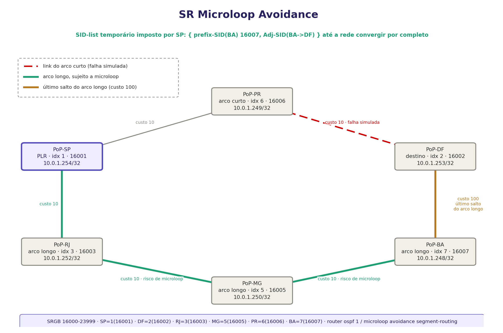
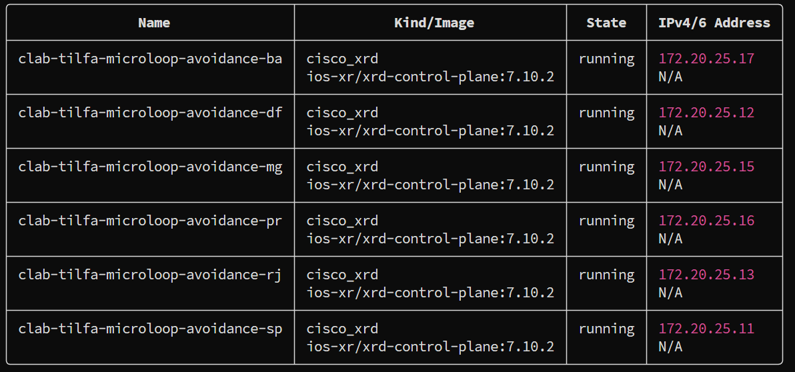
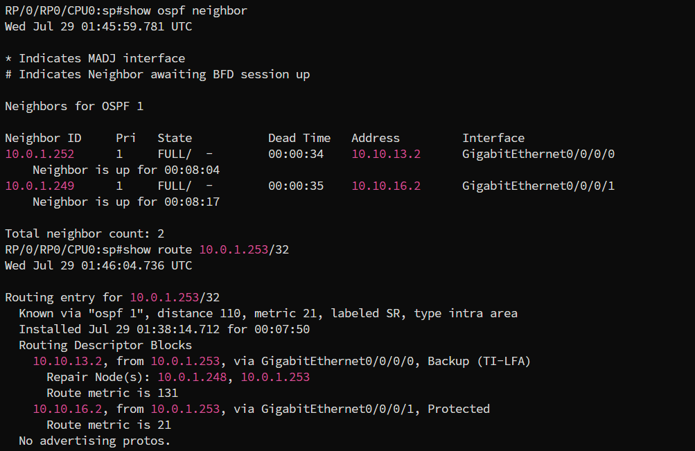
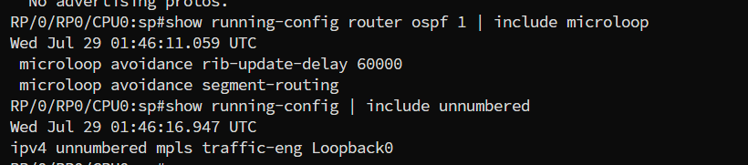
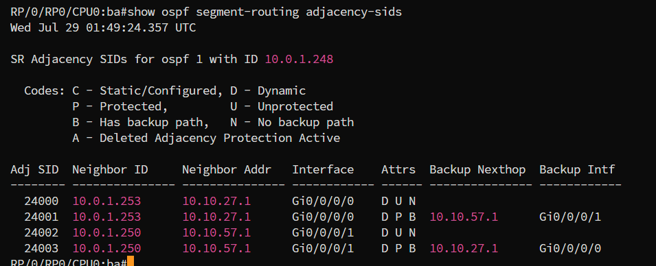
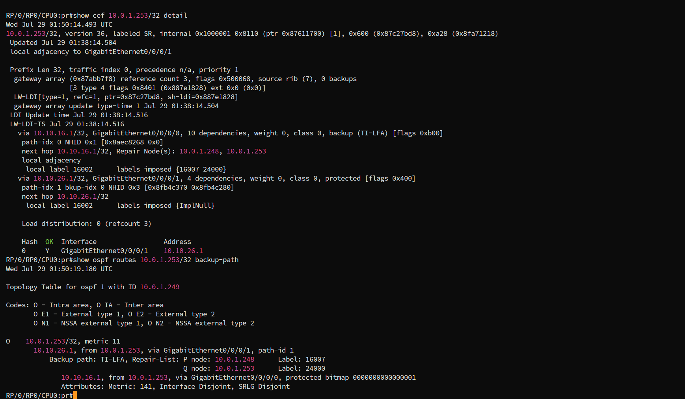
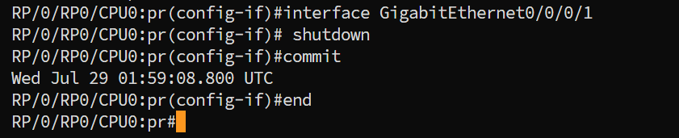
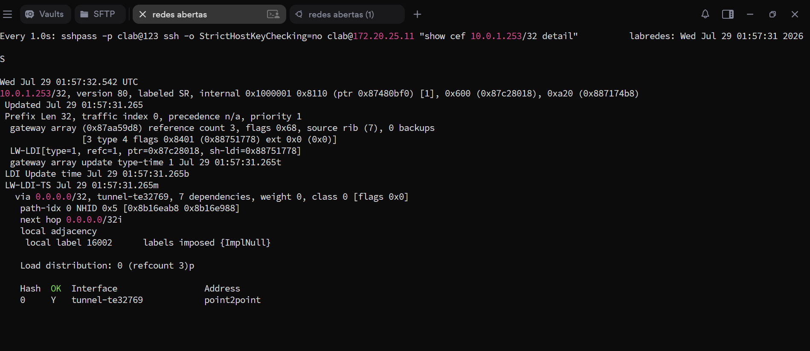
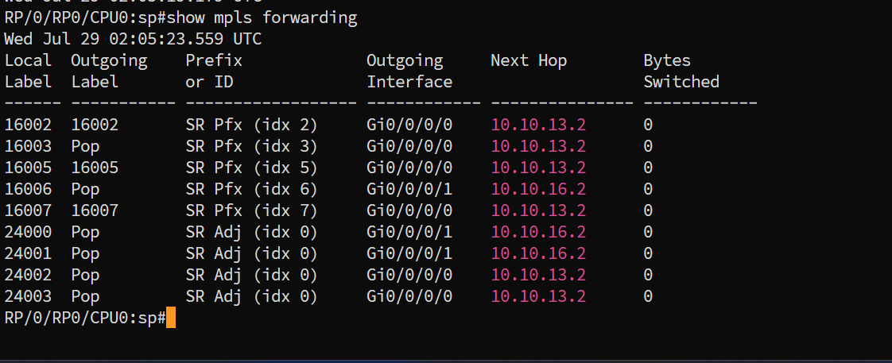

# SR Microloop Avoidance

> Pré-requisitos: [`concepts.md`](../concepts.md) para os conceitos de TI-LFA e microloop, [`base.md`](../../../base.md) para as convenções de SR-MPLS do projeto e [`setup.md`](../../../setup.md) para o ambiente.

## Contexto

Os quatro labs anteriores tratam do instante da falha, que o TI-LFA cobre em menos de 50ms com um backup pronto. Este trata do que vem depois: a reconvergência do IGP.

Cada roteador recalcula SPF no próprio tempo. Nessa janela aparece o **microloop**: SP já atualizou a rota e aponta para RJ, mas RJ ainda aponta de volta para SP, e os pacotes ficam saltando entre os dois. Ver [`concepts.md`](../concepts.md).

Este lab usa o caso de **uLoop remoto**: o nó observado (SP) está a dois saltos da falha, não é PLR de nada e não tem backup TI-LFA para acionar. A única ferramenta dele é o microloop avoidance.

O mecanismo, em quatro passos:

1. O nó recebe a notificação da mudança pelo IGP.
2. Calcula a árvore pós-convergência e vê se algum destino passaria por um nó que ainda não convergiu.
3. Se houver risco, instala uma SID-list temporária que força o caminho pós-convergência. Como o caminho vai no pacote, não dá loop.
4. Passado o `rib-update-delay`, a SID-list sai e o encaminhamento volta ao normal.

| | TI-LFA | Microloop avoidance |
|---|---|---|
| Cobre | o instante da falha | a reconvergência depois |
| Reage a | interface local caindo | LSA, inclusive de falha remota |
| Quem age | o PLR | qualquer nó, mesmo longe da falha |
| Configuração | por interface | uma flag no processo IGP |
| Estado | backup permanente | SID-list temporária |

Os dois ficam ligados juntos. O benefício do microloop avoidance é local: cada nó habilitado reduz a própria contribuição para o problema, sem depender dos outros.

---

## Este lab

Anel hexagonal de seis PoPs da Rede Ipê, fechado em `SP - PR - DF - BA - MG - RJ - SP`, com dois arcos de custo muito diferente entre SP e DF:

- **arco curto**: `SP - PR - DF`, custo 20. É o caminho primário.
- **arco longo**: `SP - RJ - MG - BA - DF`, custo 130, dos quais 100 estão concentrados no último salto `BA - DF`.

A falha testada é a queda do enlace `PR - DF`, no arco curto. Depois dela sobra um único caminho: o arco longo inteiro.

O custo 100 no enlace `BA - DF` não é decorativo. É ele que faz **todos** os nós do anel apontarem inicialmente para o arco curto, inclusive BA, que fica a um salto de DF mas prefere dar a volta pelo anel (50 contra 100). Quando o arco curto quebra, cada um desses nós precisa inverter o sentido do próprio next-hop, e é essa inversão em cadeia que produz o microloop.

### Por que o microloop aparece aqui

Distâncias até DF, antes e depois da queda de `PR - DF`, em custo IGP puro, sem o 1 que o IOS-XR soma pela loopback:

| Nó | next-hop antes | custo | next-hop depois | custo | inverte? |
|---|---|---:|---|---:|:-:|
| SP | PR | 20 | RJ | 130 | **sim** |
| RJ | SP | 30 | MG | 120 | **sim** |
| MG | RJ | 40 | BA | 110 | **sim** |
| BA | MG | 50 | DF (direto) | 100 | **sim** |
| PR | DF | 10 | SP | 140 | **sim** |

Nenhum nó mantém o next-hop. Todo par adjacente ao longo do arco longo (`SP-RJ`, `RJ-MG`, `MG-BA`) é candidato a microloop enquanto a convergência não termina: basta um convergir antes do outro para o tráfego começar a bater de um lado para o outro.

Esse é o pior caso possível de reversão e foi construído de propósito. Em uma topologia real com mais malha, normalmente só um subconjunto dos nós inverte.

### A SID-list que resolve

SP calcula o caminho pós-convergência `SP - RJ - MG - BA - DF` e precisa forçá-lo sem depender da FIB de ninguém. Duas observações:

> **Como isso aparece no IOS-XR.** O `show cef` não mostra a pilha de labels direto na entrada do prefixo. O CEF passa a apontar para uma interface `tunnel-teNNNNN`, criada automaticamente pelo IGP enquanto a SID-list durar. O conteúdo real da pilha só aparece em `show mpls forwarding` ou `show mpls traffic-eng tunnels`, olhando a entrada desse túnel. O número do túnel muda a cada falha, não é fixo. Ver passo 5.

**O caminho até BA é estável.** Nenhum nó muda a forma de chegar em BA por causa desta falha, porque nenhum deles usava o enlace `PR - DF` para isso:

| Nó | até BA antes | até BA depois |
|---|---|---|
| SP | `SP-RJ-MG-BA` (30) | igual |
| RJ | `RJ-MG-BA` (20) | igual |
| MG | `MG-BA` (10) | igual |

Como todos concordam, o prefix-SID de BA (`16007`) é uma âncora segura.

**O último salto não é estável.** Chegando em BA com o label de DF no topo, um BA não convergido devolve o pacote para MG. Para forçar o enlace `BA - DF` de qualquer jeito, é preciso o **Adj-SID** dessa adjacência.

SID-list imposta por SP:

```text
{ 16007 , Adj-SID(BA->DF) , 16002 }
    |            |             |
    |            |             +-- DF, o destino
    |            +---------------- forca o ultimo salto BA->DF
    +----------------------------- BA, ancora estavel
```

Três labels, incluindo o do destino. É o teto da plataforma: o IOS-XR não programa caminhos microloop-avoidant com mais que isso. Essa pilha é o que fica dentro do túnel de que fala o quadro acima, não algo visível numa linha só de `show cef`.

### O que o PR faz em paralelo

PR é o PLR de verdade e roda TI-LFA normalmente. PR só tem dois vizinhos diretos, SP e DF, então qualquer backup de PR passa primeiro por SP.

Para o par (PR, `PR-DF`) com destino DF:

- **P-space(PR)** = `{SP, RJ, MG, BA}`. Saindo por SP, PR alcança o anel inteiro sem tocar no enlace protegido.
- **Q-space(DF)** = vazio. Nenhum nó alcança DF pelo caminho mais curto sem passar pelo enlace protegido, nem BA, que a custo 100 prefere dar a volta.

Sem interseção, o TI-LFA de PR chega na mesma construção: `{ 16007, Adj-SID(BA->DF) }` sobre o label do destino, saindo por SP. Mesma pilha, calculada por outro nó, por outro motivo e com outro tempo de vida. O passo 4 da verificação mostra exatamente essa pilha.

---

## Topologia



Em vermelho, o enlace derrubado no teste (`PR - DF`). Em verde, o arco longo, que é o caminho pós-convergência e onde os microloops se formam entre RJ, MG e BA. Em dourado, o último salto `BA - DF`, custo 100, coberto pelo Adj-SID dentro da SID-list temporária.

---

## Endereçamento

| PoP | Papel | Loopback0 | SID index | Label | Mgmt |
|---|---|---|---:|---:|---|
| SP | nó observado, origina a SID-list temporária | `10.0.1.254/32` | 1 | `16001` | 172.20.25.11 |
| DF | destino observado | `10.0.1.253/32` | 2 | `16002` | 172.20.25.12 |
| RJ | arco longo, inverte o next-hop | `10.0.1.252/32` | 3 | `16003` | 172.20.25.13 |
| MG | arco longo, inverte o next-hop | `10.0.1.250/32` | 5 | `16005` | 172.20.25.15 |
| PR | arco curto, PLR do TI-LFA | `10.0.1.249/32` | 6 | `16006` | 172.20.25.16 |
| BA | âncora da SID-list, dono do Adj-SID `BA->DF` | `10.0.1.248/32` | 7 | `16007` | 172.20.25.17 |

| Enlace | Subnet | Lado A | Lado B | Custo |
|---|---|---|---|---:|
| SP-RJ | `10.10.13.0/30` | SP Gi0/0/0/0 `.1` | RJ Gi0/0/0/0 `.2` | 10 |
| SP-PR | `10.10.16.0/30` | SP Gi0/0/0/1 `.1` | PR Gi0/0/0/0 `.2` | 10 |
| PR-DF (falha testada) | `10.10.26.0/30` | DF Gi0/0/0/0 `.1` | PR Gi0/0/0/1 `.2` | 10 |
| DF-BA | `10.10.27.0/30` | DF Gi0/0/0/1 `.1` | BA Gi0/0/0/0 `.2` | **100** |
| MG-BA | `10.10.57.0/30` | MG Gi0/0/0/1 `.1` | BA Gi0/0/0/1 `.2` | 10 |
| RJ-MG | `10.10.35.0/30` | RJ Gi0/0/0/1 `.1` | MG Gi0/0/0/0 `.2` | 10 |

SRGB `16000-23999`, sem `local-block` explícito. Os Adj-SIDs saem do range dinâmico acima do SRGB, a partir de `24000`, mesma convenção dos demais labs de TI-LFA.

---

## Configuração

Três linhas além da base de SR-MPLS e do TI-LFA que os labs anteriores já usam.

No processo OSPF, sem nada por interface:

```text
router ospf 1
 microloop avoidance segment-routing
 microloop avoidance rib-update-delay 60000
```

Em modo global:

```text
ipv4 unnumbered mpls traffic-eng Loopback0
```

Duas observações sobre essas linhas:

- **A linha global é fácil de esquecer.** O caminho microloop-avoidant é implementado por trás como um túnel MPLS-TE que o IGP cria sozinho, e ele precisa de um endereço de origem. Sem essa linha, parte das imagens IOS-XR não instala o caminho e o lab não mostra nada, sem erro visível.
- **O `rib-update-delay` aqui está errado de propósito.** O range é 1 a 60000 ms e o default é 5000. Este lab usa o máximo, 60000, só para dar tempo de rodar um `show` e ver a SID-list antes de ela sair. Em produção use algo entre 3000 e 5000, perto do tempo real de convergência do domínio.

O TI-LFA continua ligado em todas as interfaces, como nos labs anteriores. A flag de microloop avoidance está nos seis nós. O passo 7 da verificação desliga só em SP, para isolar o efeito.

---

## Deploy

```bash
git clone https://github.com/rnpbr/LabRedes-segmentrouting.git
cd LabRedes-segmentrouting

mkdir -p ~/labs/ti-lfa/microloop-avoidance
cp IaC/Clabs/Cisco/ti-lfa/microloop-avoidance.clab.yml ~/labs/ti-lfa/microloop-avoidance/
cp -r Labs/Cisco/SR-MPLS/TI-LFA/microloop-avoidance/configs ~/labs/ti-lfa/microloop-avoidance/

cd ~/labs/ti-lfa/microloop-avoidance
sudo clab deploy -t microloop-avoidance.clab.yml
```

Seis nós pedem de 8 a 10 GB de RAM. Confira também os limites de `inotify` antes do deploy, ver [`setup.md`](../../../setup.md).



Acesso: `ssh clab@172.20.25.11`, senha `clab@123`.

```bash
# Derrubar o lab
sudo clab destroy -t microloop-avoidance.clab.yml --cleanup
```

---

## Verificação

O roteiro tem uma parte estática (passos 1 a 4, com a rede íntegra) e uma parte cronometrada (passos 5 e 6, dentro da janela de 60 segundos). Vale ler os passos 5 e 6 inteiros antes de derrubar o enlace.

### 1. Adjacências e caminho primário

Em SP:

```text
show ospf neighbor
show route 10.0.1.253/32
```



Esperado: dois vizinhos em `FULL/-` (RJ e PR) e a rota para DF com next-hop primário via `10.10.16.2` (PR), interface Gi0/0/0/1, métrica **21**.

Repare que a mesma saída já traz uma entrada `Backup (TI-LFA)` via `10.10.13.2` (RJ), métrica 131. Esse backup é permanente e não tem relação com o microloop avoidance: é o TI-LFA do próprio SP protegendo seu enlace SP-PR, um link diferente do que este lab testa. Não confundir esse backup de sempre com a SID-list temporária que aparece só depois da falha, no passo 5.

Vale confirmar a inversão prevista rodando o mesmo `show route 10.0.1.253/32` em RJ, MG e BA. Os três devem apontar no sentido do arco curto, ou seja, contra a intuição geográfica do desenho. BA em particular deve apontar para MG, e não para o vizinho direto DF.

### 2. Confirmar a flag ativa

Nos seis nós:

```text
show running-config router ospf 1 | include microloop
show running-config | include unnumbered
```



Esperado: `microloop avoidance segment-routing`, `microloop avoidance rib-update-delay 60000` e `ipv4 unnumbered mpls traffic-eng Loopback0`. As três precisam aparecer. A ausência da terceira é a causa mais comum de o lab não mostrar SID-list nenhuma no passo 5.

### 3. Descobrir o Adj-SID de `BA -> DF`

Em BA:

```text
show ospf segment-routing adjacency-sids
```



A linha com `Neighbor ID 10.0.1.253` (DF) na interface `Gi0/0/0/0` traz o Adj-SID `24000` (variante desprotegida, `D U N`) e `24001` (variante protegida, `D P B`). É o `24000` que reaparece no passo 4, dentro da pilha do backup de PR.

### 4. Backup TI-LFA pré-instalado, ainda antes da falha

Em PR:

```text
show cef 10.0.1.253/32 detail
show ospf routes 10.0.1.253/32 backup-path
```



Esperado: entrada primária pela Gi0/0/0/1 (para DF, `10.10.26.1`) marcada `protected`, com `labels imposed {ImplNull}` (PHP, DF é vizinho direto). E uma entrada de backup marcada `backup (TI-LFA)`, saindo pela Gi0/0/0/0 em direção a SP (`10.10.16.1`), com:

```text
Repair Node(s): 10.0.1.248, 10.0.1.253
local label 16002   labels imposed {16007 24000}
```

`16007` é o prefix-SID de BA e `24000` é o Adj-SID de BA para DF, o mesmo valor visto no passo 3. Confirma exatamente a construção teórica: PR alcança BA via SP, empilha o prefix-SID de BA, e o Adj-SID força o último salto até DF.

Esse é o backup pré-instalado, o mesmo mecanismo dos quatro labs anteriores. Ele existe antes de qualquer falha e cobre os primeiros milissegundos. O que o resto deste lab mostra é uma coisa diferente, que só existe **depois** que a falha acontece.

### 5. Derrubar o enlace e observar o desvio para o túnel

Deixe dois terminais abertos. No primeiro, um laço de observação em SP, a partir do host:

```bash
watch -n 1 'sshpass -p clab@123 ssh -o StrictHostKeyChecking=no clab@172.20.25.11 "show cef 10.0.1.253/32 detail"'
```

(requer `sshpass`: `sudo apt install -y sshpass`. Alternativa com `docker exec` precisa da flag `-t`, senão falha com erro de tty: `sudo docker exec -t clab-tilfa-microloop-avoidance-sp /pkg/bin/xr_cli.sh "show cef 10.0.1.253/32 detail"`.)

No segundo terminal, uma sessão em PR, derrube o enlace:

```text
conf t
interface GigabitEthernet0/0/0/1
 shutdown
commit
end
```



Dentro dos 60 segundos seguintes, a entrada de CEF de SP para `10.0.1.253/32` para de mostrar `via <ip>, GigabitEthernet.../..., labels imposed {...}` e passa a mostrar um desvio para um túnel:



```text
via 0.0.0.0/32, tunnel-te32769, ...
  next hop 0.0.0.0/32i
  local adjacency
  local label 16002    labels imposed {ImplNull}
```

`tunnel-teNNNNN` é o túnel que o IGP criou sozinho para impor a SID-list. O número muda a cada evento, não é fixo. Para ver o que o túnel realmente empilha, rode em seguida, ainda na mesma janela:

```text
show mpls forwarding
```

Procure a linha do prefixo `16002` (apontando para o túnel) e a linha do próprio túnel:

```text
16002  Pop    SR Pfx (idx 2)         tt32770       point2point
24012  16007  SR TE: 32770 [TE-INT]  Gi0/0/0/0     10.10.13.2
```

A segunda linha é a prova da SID-list: o túnel sai por `Gi0/0/0/0` em direção a RJ (`10.10.13.2`, o primeiro salto do arco longo) impondo `16007`, o prefix-SID de BA. Para ver o Adj-SID no meio da pilha e o label do destino, complete com:

```text
show mpls traffic-eng tunnels tunnel-te32770
```

(troque `32770` pelo número visto no seu `show mpls forwarding`.)

`show segment-routing traffic-eng policy` volta vazio, e isso é esperado: o caminho microloop-avoidant é montado como um túnel MPLS-TE clássico, não como uma SR-TE policy com color e endpoint. A prova está no `show mpls forwarding` e no `show mpls traffic-eng tunnels`, não nesse comando.

### 6. Depois da janela

Passados os 60 segundos, repita em SP:

```text
show cef 10.0.1.253/32 detail
show route 10.0.1.253/32
show mpls forwarding
```



Esperado: a rota continua saindo pela Gi0/0/0/0, já que o arco longo é agora o caminho definitivo, com métrica 131, mas a entrada volta a ser direta, sem túnel. No `show mpls forwarding`, o label `16002` some da lista de labels "Pop apontando para túnel" e passa a ser um swap direto (`16002 -> 16002`) saindo pela Gi0/0/0/0 em direção a RJ (`10.10.13.2`), sem nenhuma linha de túnel associada. O túnel foi desfeito e o encaminhamento voltou a ser nativo. É esse antes-e-depois, com e sem o desvio para o túnel, que resume o mecanismo inteiro.

Um traceroute a partir de SP confirma o caminho pós-convergência:

```text
traceroute 10.0.1.253 source 10.0.1.254
```

```text
1  10.10.13.2   (RJ)
2  10.10.35.2   (MG)
3  10.10.57.2   (BA)
4  10.10.27.1   (DF)
```

### 7. Controle: o mesmo teste sem microloop avoidance

Religue o enlace em PR (`no shutdown` na Gi0/0/0/1) e espere a rede estabilizar de volta no arco curto. Em SP, desabilite a flag:

```text
conf t
router ospf 1
 no microloop avoidance segment-routing
commit
end
```

Repita o passo 5. Agora, no instante seguinte à falha, o `show cef` de SP para `10.0.1.253/32` muda direto para a Gi0/0/0/0 com `labels imposed {16002}`, sem túnel nenhum no meio. SP passou a mandar tráfego para RJ confiando que RJ já saiba o que fazer, e é precisamente essa suposição que produz o microloop enquanto RJ ainda estiver apontando de volta para SP.

Reative a flag antes de encerrar:

```text
conf t
router ospf 1
 microloop avoidance segment-routing
commit
end
```

> **Limite do ambiente.** A imagem `xrd-control-plane` não tem plano de encaminhamento completo. Este lab prova o mecanismo pelo estado programado (o desvio para o túnel e a pilha de labels dentro dele), não por medição de perda. Para medir duração de microloop de verdade seria preciso uma imagem com forwarding plane completo e um gerador de tráfego.

---

## Comparando com os labs anteriores

| | Zero / Single / Double | Node + SRLG | Microloop Avoidance |
|---|---|---|---|
| Nó que age | SP, PLR do enlace | SP, PLR do enlace | SP, dois saltos longe da falha |
| Gatilho | enlace local cai | enlace ou nó local cai | LSA de falha remota |
| Estado criado | antes da falha | antes da falha | depois da falha |
| Duração | permanente | permanente | `rib-update-delay` |
| Mecanismo visível | labels direto no `show cef` | labels direto no `show cef`, com `Node Protect` | desvio para túnel MPLS-TE, labels em `show mpls forwarding` |
| Configuração | por interface | por interface, com tiebreakers | uma flag no processo IGP |

Os quatro primeiros labs instalam backup e esperam a falha. Este cria estado temporário em reação a uma falha que já aconteceu em outro lugar. Problemas diferentes, mesmo primitivo: empilhar segmentos para descrever um caminho que o encaminhamento hop-by-hop não garante sozinho.

## Referências

- RFC 9855 - *Topology Independent Fast Reroute Using Segment Routing*: <https://datatracker.ietf.org/doc/html/rfc9855>
- RFC 8333 - *Micro-loop Prevention by Introducing a Local Convergence Delay*: <https://datatracker.ietf.org/doc/html/rfc8333>
- RFC 8402 - *Segment Routing Architecture*: <https://datatracker.ietf.org/doc/html/rfc8402>
- RFC 9256 - *Segment Routing Policy Architecture*: <https://datatracker.ietf.org/doc/html/rfc9256>
- Cisco IOS-XR 7.10.x - *Configure Segment Routing Microloop Avoidance*: <https://www.cisco.com/c/en/us/td/docs/iosxr/ncs5500/segment-routing/710x/configuration/guide/b-segment-routing-cg-ncs5500-710x/configure-segment-routing-microloop-avoidance.html>
- Cisco - *Segment Routing Commands*, `microloop avoidance rib-update-delay`: <https://www.cisco.com/c/en/us/td/docs/routers/asr9000/software/segment-routing/command/reference/b-seg-routing-cr-asr9k/m-segment-routing-command-reference.html>
- Containerlab - *Configuration management, remote startup-config*: <https://containerlab.dev/manual/config-mgmt/#remote>
