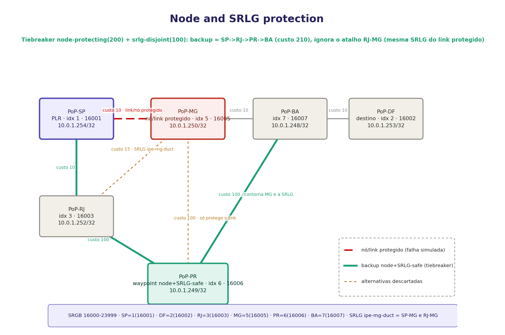

# TI-LFA Node and SRLG Protection

## Contexto

Os labs anteriores (Zero/Single/Double-Segment) tratam todos do mesmo tipo de falha: **queda de um link**. TI-LFA calcula, por padrão, um backup que só garante desviar daquele link específico - se o problema real for o **nó** do outro lado caindo por completo, ou se o próprio backup escolhido compartilhar risco físico com o link original (mesma rota de fibra, mesmo duto, mesmo cartão), a proteção de link sozinha não é suficiente.

Este lab configura os dois níveis adicionais de proteção que o TI-LFA oferece a partir do IOS-XR 6.1.1: **node protection** (o backup contorna o nó inteiro, não só o link até ele) e **local SRLG protection** (o backup evita enlaces que compartilham grupo de risco com o enlace protegido). Ver [`sr_ti-lfa_concepts.md`](../sr_ti-lfa_concepts.md) para a explicação conceitual de tiebreakers e SRLG antes de seguir.

---

## Este lab

Topologia com seis PoPs: uma cadeia primária de três saltos (SP -> MG -> BA -> DF) e uma "ponte" alta de dois PoPs adicionais (RJ, PR) que oferece rotas alternativas de qualidades diferentes.

(a linha pontilhada curta `RJ···MG`, custo 15, é um atalho físico que compartilha duto com SP-MG - ver adiante).

SP é o PLR e protege o enlace SP-MG - mas o interesse deste lab não é só esse link: é o que acontece quando o **nó MG inteiro** cai, e quando o backup escolhido por padrão acaba compartilhando infraestrutura física com o próprio recurso que deveria proteger.

### O atalho armadilha: RJ-MG

Além da cadeia principal e da ponte alta, existe um enlace direto RJ-MG, custo 15 - mais barato que ir por PR (que custaria 10+100=110 até MG). Esse enlace **compartilha a mesma canaleta física** do link SP-MG (ambos saem da região de SP em direção a MG pela mesma rota de fibra) - daí o nome do grupo SRLG usado neste lab, `ipe-mg-duct`.

Sem nenhuma configuração de tiebreaker, o TI-LFA em SP escolhe o backup mais barato que for loop-free - e `SP -> RJ -> MG` (custo 10+15=25) vence facilmente contra qualquer alternativa via PR (custo 110+). Esse backup:

- protege corretamente contra a queda do **link** SP-MG (é um caminho fisicamente distinto até MG);
- **não** protege contra a queda do **nó** MG (o backup termina exatamente em MG);
- **não** protege contra uma falha de **SRLG** que derrube tanto SP-MG quanto RJ-MG ao mesmo tempo (ambos passam pela mesma canaleta).

### A alternativa segura: SP -> RJ -> PR -> BA

Existe um caminho que resolve os dois problemas ao mesmo tempo: `SP -> RJ -> PR -> BA` (custo 10+100+100=210), que contorna MG por completo e não toca em nenhum enlace do grupo `ipe-mg-duct`. É mais caro que o atalho RJ-MG, então só é escolhido se o TI-LFA for instruído a preferir proteção de nó e de SRLG sobre custo bruto - exatamente o papel dos **tiebreakers**.

---

## Configuração dos tiebreakers

Aplicada em todas as interfaces de core de todos os nós (política uniforme, como seria em produção):

```text
router ospf 1
 area 0
  interface GigabitEthernet0/0/0/X
   fast-reroute per-prefix
   fast-reroute per-prefix ti-lfa enable
   fast-reroute per-prefix tiebreaker node-protecting index 200
   fast-reroute per-prefix tiebreaker srlg-disjoint index 100
```

Índice maior = maior preferência. Aqui `node-protecting` (200) é preferido sobre `srlg-disjoint` (100) nos casos raros em que as duas propriedades não puderem ser satisfeitas pelo mesmo caminho - neste lab elas coincidem no mesmo backup (`SP-RJ-PR-BA` satisfaz as duas ao mesmo tempo), então na prática o `show` final deve reportar `node+srlg`.

## Declaração do grupo SRLG

SRLG é um atributo de enlace, declarado localmente em cada roteador dono de uma ponta:

```text
srlg
 interface GigabitEthernet0/0/0/X
  name ipe-mg-duct
 !
 name ipe-mg-duct value 100
!
```

Neste lab, `ipe-mg-duct` é declarado em três interfaces: a de SP voltada para MG, e as duas pontas do enlace RJ-MG (em RJ e em MG). Ver `configs/sp.cfg`, `configs/mg.cfg` e `configs/rj.cfg` para o bloco completo.

---

## Topologia



Em vermelho, o enlace/nó sob teste (SP-MG). Em dourado tracejado, as duas alternativas que existem fisicamente mas são descartadas pelo tiebreaker: o atalho RJ-MG (barato, mas SRLG-compartilhado) e o enlace PR-MG (contorna o link, mas não o nó MG). Em verde, o backup realmente instalado quando os tiebreakers estão ativos: `SP -> RJ -> PR -> BA`, que contorna MG inteiro e não toca a SRLG `ipe-mg-duct`.

---

## Endereçamento

| PoP | Papel | Loopback0 | SID index | Label | Mgmt |
|---|---|---|---:|---:|---|
| SP | PLR | `10.0.1.254/32` | 1 | 16001 | 172.20.24.11 |
| DF | destino final | `10.0.1.253/32` | 2 | 16002 | 172.20.24.12 |
| RJ | ponte (P-space) | `10.0.1.252/32` | 3 | 16003 | 172.20.24.13 |
| MG | **nó sob proteção** | `10.0.1.250/32` | 5 | 16005 | 172.20.24.15 |
| PR | waypoint node+SRLG-safe | `10.0.1.249/32` | 6 | 16006 | 172.20.24.16 |
| BA | trânsito / Q-side | `10.0.1.248/32` | 7 | 16007 | 172.20.24.17 |

| Link | Subnet | Custo | SRLG |
|---|---|---:|---|
| SP-MG (protegido) | 10.10.15.0/30 | 10 | `ipe-mg-duct` |
| MG-BA | 10.10.57.0/30 | 10 | - |
| BA-DF | 10.10.27.0/30 | 10 | - |
| SP-RJ | 10.10.13.0/30 | 10 | - |
| RJ-PR | 10.10.36.0/30 | 100 | - |
| PR-MG | 10.10.56.0/30 | 100 | - |
| PR-BA | 10.10.67.0/30 | 100 | - |
| RJ-MG (atalho) | 10.10.35.0/30 | 15 | `ipe-mg-duct` |

---

## Deploy

```bash
mkdir -p ~/labs/sr-mpls/cisco/tilfa-node-srlg-protection
cd ~/labs/sr-mpls/cisco/tilfa-node-srlg-protection
cp IaC/Clabs/Cisco/ti_lfa_rede-ipe/tilfa-node-srlg-protection.yml lab.clab.yml
cp -r TI-LFA/node-srlg-protection/configs .
sudo clab deploy -t lab.clab.yml
```

```bash
# Derrubar o lab
sudo clab destroy -t lab.clab.yml
```

---

## Verificação

### 1. Adjacências e SRLG anunciada

```
show ospf neighbor
show ospf database opaque-area self-originate
```

O segundo comando, em SP e em RJ, deve mostrar o atributo SRLG anunciado para as respectivas interfaces - confirma que o grupo `ipe-mg-duct` está sendo distribuído pelo domínio, não apenas configurado localmente.

### 2. Backup instalado com os tiebreakers ativos

Em SP:

```
show ospf routes 10.0.1.253/32 backup-path
```

Esperado - backup via RJ, contornando MG:

```
O    10.0.1.253/32, metric ...
       via GigabitEthernet0/0/0/0 (RJ), path-id 1
         Backup path: TI-LFA (node+srlg), via 10.10.13.2, GigabitEthernet0/0/0/0
           P node: <RJ ou PR>   Q node: BA
         Attributes: Node Protect, SRLG Disjoint
```

O texto `TI-LFA (node+srlg)` confirma que o backup escolhido satisfaz as duas propriedades simultaneamente - é o resultado direto de configurar os dois tiebreakers.

### 3. Comparando com e sem tiebreaker

Para ver a diferença concretamente, remova temporariamente as duas linhas de tiebreaker da interface SP->MG:

```
conf t
router ospf 1
 area 0
  interface GigabitEthernet0/0/0/1
   no fast-reroute per-prefix tiebreaker node-protecting index 200
   no fast-reroute per-prefix tiebreaker srlg-disjoint index 100
commit
```

Repita o `show ospf routes 10.0.1.253/32 backup-path`. Esperado agora: backup via o atalho RJ-MG (custo 25), sem a marcação `node+srlg` - apenas link protection padrão. Isso demonstra visivelmente que, sem o tiebreaker, o TI-LFA prioriza o caminho mais barato, mesmo que ele não ofereça proteção real contra a falha de nó ou de SRLG.

Reaplique as duas linhas antes de continuar:

```
conf t
router ospf 1
 area 0
  interface GigabitEthernet0/0/0/1
   fast-reroute per-prefix tiebreaker node-protecting index 200
   fast-reroute per-prefix tiebreaker srlg-disjoint index 100
commit
```

### 4. Simulação: falha apenas do link SP-MG

```
conf t
interface GigabitEthernet0/0/0/1
 shutdown
commit
end
```

```
traceroute 10.0.1.253 source 10.0.1.254
```

Esperado: tráfego passa por RJ -> PR -> BA -> DF, contornando MG completamente mesmo que apenas o *link* tenha caído (não o nó) - a proteção de nó é conservadora por construção: o mesmo backup serve tanto para "o link caiu" quanto para "o nó caiu", porque o PLR não consegue distinguir as duas causas a partir da simples perda de sinal na interface.

### 5. Simulação: falha do nó MG inteiro

Derrube o nó MG no lugar de apenas uma interface (no clab, isso equivale a parar o container):

```bash
sudo docker stop clab-tilfa-node-srlg-protection-mg
```

Em SP:

```
traceroute 10.0.1.253 source 10.0.1.254
```

Esperado: mesmo resultado da simulação anterior - RJ -> PR -> BA -> DF - confirmando que o backup calculado para "link protection" e para "node protection" já era o mesmo caminho desde o início, graças ao tiebreaker.

Religue o nó depois:

```bash
sudo docker start clab-tilfa-node-srlg-protection-mg
```

---

## Node xor SRLG: quando as duas propriedades entram em conflito

Este lab foi desenhado para que **um único caminho** (`SP-RJ-PR-BA`) satisfaça node protection e SRLG protection ao mesmo tempo - o caso mais comum na prática, e por isso o `show` reporta `node+srlg`. Mas as duas propriedades nem sempre coincidem: é possível existir um caminho que contorna o nó protegido mas ainda usa um link da mesma SRLG, e outro caminho que evita a SRLG mas ainda atravessa o nó protegido. Quando isso acontece e nenhum caminho único satisfaz as duas propriedades, o `node-protecting index` e o `srlg-disjoint index` decidem qual delas prevalece - o maior índice vence. Vale revisitar a configuração acima e considerar: se o índice de `srlg-disjoint` fosse maior que o de `node-protecting`, qual das duas propriedades este domínio passaria a priorizar em um cenário de conflito?
