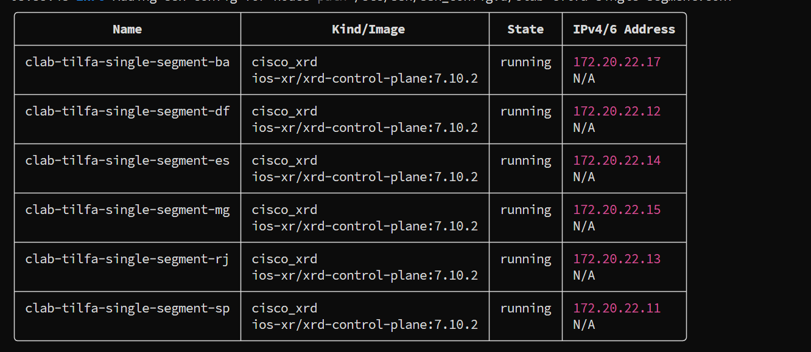
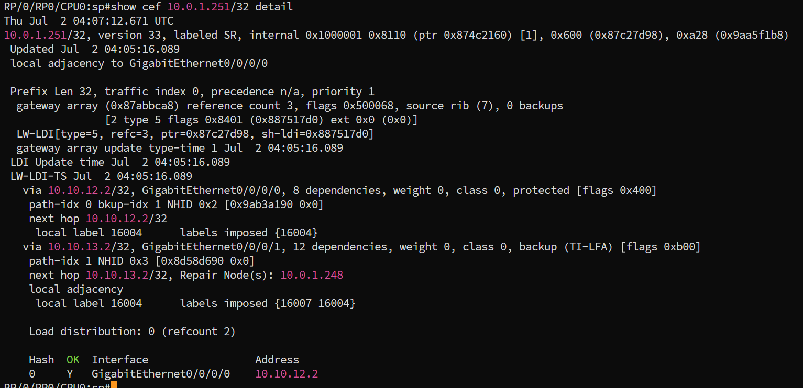
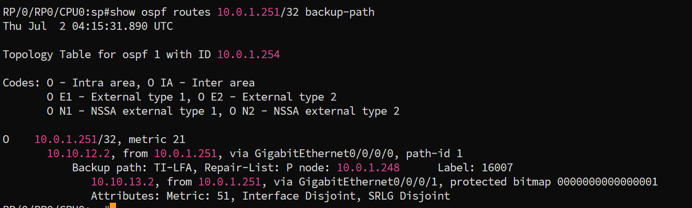

# TI-LFA Single-Segment

## Contexto

Este lab assume os conceitos apresentados em [`concepts.md`](../concepts.md) e a fundação de SR-MPLS em [`base.md`](../../../base.md). Se o cenário Zero-Segment ainda não foi executado, vale rodar aquele primeiro. A diferença entre os dois cenários é justamente o ponto central deste material.

No Zero-Segment, o PQ-node é vizinho direto do PLR: o backup não precisa de nenhum label além do Node-SID do destino, porque "chegar ao PQ-node" é apenas "sair por essa interface física". Aqui o PQ-node está **dois saltos** do PLR: alcançável através de um vizinho, mas não sendo ele próprio vizinho. Isso muda o backup de zero labels adicionais para **um** label adicional, o Node-SID do PQ-node, empilhado abaixo do Node-SID do destino final.

---

## Este lab

Estende a rede do Zero-Segment com dois PoPs novos, RJ e ES. SP continua como PLR, protegendo o link direto SP-DF. A diferença é o destino observado: em vez de calcular o backup para DF (o vizinho do outro lado do link protegido), calculamos para **ES**, um PoP que só existe atrás de DF.

Adjacências: `SP<->DF` (protegido), `SP<->RJ`, `RJ<->MG`, `MG<->BA`, `BA<->DF`, `DF<->ES`.

Na prática, SP tem dois links: um direto para DF, que é o protegido, e um para RJ. A partir de RJ existe um caminho de volta até DF passando por MG e BA. ES está pendurado atrás de DF, com um único link. Todos os enlaces têm custo **10**, sem artifícios de custo neste lab: o link SP-DF é genuinamente o caminho mais curto até DF (custo 10, contra 40 pelo caminho alternativo `SP-RJ-MG-BA-DF`), exatamente como seria em produção.

### Por que single-segment e não zero-segment

Com o link SP-DF fora do ar, o único caminho restante de SP até ES é `SP -> RJ -> MG -> BA -> DF -> ES`. TI-LFA em SP calcula P-space e Q-space **em cima da topologia original**, sem remover o link, apenas verificando para cada nó se o caminho mais curto até ele evita usar o link protegido. O ponto que faz single-segment acontecer é que o P-space **direto** de SP não é suficiente: é preciso estender através do vizinho RJ.

**P-space direto(SP, SP-DF)**, nós que SP alcança pelo caminho mais curto sem usar o link SP-DF:

| Nó | Caminho mais curto a partir de SP | Usa SP-DF? | No P-space direto? |
|---|---|:-:|:-:|
| RJ | `SP-RJ` (10) | não | **sim** |
| MG | `SP-RJ-MG` (20) contra `SP-DF-BA-MG` (30) | não | **sim** |
| BA | `SP-DF-BA` (20) contra `SP-RJ-MG-BA` (30) | **sim** | não |

Só RJ e MG. Sozinho, isso não seria suficiente para explicar o backup real: falta estender.

**P-space estendido(SP, SP-DF)**, une o P-space direto de SP com o P-space de cada vizinho remanescente de SP (aqui, só RJ):

| Nó | Caminho mais curto a partir de RJ | Usa SP-DF? | No P-space de RJ? |
|---|---|:-:|:-:|
| MG | `RJ-MG` (10) | não | **sim** |
| BA | `RJ-MG-BA` (20) contra `RJ-SP-DF-BA` (30) | não | **sim** |

P-space estendido = `{RJ, MG}` ∪ `{MG, BA}` = **`{RJ, MG, BA}`**. BA entra aqui porque, do ponto de vista de RJ e não de SP, o caminho mais curto até BA passa por MG e nunca toca o link protegido.

**Q-space(ES, SP-DF)**, nós que alcançam ES pelo caminho mais curto sem usar o link SP-DF:

| Nó | Caminho mais curto até ES | Usa SP-DF? | No Q-space? |
|---|---|:-:|:-:|
| BA | `BA-DF-ES` (20) | não | **sim** |
| MG | `MG-BA-DF-ES` (30) contra `MG-RJ-SP-DF-ES` (40) | não | **sim** |
| RJ | `RJ-SP-DF-ES` (30) contra `RJ-MG-BA-DF-ES` (40) | **sim** | não |

A interseção P-space estendido ∩ Q-space é **`{MG, BA}`**, dois candidatos válidos e não um só. Isso é normal: quando existe mais de um PQ-node possível, a implementação escolhe um segundo critérios próprios (custo do caminho de backup resultante, entre outros) que não fazem parte da formalização RFC. **Na prática, o IOS-XR deste lab escolheu BA.**

Backup calculado: `push { prefix-SID(BA) 16007 }` abaixo do `prefix-SID(ES) 16004` já presente no pacote. RJ recebe os dois labels empilhados, olha apenas o topo (16007) e encaminha nativamente em direção a BA. RJ não precisa saber nada sobre ES, TI-LFA ou a falha.

O pacote passa fisicamente por MG no caminho. MG é o penúltimo salto antes de BA, então é ele quem faz o PHP: remove o label 16007 e entrega o pacote a BA já com apenas o 16004. Isso é comportamento nativo de MPLS, não tem nada de TI-LFA, e MG não precisa conhecer o cenário de falha. Ao receber o pacote, BA encaminha o restante pelo seu caminho nativo até ES via DF.

---

## Topologia


O caminho SP->RJ->MG->BA é onde o label extra importa: é a parte "roteada" do backup. MG é atravessado por forwarding MPLS comum, não por ser ele mesmo o alvo do label. O caminho BA->DF->ES é encaminhamento nativo, sem SID adicional: uma vez em BA, a rede já sabe levar o pacote até ES sem cruzar o link protegido.

---

## Endereçamento

| PoP | Papel | Loopback0 | SID index | Label | Mgmt |
|---|---|---|---:|---:|---|
| SP | PLR | `10.0.1.254/32` | 1 | 16001 | 172.20.22.11 |
| DF | trânsito (outro lado do link protegido) | `10.0.1.253/32` | 2 | 16002 | 172.20.22.12 |
| RJ | vizinho direto do PLR (P-space) | `10.0.1.252/32` | 3 | 16003 | 172.20.22.13 |
| ES | destino final do backup | `10.0.1.251/32` | 4 | 16004 | 172.20.22.14 |
| MG | candidato a PQ-node (não escolhido) | `10.0.1.250/32` | 5 | 16005 | 172.20.22.15 |
| BA | **PQ-node escolhido pelo IOS-XR** | `10.0.1.248/32` | 7 | 16007 | 172.20.22.17 |

| Link | Subnet | Custo |
|---|---|---:|
| SP-DF (protegido) | 10.10.12.0/30 | 10 |
| SP-RJ | 10.10.13.0/30 | 10 |
| RJ-MG | 10.10.35.0/30 | 10 |
| MG-BA | 10.10.57.0/30 | 10 |
| BA-DF | 10.10.27.0/30 | 10 |
| DF-ES | 10.10.24.0/30 | 10 |

SRGB `16000-23999`, sem `local-block` explícito. Adj-SIDs saem do range dinâmico logo acima do SRGB, a partir de 24000, mesma convenção do Zero-Segment.

---

## Deploy

```bash
git clone https://github.com/rnpbr/LabRedes-segmentrouting.git
cd LabRedes-segmentrouting

mkdir -p ~/labs/ti-lfa/single-segment
cp IaC/Clabs/Cisco/ti-lfa/single-segment.clab.yml ~/labs/ti-lfa/single-segment/
cp -r Labs/Cisco/SR-MPLS/TI-LFA/single-segment/configs ~/labs/ti-lfa/single-segment/

cd ~/labs/ti-lfa/single-segment
sudo clab deploy -t single-segment.clab.yml
```

Seis nós pedem de 10 a 12 GB de RAM.

Acesso: `ssh clab@172.20.22.11`, senha `clab@123`. Ou `sudo docker exec -it clab-tilfa-single-segment-sp /pkg/bin/xr_cli.sh`.



```bash
# Derrubar o lab
sudo clab destroy -t single-segment.clab.yml --cleanup
```

---

## Verificação

### 1. Adjacências OSPF

Em todos os seis nós:

```
show ospf neighbor
```


Esperado: `FULL/-` em cada interface de core. SP deve ter exatamente dois vizinhos, DF e RJ. Sem isso, o restante da verificação não faz sentido: o TI-LFA depende de uma base de dados de topologia sincronizada.

### 2. Confirmar que o link SP-DF é mesmo o caminho primário

```
show route 10.0.1.251/32
```


Rota para ES, a Loopback0 de destino. Esperado: next-hop primário via Gi0/0/0/0 (interface para DF), custo total 21, com uma entrada de backup marcada `Backup (TI-LFA)` via Gi0/0/0/1, `Repair Node(s): 10.0.1.248` (BA).

O custo 21 vem de 10 (SP-DF) + 10 (DF-ES) + 1, este último o custo padrão da Loopback0 do ES, que não tem `cost` explícito na configuração.

### 3. Backup TI-LFA para ES

```
show cef 10.0.1.251/32 detail
```



Esperado: uma entrada primária via Gi0/0/0/0 (para DF) marcada `protected`, e uma entrada de backup via Gi0/0/0/1 (para RJ) marcada `backup (TI-LFA)`, **não** `Local-LFA`, que é a marcação usada no Zero-Segment quando o backup é um vizinho físico direto do destino.

O campo `labels imposed` na entrada de backup deve mostrar dois labels na pilha. Na execução capturada acima:

```text
via 10.10.13.2/32, GigabitEthernet0/0/0/1, ..., backup (TI-LFA)
  next hop 10.10.13.2/32, Repair Node(s): 10.0.1.248
  local label 16004   labels imposed {16007 16004}
```

`16007` (prefix-SID de BA) no topo e `16004` (prefix-SID de ES) embaixo. O campo `Repair Node(s)` traz um nó só, `10.0.1.248`, e é justamente aí que o double-segment vai diferir: lá a mesma linha lista dois.

### 4. Confirmar o PQ-node

```
show ospf routes 10.0.1.251/32 backup-path
```



Esperado, no mesmo formato usado pelo IOS-XR no lab de node/SRLG:

```text
O    10.0.1.251/32, metric 21
       10.10.12.2, from 10.0.1.251, via GigabitEthernet0/0/0/0, path-id 1
           Backup path: TI-LFA, Repair-List: P node: 10.0.1.248      Label: 16007
              10.10.13.2, from 10.0.1.251, via GigabitEthernet0/0/0/1, protected bitmap ...
              Attributes: Metric: 51, Interface Disjoint, SRLG Disjoint
```

Três leituras que costumam ser confundidas:

- `10.10.13.2` na linha de baixo é o **next-hop físico** do backup, ou seja, RJ. É por onde o pacote sai fisicamente do SP.
- `Repair-List: P node: 10.0.1.248 / Label: 16007` é o **único segmento** empilhado, ou seja, BA.
- `Metric: 51` é o custo total do caminho de backup: 50 pelo trajeto `SP-RJ-MG-BA-DF-ES`, mais o custo padrão 1 da loopback do ES. Não é o critério usado para escolher o backup, apenas informa quanto ele custaria se fosse ativado. `Interface Disjoint` e `SRLG Disjoint` confirmam que o backup não compartilha nem interface nem grupo de risco com o caminho primário, condição necessária para o backup ser válido.

RJ não aparece na repair-list, e não deveria: ele é atravessado por encaminhamento nativo, sem que ninguém precise endereçá-lo com um label. Isso bate exatamente com o `labels imposed {16007, 16004}` do passo anterior, que tem um label de reparo só. Se a repair-list tivesse dois nós, o `show cef` mostraria três labels e o cenário seria double-segment, não single.

Esse é o print que fecha a prova do lab: o backup já está instalado na FIB antes de qualquer falha acontecer, que é o ponto inteiro do TI-LFA, pré-computado e não reativo.

---

## Comparando com Zero-Segment

| | Zero-Segment | Single-Segment |
|---|---|---|
| PQ-node | vizinho direto do PLR | alcançado via um vizinho do PLR (P-space estendido) |
| Labels empilhados pelo PLR | 0 (além do label do destino) | 1 (Node-SID do PQ-node) |
| Marcação em `show cef` | `Local-LFA` | `backup (TI-LFA)` |
| Interpretação do primeiro hop | "sair fisicamente por esta porta" | "usar SR para chegar até o PQ-node" |

A rede é a mesma família, com SRGB, convenções de endereçamento e o próprio PLR (SP) idênticos ao Zero-Segment, mas o destino escolhido (ES, atrás de DF, em vez do próprio DF) muda a geometria do problema o suficiente para exigir um segmento a mais.