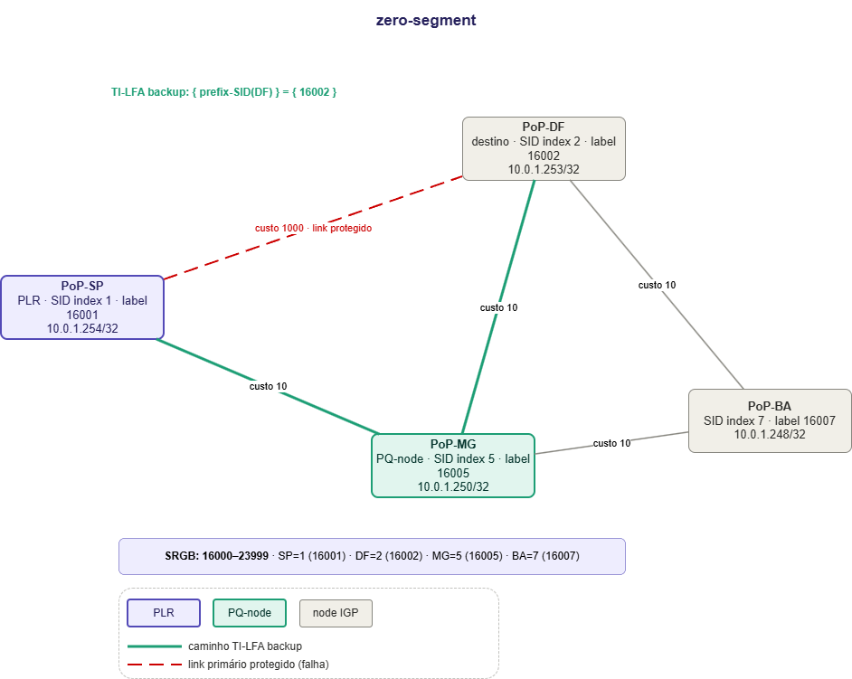
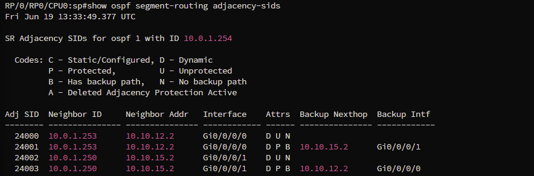
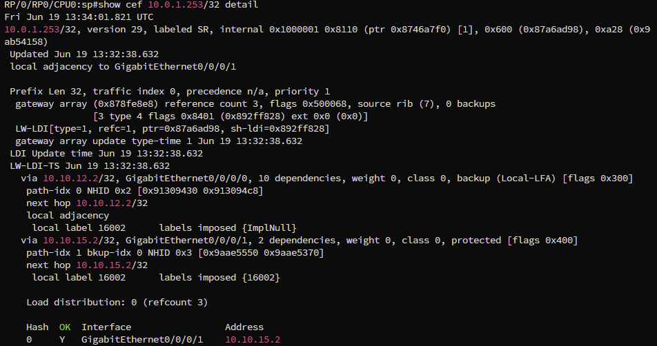
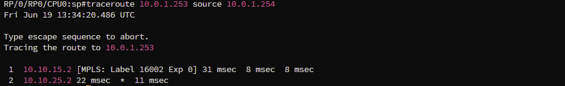

# TI-LFA Zero-Segment

## Contexto tecnológico

### LFA (Loop-Free Alternates)

LFA é o mecanismo original de fast reroute definido no RFC 5286. A ideia é simples: o IGP já conhece a topologia inteira, então em vez de esperar reconvergir após uma falha, o roteador pré-calcula um próximo salto alternativo para cada prefixo e o instala na FIB antes de qualquer falha acontecer. Quando o link cai, a comutação é imediata.

A condição matemática para que um vizinho N seja LFA para um destino D, a partir do PLR P, é:

```
dist(N, D) < dist(N, P) + dist(P, D)
```

Traduzindo: N só é alternativa válida se o caminho de N até D for mais curto do que qualquer caminho que passe por P. Isso garante que N não vai mandar o tráfego de volta para P criando um loop.

O problema é que essa condição depende da topologia. Em redes com poucos caminhos alternativos ou topologias em anel, muitos prefixos simplesmente não têm nenhum vizinho que satisfaça a condição. A cobertura do LFA pode ficar bem abaixo de 100% dependendo de como a rede está desenhada, o que torna a proteção imprevisível e difícil de garantir em produção.

### rLFA (Remote LFA)

O rLFA, definido no RFC 7490, foi criado para resolver a cobertura incompleta do LFA. A observação é que às vezes não existe vizinho direto que satisfaça a condição de loop-free, mas existe um node mais distante na rede que satisfaz - só que o PLR não consegue alcançá-lo diretamente para usá-lo como próximo salto de backup.

A solução do rLFA é criar um túnel LDP até esse node remoto, chamado PQ-node, e encaminhar o tráfego de backup por dentro do túnel. O PQ-node precisa satisfazer duas condições: o PLR consegue alcançá-lo sem cruzar o link protegido (P-space), e ele consegue alcançar o destino sem cruzar o link protegido (Q-space). Com isso, a cobertura aumenta significativamente.

O problema do rLFA está na dependência do LDP. Para criar o túnel até o PQ-node, o LDP precisa estar rodando em toda a rede, o que significa sinalização adicional, tabelas de estado em cada node intermediário e uma pilha de protocolo paralela ao IGP. Em redes que já usam SR-MPLS e querem eliminar o LDP exatamente para reduzir complexidade operacional, o rLFA é uma contradição: resolve um problema criando outro.

Além disso, o rLFA ainda tem limitações de cobertura em topologias onde P-space e Q-space não se intersectam em nenhum node, o que continua deixando prefixos desprotegidos.

### TI-LFA (Topology Independent LFA)

O TI-LFA, definido no RFC 8102, parte do mesmo conceito de P-space e Q-space do rLFA, mas elimina a dependência do LDP e garante cobertura de 100% em qualquer topologia.

Em vez de criar um túnel separado para chegar ao PQ-node, o PLR usa Segment Routing para expressar o caminho de backup diretamente como uma SID-list empilhada no pacote. Os roteadores intermediários não precisam de nenhum estado adicional: eles simplesmente leem o label do topo da pilha e encaminham normalmente.

Quando P-space e Q-space se intersectam em um vizinho direto do PLR, o backup é expresso com um único label - o Node-SID do destino. Isso é o Zero-Segment. Quando a interseção existe mas não em um vizinho direto, o PLR empilha o Node-SID do PQ-node antes do Node-SID do destino. Isso é o Single-Segment. Quando P-space e Q-space não se intersectam em nenhum node, o PLR usa um Adjacency-SID para conectar os dois espaços. Isso é o Double-Segment. Em todos os casos, o backup é calculado e instalado antes da falha, e o caminho expresso é exatamente o que a rede usaria após a convergência do IGP - loop-free por construção.

---

## Este lab

Lab de simulação do cenário Zero-Segment do TI-LFA sobre SR-MPLS com roteadores Cisco XRd via Containerlab. Quatro nós representando PoPs da Rede Ipê: SP como PLR, DF como destino, MG como PQ-node e BA como node de trânsito.

SP tem link direto com DF (link protegido) e com MG. MG conecta-se a SP, DF e BA. BA conecta-se a MG e DF. Não existe link direto entre SP e BA.

Quando o link SP-DF falha, os caminhos possíveis sem cruzar SP-DF são:

```
SP -> MG -> DF        custo 10 + 10 = 20
SP -> MG -> BA -> DF  custo 10 + 10 + 10 = 30
```

O TI-LFA calcula o P-space de SP sem o link SP-DF: MG é vizinho direto, BA é alcançável via MG. P-space = {MG, BA}. O Q-space de DF sem cruzar SP-DF: MG alcança DF diretamente, BA alcança DF diretamente. Q-space = {MG, BA}.

A interseção é {MG, BA}. O TI-LFA elege MG porque é vizinho direto do SP e tem menor custo até DF (custo 20 vs 30 via BA). MG é o PQ-node. Stack = `{ 16002 }`.

> O link SP-DF tem custo 1000 e os demais têm custo 10. Isso é um artifício do lab: como todas as interfaces do XRd são GigabitEthernet com custo igual por padrão, elevar o custo de SP-DF força o OSPF a preferir o caminho via MG, tornando o backup visível no CEF no estado normal. Em produção, o link SP-DF seria o caminho primário com custo baixo e o backup ficaria instalado na FIB sem aparecer como rota ativa, sendo ativado apenas no momento da falha.

---

## Topologia



MG é vizinho direto de SP e alcança DF sem cruzar SP-DF, portanto MG é PQ-node. O caminho de backup em verde é SP -> MG -> DF com label `{ 16002 }` imposta pelo SP. O link SP-DF em vermelho tracejado é o link protegido.

---

## Endereçamento

| No | Loopback | SID index | Label | Mgmt |
|----|----------|-----------|-------|------|
| SP (PLR) | 10.0.1.254/32 | 1 | 16001 | 172.20.21.11 |
| DF (destino) | 10.0.1.253/32 | 2 | 16002 | 172.20.21.12 |
| MG (PQ-node) | 10.0.1.250/32 | 5 | 16005 | 172.20.21.15 |
| BA | 10.0.1.248/32 | 7 | 16007 | 172.20.21.17 |

O label de cada node é calculado como base do SRGB + SID index. Com SRGB 16000-23999 e SID index 2, o DF tem label 16002. Esse label tem significado global: qualquer roteador que receba um pacote com label 16002 encaminha para DF pelo seu caminho mais curto local.

| Link | Subnet | Custo |
|------|--------|-------|
| SP-DF | 10.10.12.0/30 | 1000 |
| SP-MG | 10.10.15.0/30 | 10 |
| MG-DF | 10.10.25.0/30 | 10 |
| MG-BA | 10.10.57.0/30 | 10 |
| BA-DF | 10.10.27.0/30 | 10 |

---

## Deploy

```bash
mkdir -p ~/labs/sr-mpls/cisco/ti-lfa/zero-segment
cd ~/labs/sr-mpls/cisco/ti-lfa/zero-segment
```

Copiar o arquivo de topologia e as configurações do repositório:

```bash
cp IaC/Clabs/Cisco/ti-lfa/zero-segment.yml lab.clab.yml
cp -r Labs/Cisco/SR-MPLS/TI-LFA/zero-segment/configs .
```

O arquivo `zero-segment.yml` define os nós, imagem, endereços de gerência e mapeamento de interfaces, e referencia cada `.cfg` via `startup-config` - os nós já sobem configurados.

```bash
sudo clab deploy -t lab.clab.yml
```

Aguardar cerca de 5 minutos para o XRd inicializar. Acesso via `ssh clab@<IP>` com senha `clab@123`.

```bash
# Derrubar o lab
sudo clab destroy -t lab.clab.yml
```

---

## Configurações

```
configs/
├── sp.cfg
├── df.cfg
├── mg.cfg
└── ba.cfg
```

Aplicadas automaticamente no boot via `startup-config` no `.clab.yml`. Para revisar ou reaplicar manualmente:

SP: `ssh clab@172.20.21.11` -> `configs/sp.cfg`
DF: `ssh clab@172.20.21.12` -> `configs/df.cfg`
MG: `ssh clab@172.20.21.15` -> `configs/mg.cfg`
BA: `ssh clab@172.20.21.17` -> `configs/ba.cfg`

---

## Verificação

### 1. Vizinhanças OSPF

```
show ospf neighbor
```


O OSPF precisa ter adjacência com todos os vizinhos antes de qualquer coisa funcionar. Sem vizinhanças em estado FULL, o roteador não tem visibilidade completa da topologia e o TI-LFA não consegue calcular os backups.

O SP forma adjacência com dois vizinhos: DF via Gi0/0/0/0 (custo 1000, link protegido) e MG via Gi0/0/0/1 (custo 10, caminho de backup). O estado `FULL/-` significa que a adjacência está completa e o banco de dados de topologia está sincronizado. O `-` indica ausência de eleição de DR/BDR porque as interfaces estão em modo `point-to-point`, correto para links entre dois roteadores.

O campo `Dead Time` conta regressivamente. Se chegar a zero sem receber um Hello do vizinho, o OSPF declara o vizinho inativo e inicia reconvergência. No TI-LFA, a detecção de falha via sinalização de hardware acontece em milissegundos, antes do Dead Time expirar.

---

### 2. Adjacency-SIDs e backups TI-LFA

```
show ospf segment-routing adjacency-sids
```



Este comando mostra os Adjacency-SIDs alocados dinamicamente pelo OSPF para cada enlace do SP e confirma que o TI-LFA calculou e instalou o backup para cada adjacência.

Um Adjacency-SID é um label que representa um link específico. Enquanto o Node-SID 16002 significa "encaminhe para DF pelo caminho mais curto", um Adjacency-SID significa "saia por este link específico". Isso é necessário nos cenários mais complexos de TI-LFA onde o backup precisa forçar um caminho que o IGP não escolheria naturalmente.

Cada enlace aparece em duas linhas. A primeira é o Adjacency-SID sem proteção (`U` = unprotected, `N` = no backup path). A segunda é o Adjacency-SID protegido (`P` = protected, `B` = has backup path) com o próximo salto e interface de backup calculados.

`24001 / 10.0.1.253 / Gi0/0/0/0 / D P B / backup: 10.10.15.2 / Gi0/0/0/1`: adj-SID protegido para o link SP-DF. Se esse link cair, o SP desvia via MG (10.10.15.2) pela Gi0/0/0/1.

`24003 / 10.0.1.250 / Gi0/0/0/1 / D P B / backup: 10.10.12.2 / Gi0/0/0/0`: adj-SID protegido para o link SP-MG. Se esse link cair, o backup vai pelo link SP-DF. Como SP-DF tem custo 1000, este cenário é o caminho de último recurso.

A presença de entradas com `P B` e backup nexthop preenchido confirma que o TI-LFA concluiu o cálculo e a proteção está ativa antes de qualquer falha.

---

### 3. CEF e a entrada de backup para o destino

O CEF (Cisco Express Forwarding) é a tabela de encaminhamento de alta velocidade do IOS-XR. Diferente da tabela de roteamento convencional processada pela CPU, o CEF é programado diretamente no hardware de encaminhamento. Quando um pacote chega, o hardware consulta o CEF e toma a decisão sem envolver a CPU, o que permite velocidades de linha e latências mínimas.

É no CEF que o backup do TI-LFA fica pré-instalado. Quando o link cai e o hardware detecta a falha, a comutação para o próximo salto de backup acontece consultando o CEF diretamente, sem processamento adicional. Isso é o que garante o sub-50ms.

```
show cef 10.0.1.253/32 detail
```



`10.0.1.253/32, labeled SR` confirma que a entrada é para o prefixo do DF tratado como SR.

`local adjacency to GigabitEthernet0/0/0/1` indica o próximo salto preferido no momento, MG via Gi0/0/0/1.

O bloco `via 10.10.12.2/32, GigabitEthernet0/0/0/0`: caminho via DF direto, marcado como `backup (Local-LFA)`. `labels imposed {ImplNull}` indica PHP (Penultimate Hop Popping) - o label é removido antes de entregar, pois DF é vizinho direto. Este é o backup do caminho via MG caso ele falhe.

O bloco `via 10.10.15.2/32, GigabitEthernet0/0/0/1`: caminho primário via MG, marcado como `protected`. `labels imposed {16002}` é a SID-list imposta: apenas o Node-SID do DF, sem label adicional. Isso caracteriza o Zero-Segment - MG é vizinho direto do SP e alcança DF diretamente.

A tabela de distribuição ao final mostra o tráfego concentrado em Gi0/0/0/1 (MG), com Gi0/0/0/0 (DF direto) como backup instalado.

---

### 4. Simulacao de falha

Derrubar o link SP-DF:

```
conf t
interface GigabitEthernet0/0/0/0
 shutdown
commit
end
```

Verificar o caminho após a falha:

```
traceroute 10.0.1.253 source 10.0.1.254
```



O traceroute mostra o caminho real dos pacotes após a falha. Cada linha é um salto na rede.

`1  10.10.15.2 [MPLS: Label 16002 Exp 0]`: primeiro salto, MG (10.10.15.2). O campo `[MPLS: Label 16002]` confirma que o label está presente no pacote neste ponto. `Exp 0` é o campo de QoS do cabeçalho MPLS, sem uso aqui.

`2  10.10.25.2`: segundo salto, DF (10.10.25.2). MG encaminha diretamente para DF pelo link MG-DF. DF faz pop do label e entrega o pacote. O `*` indica que uma das três sondas não respondeu, comportamento normal no XRd.

Dois saltos, label `{ 16002 }` saindo do SP e presente até MG. MG consulta a LFIB local, vê que 16002 aponta para DF e encaminha sem nenhuma instrução adicional. Nenhum roteador intermediário sabe que houve uma falha. Toda a decisão de caminho está no PLR. Os intermediários são stateless.