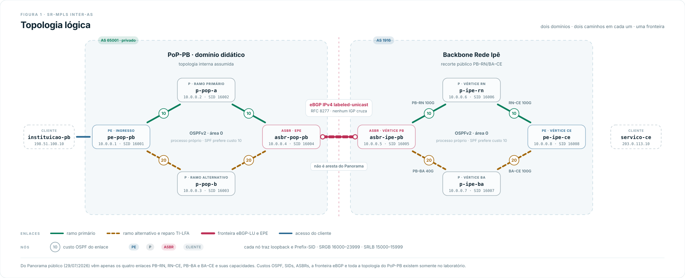
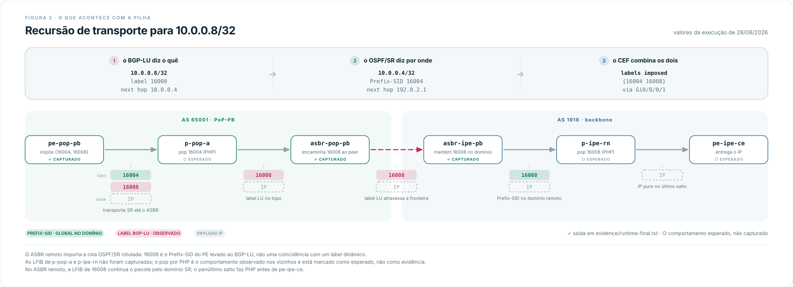
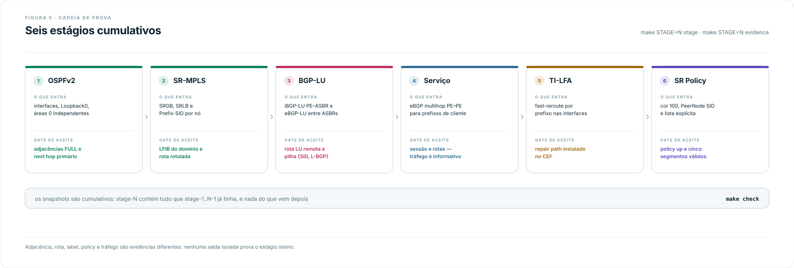
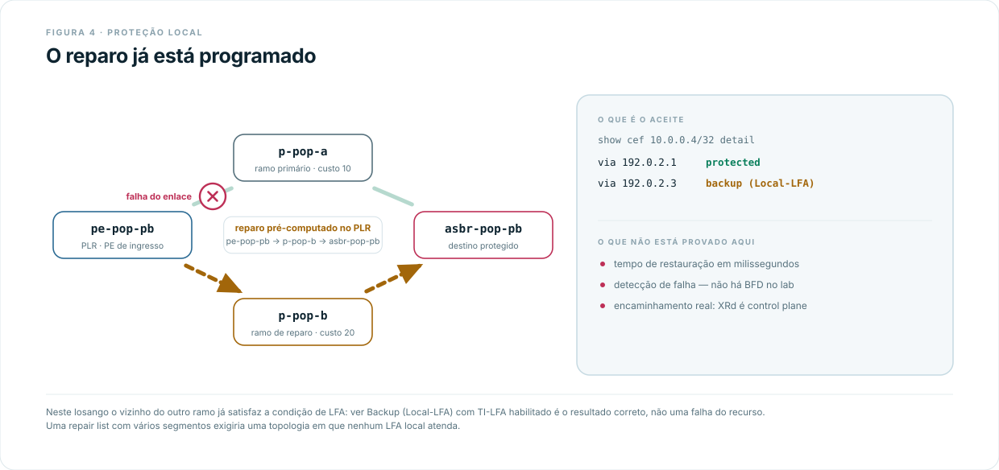
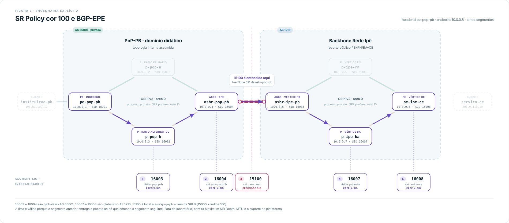

# Inter-AS: BGP-LU entre o PoP-PB e o backbone Rede Ipê

> Pré-requisitos: [conceitos de Inter-AS](../../../../../docs/concepts/sr-mpls/inter-as.md), [base Cisco](../../00-base/) e [ambiente XRd](../../../setup.md).

## O que este lab demonstra

Dois domínios administrativos, cada um com seu próprio OSPF e seus próprios
Prefix-SIDs, unidos por uma fronteira eBGP labeled-unicast. Nenhum IGP cruza a
fronteira.

O ponto central é a **recursão de transporte**: a rota BGP-LU para a loopback do
PE remoto não é encaminhável sozinha. Ela traz um label e um next hop, mas esse
next hop ainda precisa ser resolvido pelo transporte SR do domínio local. O
resultado é uma pilha de dois labels imposta pelo CEF - um do OSPF/SR, outro do
BGP - e é essa combinação, não a existência da sessão BGP, que o lab serve para
tornar visível.

Sobre esse substrato o lab acrescenta proteção TI-LFA em cada losango e uma SR
Policy explícita de cinco segmentos que atravessa os dois domínios usando um
PeerNode SID de BGP Egress Peer Engineering na fronteira.

## O que este lab não demonstra

Não é uma L3VPN inter-AS Option C completa: não há AF VPNv4/vpnv6, VRF, RD nem
RT. O lab implementa o **substrato de transporte** da Opção C e substitui a
camada VPN por uma rota LU para a loopback do PE remoto mais uma sessão eBGP
IPv4 unicast multihop entre os PEs. O prefix-set `LU_LOOPBACKS` é o limite entre
as duas camadas.

Também não mede convergência em 50 ms nem capacidade de encaminhamento. Não há
BFD configurado, e a imagem XRd Control Plane não é uma plataforma de dados. O
estágio 5 prova a **instalação** do repair path no CEF, não um SLA.

> Este lab não reproduz a configuração da RNP. O AS 1916 identifica o papel do
> backbone no ambiente isolado; o AS 65001 é privado e identifica o PoP
> didático. Endereços, custos, SIDs e configurações não descrevem a produção.
> Somente os quatro enlaces do losango PB-RN/BA-CE vêm do mapa público. Método,
> evidências e limites da analogia em [`recorte-rede-ipe.md`](./recorte-rede-ipe.md).

## Conceitos aplicados

- **BGP-LU (RFC 8277)**: BGP carregando o prefixo com um label MPLS. Estende o
  alcance MPLS entre domínios que não compartilham IGP.
- **Recursão de transporte**: o next hop de uma rota LU é resolvido pela rota
  SR do domínio local; o CEF empilha o Node-SID sobre o label BGP.
- **`next-hop-self` no ASBR**: sem ele o PE recebe um next hop que seu IGP não
  conhece, e a rota LU não resolve.
- **PeerNode SID (BGP-EPE, RFC 9087)**: label local do ASBR de saída cuja
  semântica é "encaminhe ao peer BGP X", e não "alcance o Node-SID de X".
- **SRGB compartilhado**: `16000-23999` nos oito nós. Label = `16000 + índice`.
  O mesmo valor numérico só tem semântica global dentro do domínio que anuncia
  aquele SID.

## Topologia

<picture>
  <source media="(prefers-color-scheme: dark)" srcset="./images/topology-bgp-lu-escuro.svg">
  
</picture>

Cada domínio é um losango: dois caminhos internos entre a borda de serviço e a
borda administrativa, um com custo 10 por enlace e outro com 20. Isso dá, em
cada lado, um caminho SPF previsível, um candidato natural a repair path do
TI-LFA e um ramo alternativo para a SR Policy forçar.

| Nó | Papel | AS | Loopback0 | SID index | Label |
|---|---|---:|---|---:|---:|
| `pe-pop-pb` | PE de ingresso | 65001 | `10.0.0.1/32` | 1 | `16001` |
| `p-pop-a` | P, ramo primário | 65001 | `10.0.0.2/32` | 2 | `16002` |
| `p-pop-b` | P, ramo alternativo | 65001 | `10.0.0.3/32` | 3 | `16003` |
| `asbr-pop-pb` | ASBR e headend EPE | 65001 | `10.0.0.4/32` | 4 | `16004` |
| `asbr-ipe-pb` | ASBR e headend EPE | 1916 | `10.0.0.5/32` | 5 | `16005` |
| `p-ipe-rn` | P, ramo primário | 1916 | `10.0.0.6/32` | 6 | `16006` |
| `p-ipe-ba` | P, ramo alternativo | 1916 | `10.0.0.7/32` | 7 | `16007` |
| `pe-ipe-ce` | PE de saída | 1916 | `10.0.0.8/32` | 8 | `16008` |

As siglas PB, RN, BA e CE identificam vértices do grafo público, não
equipamentos reais. Os nomes do domínio do PoP são deliberadamente funcionais
porque sua topologia interna não é pública.

| Enlace | Interfaces XR | Prefixo | Endereços | Custo |
|---|---|---|---|---:|
| `instituicao-pb`-`pe-pop-pb` | - / Gi0/0/0/0 | `198.51.100.0/24` | `.10` / `.1` | - |
| `pe-pop-pb`-`p-pop-a` | Gi0/0/0/1 / Gi0/0/0/0 | `192.0.2.0/31` | `.0` / `.1` | 10 |
| `pe-pop-pb`-`p-pop-b` | Gi0/0/0/2 / Gi0/0/0/0 | `192.0.2.2/31` | `.2` / `.3` | 20 |
| `p-pop-a`-`asbr-pop-pb` | Gi0/0/0/1 / Gi0/0/0/0 | `192.0.2.4/31` | `.4` / `.5` | 10 |
| `p-pop-b`-`asbr-pop-pb` | Gi0/0/0/1 / Gi0/0/0/1 | `192.0.2.6/31` | `.6` / `.7` | 20 |
| `asbr-pop-pb`-`asbr-ipe-pb` | Gi0/0/0/2 / Gi0/0/0/2 | `192.0.2.8/31` | `.8` / `.9` | fora do OSPF |
| `asbr-ipe-pb`-`p-ipe-rn` | Gi0/0/0/0 / Gi0/0/0/1 | `192.0.2.10/31` | `.10` / `.11` | 10 |
| `asbr-ipe-pb`-`p-ipe-ba` | Gi0/0/0/1 / Gi0/0/0/1 | `192.0.2.12/31` | `.12` / `.13` | 20 |
| `p-ipe-rn`-`pe-ipe-ce` | Gi0/0/0/0 / Gi0/0/0/1 | `192.0.2.14/31` | `.14` / `.15` | 10 |
| `p-ipe-ba`-`pe-ipe-ce` | Gi0/0/0/0 / Gi0/0/0/2 | `192.0.2.16/31` | `.16` / `.17` | 20 |
| `pe-ipe-ce`-`servico-ce` | Gi0/0/0/0 / - | `203.0.113.0/24` | `.1` / `.10` | - |

Os enlaces usam `192.0.2.0/24` em `/31` conforme a RFC 3021; as redes de cliente
usam `198.51.100.0/24` e `203.0.113.0/24`. Os três blocos são reservados pela
RFC 5737 para documentação. As loopbacks ficam em `10.0.0.0/24`, o mesmo esquema
da topologia de referência da [base Cisco](../../00-base/).

O enlace `asbr-pop-pb`-`asbr-ipe-pb` é o único fora do OSPF: ali só existe eBGP
labeled-unicast.

### Sessões BGP

| Sessão | Tipo | AF | Next hop |
|---|---|---|---|
| `pe-pop-pb`-`asbr-pop-pb` | iBGP 65001 | IPv4 LU | loopbacks; ASBR usa `next-hop-self` |
| `asbr-pop-pb`-`asbr-ipe-pb` | eBGP 65001↔1916 | IPv4 LU | endereços diretamente conectados |
| `asbr-ipe-pb`-`pe-ipe-ce` | iBGP 1916 | IPv4 LU | loopbacks; ASBR usa `next-hop-self` |
| `pe-pop-pb`-`pe-ipe-ce` | eBGP multihop | IPv4 unicast | loopbacks |

As três sessões LU usam a route-policy `LU_ONLY`, que admite exclusivamente
`10.0.0.1/32` e `10.0.0.8/32`. Redes de cliente nunca recebem label.

## Deploy

```bash
git clone https://github.com/rnpbr/LabRedes-segmentrouting.git
cd LabRedes-segmentrouting
cd labs/cisco/sr-mpls/inter-as/bgp-lu
sudo clab deploy -t lab.clab.yml
```

Oito roteadores XRd mais dois clientes Alpine. Reserve cerca de 12 GB de RAM e
oito CPUs - é o maior lab do repositório. Gerência em `172.20.26.0/24`:

| Nó | Gerência | Nó | Gerência |
|---|---|---|---|
| `pe-pop-pb` | `172.20.26.11` | `asbr-ipe-pb` | `172.20.26.15` |
| `p-pop-a` | `172.20.26.12` | `p-ipe-rn` | `172.20.26.16` |
| `p-pop-b` | `172.20.26.13` | `p-ipe-ba` | `172.20.26.17` |
| `asbr-pop-pb` | `172.20.26.14` | `pe-ipe-ce` | `172.20.26.18` |
| `instituicao-pb` | `172.20.26.21` | `servico-ce` | `172.20.26.22` |

Acesso: `ssh clab@172.20.26.11`, senha `clab@123`. Ou:

```bash
sudo docker exec -it clab-inter-as-bgp-lu-pe-pop-pb /pkg/bin/xr_cli.sh
```

O boot do XR leva alguns minutos. Container em `running` não significa CLI
pronta, e o BGP precisa de mais tempo ainda para estabilizar - ver
[Tempo de estabilização](#tempo-de-estabilização).

```bash
# Derrubar o lab
sudo clab destroy -t lab.clab.yml --cleanup
```

## O mecanismo central, em detalhe

Trecho relevante de `configs/pe-pop-pb.cfg` e `configs/asbr-pop-pb.cfg` (o resto
segue a [base SR-MPLS no IOS-XR](../../00-base/)):

```text
! pe-pop-pb - PE de ingresso
router bgp 65001
 address-family ipv4 unicast
  network 10.0.0.1/32
  allocate-label all
 !
 neighbor 10.0.0.4
  remote-as 65001
  update-source Loopback0
  address-family ipv4 labeled-unicast
   route-policy LU_ONLY in
   route-policy LU_ONLY out

! asbr-pop-pb - ASBR
router bgp 65001
 neighbor 10.0.0.1
  address-family ipv4 labeled-unicast
   next-hop-self
 !
 neighbor 192.0.2.9
  remote-as 1916
  address-family ipv4 labeled-unicast
   route-policy LU_ONLY in
   route-policy LU_ONLY out
```

Para a loopback `10.0.0.8/32`, originada por `pe-ipe-ce`:

1. `pe-pop-pb` aprende o prefixo via BGP-LU com next hop `10.0.0.4`
   (`asbr-pop-pb`), porque o ASBR aplicou `next-hop-self`.
2. `10.0.0.4` não é diretamente conectado. O next hop **recursa** na rota
   OSPF/SR para `asbr-pop-pb`, que é o Node-SID `16004`.
3. O CEF combina os dois: impõe `{16004, <label BGP>}` e envia por `p-pop-a`.
4. O domínio do PoP encaminha por SPF até `asbr-pop-pb`, fazendo pop de `16004`
   (PHP no penúltimo salto).
5. Em `asbr-pop-pb` só resta o label BGP, que é trocado na fronteira.
6. O domínio do backbone entrega a `pe-ipe-ce`.

<picture>
  <source media="(prefers-color-scheme: dark)" srcset="./images/diagram-pilha-recursiva-escuro.svg">
  
</picture>

`next-hop-self` é decisivo. Sem ele, `pe-pop-pb` receberia como next hop o
endereço de fronteira `192.0.2.9`, que não existe em seu OSPF - a rota LU seria
recebida mas nunca resolveria.

Não fixe em documentação um label da faixa dinâmica. Na execução registrada, o
label LU recebido para `10.0.0.8/32` foi `16008`, numericamente igual ao
Prefix-SID do PE remoto. A coincidência não elimina o contrato downstream: quem
define a semântica de um label é o roteador que o recebe e sua entrada de LFIB.

## Progressão em seis estágios

`configs/` é o estado final, com tudo ligado. Para percorrer o lab por partes,
suba o estado final e remova o que ainda não entrou, ou monte cada estágio
retirando dos `.cfg` os blocos listados abaixo. Cada estágio é cumulativo e só
deve ser passado depois que seus critérios de aceite fecharem.

<picture>
  <source media="(prefers-color-scheme: dark)" srcset="./images/diagram-progressao-estagios-escuro.svg">
  
</picture>

### Estágio 1 - underlay OSPF

Interfaces, endereçamento, `Loopback0`, OSPFv2 área 0 em cada domínio, custos 10
e 20. Fora: todo o resto.

```text
show ospf neighbor
show route 10.0.0.4/32 detail
show route 10.0.0.8/32 detail
```

Aceite: dois vizinhos `FULL` em cada roteador; `pe-pop-pb` alcança as quatro
loopbacks do PoP e **nenhuma** do backbone; a rota para `10.0.0.4/32` sai por
`192.0.2.1` (`p-pop-a`); `asbr-ipe-pb` alcança `10.0.0.8/32` via `p-ipe-rn`.

O custo de uma rota para loopback pode incluir o custo do prefixo stub além dos
enlaces. O dado decisivo é o next hop, não o número.

### Estágio 2 - SR-MPLS intradomínio

Entra: `segment-routing global-block` / `local-block`, `segment-routing mpls` no
processo e na área OSPF, `prefix-sid index <N>` em cada `Loopback0`.

```text
show ospf database opaque-area self-originate
show mpls forwarding
show mpls label table 0 label 16004 detail
```

Aceite: cada loopback anuncia seu Prefix-SID; `pe-pop-pb` vê `10.0.0.4/32` como
rota SR rotulada; os nós de trânsito têm LFIB para os SIDs do próprio domínio;
não existe LDP nem RSVP.

Os SIDs `16005`-`16008` **não** aparecem no domínio do PoP. Não há flooding OSPF
entre os domínios - é exatamente o problema que o estágio 3 resolve.

### Estágio 3 - transporte BGP labeled-unicast

Entra: `prefix-set LU_LOOPBACKS`, `route-policy LU_ONLY`, `router bgp` com
`allocate-label all`, as três sessões LU, `next-hop-self` nos ASBRs em direção
aos PEs, `mpls static` na interface de fronteira e uma rota estática `/32` para
o endereço de fronteira do ASBR oposto:

```text
! asbr-pop-pb
router static
 address-family ipv4 unicast
  192.0.2.9/32 GigabitEthernet0/0/0/2

! asbr-ipe-pb
router static
 address-family ipv4 unicast
  192.0.2.8/32 GigabitEthernet0/0/0/2
```

O IOS XR precisa dessa rota host na fronteira Inter-AS para vincular o label
MPLS a um FEC `/32`. Sem ela, a sessão BGP-LU pode ficar operacional e trocar
labels enquanto o tráfego rotulado não é encaminhado. Esse comportamento e a
rota estática requerida no ASBR IOS XR são descritos pela Cisco em
[Configure Inter-AS Option C MPLS VPN With Cisco IOS and Cisco IOS-XR](https://www.cisco.com/c/en/us/support/docs/multiprotocol-label-switching-mpls/mpls/200523-Configuration-and-Verification-of-Layer.html).

Em `pe-pop-pb`:

```text
show bgp ipv4 labeled-unicast summary
show bgp ipv4 labeled-unicast 10.0.0.8/32
show cef 10.0.0.8/32 detail
```

Em cada ASBR:

```text
show bgp ipv4 labeled-unicast summary
show route 192.0.2.9/32
show mpls forwarding
```

Em `asbr-ipe-pb`, consulte `192.0.2.8/32` no segundo comando.

Aceite: as três sessões LU `Established`; a rota remota válida, best e com
label; o CEF de `pe-pop-pb` recursando pelo next hop `10.0.0.4`; a imposição
incluindo `16004` mais um label BGP; entrada de LFIB correspondente no ASBR;
`198.51.100.0/24` e `203.0.113.0/24` **ausentes** da tabela LU.

### Estágio 4 - sobreposição de serviço

Entra: eBGP IPv4 unicast multihop `pe-pop-pb`-`pe-ipe-ce`, o `network` das
redes de cliente e `route-policy PE_UNICAST_EXPORT_ONLY` na saída de cada PE.
O filtro anuncia somente `198.51.100.0/24` de `pe-pop-pb` e somente
`203.0.113.0/24` de `pe-ipe-ce`. As loopbacks continuam na AF unicast local
para receber um binding de label, mas não vazam pela sessão de serviço
AFI 1/SAFI 1; entre domínios elas são transportadas apenas por BGP-LU.

```text
show bgp ipv4 unicast summary
show bgp ipv4 unicast 203.0.113.0/24
```

```bash
docker exec clab-inter-as-bgp-lu-instituicao-pb ping -c 5 203.0.113.10
docker exec clab-inter-as-bgp-lu-servico-ce ping -c 5 198.51.100.10
docker exec clab-inter-as-bgp-lu-instituicao-pb traceroute -e 203.0.113.10
```

Aceite: sessão multihop `Established` com um prefixo recebido; as redes de
cliente presentes **somente** na família IPv4 unicast; ping cliente-cliente nos
dois sentidos sem perda; traceroute alcançando o cliente remoto.

Há uma dependência circular aparente - a sessão PE-PE precisa do transporte que
o estágio 3 construiu, e é por isso que ela vem depois.

### Estágio 5 - TI-LFA

Entra, em toda interface OSPF de core:

```text
fast-reroute per-prefix
fast-reroute per-prefix ti-lfa enable
```

```text
show route 10.0.0.4/32 detail
show cef 10.0.0.4/32 detail
```

Aceite: primário de `pe-pop-pb` para `asbr-pop-pb` via `p-pop-a` e repair
instalado via `p-pop-b`; simetricamente, primário de `asbr-ipe-pb` para
`pe-ipe-ce` via `p-ipe-rn` e repair via `p-ipe-ba`.

<picture>
  <source media="(prefers-color-scheme: dark)" srcset="./images/diagram-ti-lfa-reparo-escuro.svg">
  
</picture>

**É esperado que a saída classifique o reparo como `Local-LFA`, mesmo com TI-LFA
habilitado.** Neste losango o vizinho do outro ramo já satisfaz a condição de
LFA clássico, então não é preciso uma lista de reparo com segmentos remotos. Não
há contradição. Para ver uma repair list de múltiplos segmentos é preciso uma
topologia onde nenhum LFA local atenda - é o que fazem os labs de
[TI-LFA](../../../../../docs/concepts/sr-mpls/ti-lfa.md).

O que **não** é aceitável é inferir reparo a partir de uma segunda rota na RIB
sem confirmar CEF/FRR.

Ensaio de falha, com `shutdown` na interface primária: em XRd CP dá para
observar a mudança de RIB/CEF, mas não medir perda. Sem BFD, timestamps e uma
plataforma de forwarding, o ensaio não sustenta nenhuma afirmação sobre 50 ms.

### Estágio 6 - SR Policy explícita e EPE

Entra: `egress-engineering` e `peer-node-sid index 100` nos dois ASBRs;
`extcommunity-set opaque COLOR_100` e `route-policy COLOR_100` em `pe-pop-pb`; a
segment-list e a policy de cor 100.

```text
segment-routing
 traffic-eng
  segment-list INTERAS-BACKUP
   index 10 mpls label 16003
   index 20 mpls label 16004
   index 30 mpls label 15100
   index 40 mpls label 16007
   index 50 mpls label 16008
  !
  policy INTERAS-COLOR-100
   color 100 end-point ipv4 10.0.0.8
   candidate-paths
    preference 100
     explicit segment-list INTERAS-BACKUP
```

<picture>
  <source media="(prefers-color-scheme: dark)" srcset="./images/diagram-sr-policy-epe-escuro.svg">
  
</picture>

| Ordem | Label | Semântica quando ativo |
|---:|---:|---|
| 1 | `16003` | alcançar `p-pop-b` pelo domínio do PoP |
| 2 | `16004` | alcançar `asbr-pop-pb` pelo domínio do PoP |
| 3 | `15100` | PeerNode SID local de `asbr-pop-pb`: enviar ao peer `asbr-ipe-pb` |
| 4 | `16007` | alcançar `p-ipe-ba` pelo domínio do backbone |
| 5 | `16008` | alcançar `pe-ipe-ce` pelo domínio do backbone |

Um único Node-SID por domínio seguiria o SPF primário. Os cinco segmentos são o
mínimo para forçar os **dois** ramos alternativos e o peer de saída.

O label `15100` vem do índice 100 na SRLB iniciada em `15000`. Diferente de um
Prefix-SID, ele é **local** a `asbr-pop-pb`, e significa "encaminhe ao peer BGP",
não "alcance o Node-SID de `asbr-ipe-pb`". A lista cruza domínios porque `16004`
entrega o pacote ao nó que entende `15100` antes de esse label chegar ao topo.

Em `asbr-pop-pb`:

```text
show bgp egress-engineering
show mpls forwarding labels 15100 detail
```

Em `pe-pop-pb`:

```text
show segment-routing traffic-eng policy color 100
show cef 203.0.113.0/24 detail
```

Aceite: PeerNode SID `15100` associado ao peer `192.0.2.9`; policy Admin e
Operational `up`; candidate path explícito válido com os cinco segmentos na
ordem; Binding SID presente; rota `203.0.113.0/24` associada à cor 100 e ao BSID
da policy; traceroute exibindo, no primeiro salto MPLS, a sequência
`{16004, 15100, 16007, 16008}` depois de o SID inicial sofrer PHP.

Se a sessão de serviço do estágio 4 não formar, o CEF do prefixo de cliente não
recursa na policy: a estrutura pode estar correta e ainda assim o steering não
acontece.

Este exercício configura EPE e policy localmente. Não implementa a solução
centralizada da RFC 9087 - não há controlador, exportação BGP-LS da topologia de
peering nem programação remota. O objeto de data plane demonstrado é o BGP
Peering SID.

## Verificação

Cadeia mínima no estado final, a partir de `pe-pop-pb`. Nenhuma saída isolada
prova tudo.

| Comando | O que confirmar |
|---|---|
| `show ospf neighbor` | `FULL` em toda interface de core |
| `show mpls forwarding` | uma entrada por Node-SID do domínio local |
| `show bgp ipv4 labeled-unicast summary` | as três sessões LU `Established` |
| `show bgp ipv4 labeled-unicast 10.0.0.8/32` | rota best, com label e next hop `10.0.0.4` |
| `show cef 10.0.0.8/32 detail` | pilha `{16004, <label BGP>}` via `p-pop-a` |
| `show cef 10.0.0.4/32 detail` | backup instalado via `p-pop-b` |
| `show bgp ipv4 unicast summary` | sessão multihop PE-PE `Established` |
| `show bgp egress-engineering` | PeerNode SID `15100` no peer `192.0.2.9` (em `asbr-pop-pb`) |
| `show segment-routing traffic-eng policy color 100` | Admin/Oper `up`, cinco segmentos |
| `show cef 203.0.113.0/24 detail` | prefixo de cliente resolvido pelo BSID da policy |

E o encaminhamento fim a fim:

```bash
docker exec clab-inter-as-bgp-lu-instituicao-pb ping -c 5 203.0.113.10
docker exec clab-inter-as-bgp-lu-instituicao-pb traceroute -e 203.0.113.10
```

Cada pergunta tem sua evidência própria: `show route` responde se o OSPF conhece
o caminho, `show bgp ... labeled-unicast` se o BGP recebeu NLRI e label,
`show mpls label table` quais labels locais existem, `show mpls forwarding` como
um label será encaminhado, e `show cef ... detail` qual recursão e qual pilha um
prefixo usa. Adjacência OSPF `FULL` não prova label forwarding; rota LU válida
não prova que uma sessão multihop atravessa a imagem; SR Policy operacional não
prova que houve tráfego.

### Tempo de estabilização

Este lab é sensível a captura precoce. A sessão eBGP multihop PE-PE depende de
pacotes TCP gerados no próprio PE atravessarem o LSP construído pelos estágios
anteriores. Uma captura feita cedo demais encontra a sessão em `Active`.

Se isso acontecer, **não** conclua que a imagem não encaminha. Confirme primeiro
a recursão do transporte e aguarde a estabilização, esperando estes cinco em
conjunto:

```text
show bgp ipv4 labeled-unicast summary
show bgp ipv4 labeled-unicast 10.0.0.8/32
show cef 10.0.0.8/32 detail
show bgp ipv4 unicast summary
show bgp ipv4 unicast 203.0.113.0/24
```

O gate é estado e alcance, não um temporizador fixo. O que a execução de
referência efetivamente observou está em [`validacao.md`](./validacao.md).

## Documentos deste lab

| Documento | Para que serve |
|---|---|
| [Conceitos de Inter-AS](../../../../../docs/concepts/sr-mpls/inter-as.md) | Planos, recursão, Option C e EPE |
| [`guia-aprofundado.md`](./guia-aprofundado.md) | Da configuração ao fio: RIB/LIB/LFIB/CEF e pilhas salto a salto |
| [`recorte-rede-ipe.md`](./recorte-rede-ipe.md) | Evidência do mapa, método de seleção e limites da analogia |
| [`validacao.md`](./validacao.md) | O que a execução de referência confirmou, e o que não |

## Referências

- [Panorama de Tráfego da Rede Ipê](https://redeipe.rnp.br/panorama)
- RFC 8277 - *Using BGP to Bind MPLS Labels to Address Prefixes*: <https://www.rfc-editor.org/rfc/rfc8277.html>
- RFC 9087 - *Segment Routing Centralized BGP Egress Peer Engineering*: <https://www.rfc-editor.org/rfc/rfc9087.html>
- RFC 9256 - *Segment Routing Policy Architecture*: <https://www.rfc-editor.org/rfc/rfc9256.html>
- RFC 9855 - *Topology Independent Fast Reroute Using Segment Routing*: <https://www.rfc-editor.org/rfc/rfc9855.html>
- RFC 4364 seção 10 - contexto das opções inter-AS: <https://www.rfc-editor.org/rfc/rfc4364.html>
- Cisco - [Configure Inter-AS Option C MPLS VPN With Cisco IOS and Cisco IOS-XR](https://www.cisco.com/c/en/us/support/docs/multiprotocol-label-switching-mpls/mpls/200523-Configuration-and-Verification-of-Layer.html)
- [Containerlab - Cisco XRd kind](https://containerlab.dev/manual/kinds/xrd/)

Lista completa das fontes, incluindo as do recorte público, em
[documento conceitual de Inter-AS](../../../../../docs/concepts/sr-mpls/inter-as.md#referências).
