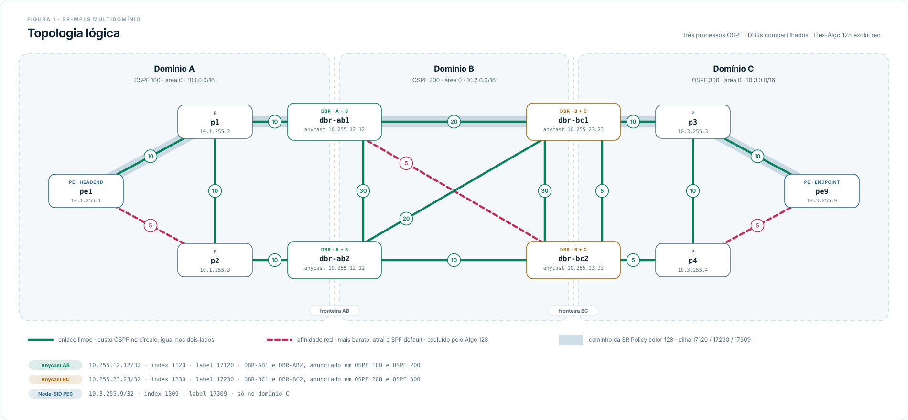
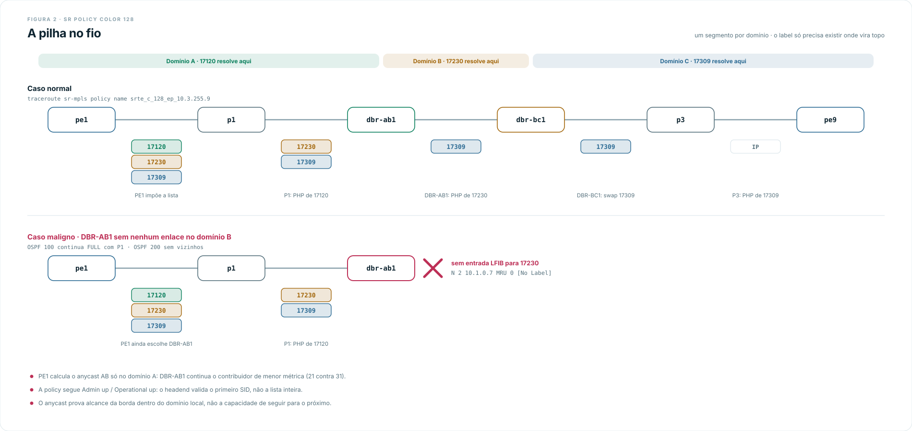

# Multidomínio: Flex-Algo com SID anycast de borda

> Pré-requisitos: [conceitos de multidomínio e Flex-Algo](../../../../../docs/concepts/sr-mpls/multidominio.md), [base Cisco](../../00-base/) e [ambiente XRd](../../../setup.md).

## O que este lab demonstra

Três domínios OSPF independentes - processos `100`, `200` e `300`, todos em
área `0` - sem redistribuição entre eles. O PE de um extremo não tem rota, LSA
nem label para o PE do outro. Mesmo assim, uma SR Policy em `pe1` entrega
tráfego a `pe9` com uma pilha de três segmentos, um por domínio:

```text
17120  SID anycast da fronteira AB, Algo 128
17230  SID anycast da fronteira BC, Algo 128
17309  Node-SID de pe9, Algo 128
```

O ponto central é que **cada label só precisa existir no domínio em que vira o
topo da pilha**. `17230` só existe nos nós dos domínios B e C, e `17309` só nos
do domínio C. `pe1` e `p1` não têm entrada para nenhum dos dois, e não precisam.

Duas peças tornam a pilha útil:

- **Flex-Algo 128**, definido igual nos três domínios: métrica IGP e exclusão
  dos enlaces com afinidade `red`. Os enlaces `red` são de propósito mais
  baratos que o caminho limpo, então o SPF default os usa e o algoritmo 128 os
  evita.
- **SIDs anycast de borda**: os dois DBRs de cada fronteira anunciam o mesmo
  prefixo com o mesmo índice. A pilha diz "entregue a qualquer borda AB", não
  "entregue ao `dbr-ab1`".

Por fim, o lab quebra o desenho de duas formas: uma falha que o anycast absorve
e outra em que ele cria um buraco negro que nem o domínio de origem nem o
headend conseguem perceber.

## O que este lab não demonstra

- **Não há computação de caminho interdomínio.** Não há BGP-LU, SR-PCE, BGP-LS
  nem ODN. A pilha foi montada à mão: o humano faz o papel do elemento de
  computação. Trate a lista estática como degrau didático, não como resposta de
  produção. O transporte interdomínio por BGP está no lab
  [`bgp-lu`](../../inter-as/bgp-lu/).
- **Não há caminho de volta.** `pe9` não tem rota para o domínio A. A prova
  bidirecional usa o endereço de gerência de `pe1` como origem, para que a
  resposta volte pela rede de gerência - ver [Estágio 3](#estágio-3---sr-policy-explícita).
- **Não há mitigação do risco do anycast.** O [ensaio maligno](#ensaio-2---o-risco-do-sid-anycast)
  mostra o problema; nada no lab o corrige.
- **Não é OSPF multiárea nem IS-IS multinível.** São processos separados. Ver
  [multiprocesso não é multiárea](../../../../../docs/concepts/sr-mpls/multidominio.md#multiprocesso-não-é-multiárea).
- **Não mede convergência.** Não há BFD, e a imagem XRd Control Plane não é uma
  plataforma de dados.

## Conceitos aplicados

- **Flex-Algo 128 (RFC 9350)**: FAD com `priority 200`, `advertise-definition`
  e `affinity exclude-any red` em todos os nós de todos os domínios.
- **Afinidade `red`**: `affinity-map red bit-position 10`, anunciada como admin
  group `0x00000400` nos atributos de enlace do Flex-Algo.
- **Prefix-SID por algoritmo**: toda loopback tem um SID no algoritmo 0 e outro
  no 128 (`prefix-sid algorithm 128 index ...`).
- **SID anycast**: `Loopback12` (`10.255.12.12/32`) nos dois DBRs AB e
  `Loopback23` (`10.255.23.23/32`) nos dois DBRs BC, com `n-flag-clear`,
  anunciadas nos dois processos de cada DBR.
- **SR Policy explícita**: segment list de labels, steering por rota estática
  `sr-policy`, como no lab [`explicit-policy`](../../sr-te/explicit-policy/).
- **MPLS OAM**: `mpls oam` em todos os nós, para provar a pilha com
  `ping mpls` e `traceroute sr-mpls`.

## Topologia

<picture>
  <source media="(prefers-color-scheme: dark)" srcset="./images/topology-flex-algo-anycast-escuro.svg">
  
</picture>

Cada DBR pertence a dois domínios e roda um processo OSPF por domínio. Os dois
enlaces entre `dbr-bc1` e `dbr-bc2` são distintos: `Gi0/0/0/2` está no domínio B
e `Gi0/0/0/4` no domínio C.

### Esquema de SIDs

O índice codifica o domínio e o nó; o algoritmo 128 soma `1000`. Com a SRGB
`16000-23999` nos dez nós, label = `16000 + índice`.

| Nó | Domínio | Router-ID | Interface | Prefixo | Índice algo 0 / 128 | Label algo 128 |
|---|---|---|---|---|---|---:|
| `pe1` | A | `1.1.1.1` | Lo0 | `10.1.255.1/32` | 101 / 1101 | `17101` |
| `p1` | A | `1.1.1.2` | Lo0 | `10.1.255.2/32` | 102 / 1102 | `17102` |
| `p2` | A | `1.1.1.3` | Lo0 | `10.1.255.3/32` | 103 / 1103 | `17103` |
| `dbr-ab1` | A | `1.1.1.4` | Lo0 | `10.1.255.11/32` | 111 / 1111 | `17111` |
| | B | `2.2.2.1` | Lo1 | `10.2.255.11/32` | 201 / 1201 | `17201` |
| `dbr-ab2` | A | `1.1.1.5` | Lo0 | `10.1.255.12/32` | 112 / 1112 | `17112` |
| | B | `2.2.2.2` | Lo1 | `10.2.255.12/32` | 202 / 1202 | `17202` |
| `dbr-bc1` | B | `2.2.2.3` | Lo0 | `10.2.255.21/32` | 221 / 1221 | `17221` |
| | C | `3.3.3.1` | Lo1 | `10.3.255.21/32` | 321 / 1321 | `17321` |
| `dbr-bc2` | B | `2.2.2.4` | Lo0 | `10.2.255.22/32` | 222 / 1222 | `17222` |
| | C | `3.3.3.2` | Lo1 | `10.3.255.22/32` | 322 / 1322 | `17322` |
| `p3` | C | `3.3.3.3` | Lo0 | `10.3.255.3/32` | 303 / 1303 | `17303` |
| `p4` | C | `3.3.3.4` | Lo0 | `10.3.255.4/32` | 304 / 1304 | `17304` |
| `pe9` | C | `3.3.3.9` | Lo0 | `10.3.255.9/32` | 309 / 1309 | `17309` |

Nos DBRs, `Loopback0` é sempre a do primeiro domínio e `Loopback1` a do segundo:
em `dbr-bc1`, `Loopback0` está no domínio B, não no A.

| SID anycast | Prefixo | Anunciado por | Processos | Índice algo 0 / 128 | Label algo 128 |
|---|---|---|---|---|---:|
| Anycast AB | `10.255.12.12/32` | `dbr-ab1`, `dbr-ab2` | 100 e 200 | 120 / 1120 | `17120` |
| Anycast BC | `10.255.23.23/32` | `dbr-bc1`, `dbr-bc2` | 200 e 300 | 230 / 1230 | `17230` |

### Enlaces

Endereços em `/31`, um bloco `10.<domínio>.0.0/16` por domínio. Custos
declarados nos dois lados.

| Enlace | Domínio | Interfaces XR | Prefixo | Custo | Afinidade |
|---|---|---|---|---:|---|
| `pe1`-`p1` | A | Gi0/0/0/0 / Gi0/0/0/0 | `10.1.0.0/31` | 10 | - |
| `pe1`-`p2` | A | Gi0/0/0/1 / Gi0/0/0/0 | `10.1.0.2/31` | 5 | `red` |
| `p1`-`p2` | A | Gi0/0/0/1 / Gi0/0/0/1 | `10.1.0.4/31` | 10 | - |
| `p1`-`dbr-ab1` | A | Gi0/0/0/2 / Gi0/0/0/0 | `10.1.0.6/31` | 10 | - |
| `p2`-`dbr-ab2` | A | Gi0/0/0/2 / Gi0/0/0/0 | `10.1.0.8/31` | 10 | - |
| `dbr-ab1`-`dbr-bc1` | B | Gi0/0/0/1 / Gi0/0/0/0 | `10.2.0.0/31` | 20 | - |
| `dbr-ab1`-`dbr-bc2` | B | Gi0/0/0/2 / Gi0/0/0/0 | `10.2.0.2/31` | 5 | `red` |
| `dbr-ab2`-`dbr-bc1` | B | Gi0/0/0/1 / Gi0/0/0/1 | `10.2.0.4/31` | 20 | - |
| `dbr-ab2`-`dbr-bc2` | B | Gi0/0/0/2 / Gi0/0/0/1 | `10.2.0.6/31` | 10 | - |
| `dbr-ab1`-`dbr-ab2` | B | Gi0/0/0/3 / Gi0/0/0/3 | `10.2.0.8/31` | 30 | - |
| `dbr-bc1`-`dbr-bc2` | B | Gi0/0/0/2 / Gi0/0/0/2 | `10.2.0.10/31` | 30 | - |
| `dbr-bc1`-`p3` | C | Gi0/0/0/3 / Gi0/0/0/0 | `10.3.0.0/31` | 10 | - |
| `dbr-bc2`-`p4` | C | Gi0/0/0/3 / Gi0/0/0/0 | `10.3.0.2/31` | 5 | - |
| `p3`-`p4` | C | Gi0/0/0/1 / Gi0/0/0/1 | `10.3.0.4/31` | 10 | - |
| `p3`-`pe9` | C | Gi0/0/0/2 / Gi0/0/0/0 | `10.3.0.6/31` | 10 | - |
| `p4`-`pe9` | C | Gi0/0/0/2 / Gi0/0/0/1 | `10.3.0.8/31` | 5 | `red` |
| `dbr-bc1`-`dbr-bc2` | C | Gi0/0/0/4 / Gi0/0/0/4 | `10.3.0.10/31` | 5 | - |

O lab não usa o `192.0.2.0/24` dos outros cenários porque precisa de um bloco
por domínio: com `10.<domínio>.x.x`, o domínio de qualquer endereço fica legível
direto na saída de um `traceroute`.

## Deploy

```bash
git clone https://github.com/rnpbr/LabRedes-segmentrouting.git
cd LabRedes-segmentrouting
cd labs/cisco/sr-mpls/multidominio/flex-algo-anycast
sudo clab deploy -t lab.clab.yml
```

Dez roteadores XRd: é o maior lab do repositório. Na execução de referência
cada nó ocupou cerca de 2,2 GB de RAM, cerca de 22 GB no total; reserve 24 GB e
oito CPUs. Gerência em `172.20.27.0/24`:

| Nó | Gerência | Nó | Gerência |
|---|---|---|---|
| `pe1` | `172.20.27.11` | `dbr-bc1` | `172.20.27.16` |
| `p1` | `172.20.27.12` | `dbr-bc2` | `172.20.27.17` |
| `p2` | `172.20.27.13` | `p3` | `172.20.27.18` |
| `dbr-ab1` | `172.20.27.14` | `p4` | `172.20.27.19` |
| `dbr-ab2` | `172.20.27.15` | `pe9` | `172.20.27.20` |

Acesso: `ssh clab@172.20.27.11`, senha `clab@123`. Ou:

```bash
sudo docker exec -it clab-multidominio-flex-algo-anycast-pe1 /pkg/bin/xr_cli.sh
```

O boot do XR leva alguns minutos; container em `running` não significa CLI
pronta. Na execução de referência, a policy de `pe1` ficou `up` cerca de três
minutos depois do fim do `clab deploy`.

```bash
# Derrubar o lab
sudo clab destroy -t lab.clab.yml --cleanup
```

### Diferenças no bloco base

Os `.cfg` seguem o [formato do projeto](../../../setup.md#formato-dos-arquivos-cfg),
com três diferenças deliberadas, comentadas no próprio arquivo:

- **Sem rota default pela gerência.** Os outros labs instalam
  `0.0.0.0/0 MgmtEth0/RP0/CPU0/0`. Aqui ela mascararia a prova de isolamento -
  `pe1` teria "rota" para tudo - e mandaria para o host o tráfego do lab sem
  destino.
- **Sem `grpc port 9339`.** O XRd 7.10.2 só aceita portas `57344-57999` e
  rejeitaria a linha no boot. O gRPC sobe na porta padrão. Sem essa linha,
  `show configuration failed startup` volta limpo, como pede o estágio 1.
- **ACL `MGMT-NO-TRANSIT` na entrada da gerência.** Não remova. O XRd aceita na
  `MgmtEth` quadros endereçados a outros MACs e os roteia de volta para a mesma
  rede. As provas do [estágio 3](#estágio-3---sr-policy-explícita) usam o
  endereço de gerência de `pe1` como origem, e `pe1` não transmite nada pela
  gerência: 300 s depois a ponte esquece o MAC de `pe1` e passa a inundar as
  respostas destinadas a ele. Sem a ACL, os outros nove nós reencaminham cada
  cópia entre si e a tempestade se sustenta sozinha. Na validação deste lab, um
  único `traceroute sr-mpls` nessa condição gerou mais de 200 mil pacotes por
  segundo em cada nó, CPU acima de 100%, adjacências OSPF caindo e a policy
  oscilando. A ACL descarta o que chega para outro endereço da gerência; o
  endereço do próprio nó vem de `{{ .MgmtIPv4Address }}`.

## O mecanismo central, em detalhe

Trechos de `configs/pe1.cfg` e `configs/dbr-ab1.cfg`. O resto segue a
[base SR-MPLS no IOS-XR](../../00-base/).

```text
! pe1 - headend
router ospf 100
 affinity-map
  red bit-position 10
 !
 area 0
  interface Loopback0
   prefix-sid index 101
   prefix-sid algorithm 128 index 1101
  !
  interface GigabitEthernet0/0/0/1
   cost 5
   affinity flex-algo
    red
 !
 flex-algo 128
  priority 200
  advertise-definition
  affinity exclude-any
   red
!
router static
 address-family ipv4 unicast
  10.3.255.9/32 sr-policy srte_c_128_ep_10.3.255.9
!
segment-routing
 traffic-eng
  segment-list PE1-TO-PE9-FA128
   index 10 mpls label 17120
   index 20 mpls label 17230
   index 30 mpls label 17309
  !
  policy PE1-TO-PE9-FA128
   color 128 end-point ipv4 10.3.255.9
   candidate-paths
    preference 100
     explicit segment-list PE1-TO-PE9-FA128

! dbr-ab1 - mesma loopback anycast nos dois processos
interface Loopback12
 description anycast-dbr-ab
 ipv4 address 10.255.12.12 255.255.255.255
!
router ospf 100
 area 0
  interface Loopback12
   passive enable
   prefix-sid index 120 n-flag-clear
   prefix-sid algorithm 128 index 1120 n-flag-clear
!
router ospf 200
 area 0
  interface Loopback12
   passive enable
   prefix-sid index 120 n-flag-clear
   prefix-sid algorithm 128 index 1120 n-flag-clear
```

Pacote IP para `10.3.255.9` saindo de `pe1`:

1. A rota estática entrega o prefixo à policy; `pe1` impõe `{17120, 17230, 17309}`.
2. No domínio A, `17120` segue o Algo 128 até o contribuidor anycast mais
   próximo, `dbr-ab1`, evitando o enlace `red` `pe1`-`p2`. `p1` é o penúltimo
   salto e faz PHP.
3. `dbr-ab1` recebe `17230` no topo. No processo 200, o Algo 128 evita o enlace
   `red` `dbr-ab1`-`dbr-bc2` e escolhe `dbr-bc1`, que é o próprio anunciante:
   `dbr-ab1` faz PHP.
4. `dbr-bc1` recebe `17309` no topo e o encaminha no processo 300 por `p3`,
   evitando o caminho `red` via `p4`. `p3` faz PHP e `pe9` recebe IP.

<picture>
  <source media="(prefers-color-scheme: dark)" srcset="./images/diagram-pilha-anycast-escuro.svg">
  
</picture>

A troca de `17309` por `17309` em `dbr-bc1` não é coincidência: SRGB igual em
todos os nós faz o mesmo índice resultar no mesmo label em todo o domínio C.

## Progressão em três estágios

`configs/` é o estado final, com tudo ligado. Para percorrer o lab por partes,
monte cada estágio retirando dos `.cfg` os blocos listados, ou suba o estado
final e use os critérios abaixo como checklist. Cada estágio é cumulativo.

### Estágio 1 - três domínios OSPF/SR com Flex-Algo

Interfaces, loopbacks por domínio, os três processos OSPF, SR-MPLS, as
afinidades `red`, a FAD do algoritmo 128 e os Prefix-SIDs dos dois algoritmos.
Fora: `Loopback12`, `Loopback23`, a SR Policy e a rota estática de `pe1`.

Em todos os nós:

```text
show configuration failed startup
```

Aceite: só o cabeçalho com o horário; nenhuma linha rejeitada.

```text
! pe1
show ospf 100 neighbor
! dbr-ab1
show ospf 100 neighbor
show ospf 200 neighbor
! dbr-bc1
show ospf 200 neighbor
show ospf 300 neighbor
! pe9
show ospf 300 neighbor
```

Aceite: `pe1` com dois vizinhos `FULL`; `dbr-ab1` com um no OSPF 100 (`p1`) e
três no OSPF 200 (`dbr-bc1`, `dbr-bc2`, `dbr-ab2`); `dbr-bc1` com três no
OSPF 200 e dois no OSPF 300 (`p3`, `dbr-bc2`); `pe9` com dois.

Isolamento entre domínios:

```text
! pe1
show route 10.2.255.21/32
show route 10.3.255.9/32
! pe9
show route 10.1.255.1/32
show route 10.2.255.11/32
```

Aceite: `% Network not in table` nos quatro, no estágio 1. Ao fim do estágio 3,
`10.3.255.9/32` passa a existir em `pe1` como rota `static`; os outros três
continuam ausentes.

Divergência entre o SPF default e o Algo 128, dentro do domínio A:

```text
! pe1
show route 10.1.255.12/32
show ospf routes flex-algo 128 10.1.255.12/32 detail
```

Aceite: para a loopback de `dbr-ab2`, o SPF default sai por `10.1.0.3` (`p2`,
enlace `red`) e o Algo 128 sai por `10.1.0.1` (`p1`), com label `17112`.

### Estágio 2 - SIDs anycast de borda

Entra: `Loopback12` nos dois DBRs AB e `Loopback23` nos dois DBRs BC, nos dois
processos de cada um, com `n-flag-clear`.

```text
! pe1
show route 10.255.12.12/32
show ospf routes flex-algo 128 10.255.12.12/32 detail
show mpls forwarding labels 17120 detail
```

Aceite: o SPF default chega ao anycast AB por `10.1.0.3` (`p2`), com
`dbr-ab2` (`from 1.1.1.5`) como anunciante, métrica 16. O Algo 128 chega por
`10.1.0.1` (`p1`) com `dbr-ab1` (`From 1.1.1.4`) `Inuse`, métrica 21; `dbr-ab2`
aparece como segundo contribuidor, métrica 31. A LFIB troca `17120` por `17120`
via `Gi0/0/0/0`.

```text
! dbr-ab1
show route 10.255.23.23/32
show ospf routes flex-algo 128 10.255.23.23/32 detail
show mpls forwarding labels 17230 detail
```

Aceite: o SPF default chega ao anycast BC pelo enlace `red` até `dbr-bc2`
(`10.2.0.3`), métrica 6. O Algo 128 escolhe `dbr-bc1` (`10.2.0.1`), métrica 21;
`dbr-bc2` aparece com métrica 41, alcançável só via `dbr-ab2`. Como `dbr-bc1`
é o próprio anunciante, o rótulo de saída é `Pop`: a LFIB tem a entrada local
`17230`, com saída `Pop` por `Gi0/0/0/1`.

```text
! dbr-bc1
show route 10.3.255.9/32
show ospf routes flex-algo 128 10.3.255.9/32 detail
show mpls forwarding labels 17309 detail
```

Aceite: o SPF default chega a `pe9` por `dbr-bc2` (`10.3.0.11`) e pelo enlace
`red` `p4`-`pe9`, métrica 16. O Algo 128 vai por `p3` (`10.3.0.1`), métrica 21,
trocando `17309` por `17309`.

Sinalização do anycast e da afinidade:

```text
! dbr-ab1
show ospf 100 database opaque-area self-originate | include "Extended Prefix|Flags|Prefix  |Algo|SID Index"
show ospf 200 database opaque-area self-originate | include "Admin Group Val|Link ID"
```

Aceite, na primeira saída: a FAD do algoritmo 128 com prioridade 200; o Extended
Prefix TLV de `10.1.255.11/32` com `Flags : 0x40` (N-flag ligada, prefixo de
nó) e o de `10.255.12.12/32` com `Flags : 0x0`, efeito de `n-flag-clear`; os
dois SIDs do anycast, índices `120` (algo 0) e `1120` (algo 128). Os flags do
SID sub-TLV são `0x0` nos dois prefixos e não distinguem anycast de nó. Na
segunda saída, o enlace para `2.2.2.4` (`dbr-bc2`) com admin group
`0x00000400`, o bit 10 de `red`.

### Estágio 3 - SR Policy explícita

Entra, só em `pe1`: a segment list, a policy de cor 128 e a rota estática
`10.3.255.9/32 sr-policy srte_c_128_ep_10.3.255.9`.

```text
! pe1
show segment-routing traffic-eng policy color 128
show route 10.3.255.9/32
show cef 10.3.255.9/32 detail
```

Aceite: policy `Admin: up  Operational: up`; candidate path de preferência 100
ativo, segment list `PE1-TO-PE9-FA128` `(valid)` com `17120`, `17230` e
`17309`; Binding SID dinâmico. `10.3.255.9/32` conhecido via `static`, e o CEF
apontando para `srte_c_128_ep_10.3.255.9`.

Plano de dados. Com origem na loopback, o ping falha - de propósito:

```text
! pe1
ping 10.3.255.9 source 10.1.255.1
```

Esperado: `Success rate is 0 percent`. A requisição chega a `pe9` pela policy,
mas `pe9` não tem rota de volta para `10.1.255.1`.

Para uma prova bidirecional, use como origem o endereço de gerência de `pe1`. O
destino continua direcionado pela policy; só a resposta volta pela rede de
gerência, onde `pe9` tem rota conectada. Esse atalho depende da ACL
`MGMT-NO-TRANSIT` descrita em [diferenças no bloco base](#diferenças-no-bloco-base):

```text
! pe1
ping 10.3.255.9 source 172.20.27.11
traceroute 10.3.255.9 source 172.20.27.11
```

Esperado: `Success rate is 100 percent`, e o traceroute:

```text
 1  10.1.0.1 [MPLS: Labels 17120/17230/17309 Exp 0]
 2  10.1.0.7 [MPLS: Labels 17230/17309 Exp 0]
 3  10.2.0.1 [MPLS: Label 17309 Exp 0]
 4  10.3.0.1 [MPLS: Label 17309 Exp 0]
 5  10.3.0.7
```

Os saltos são `p1`, `dbr-ab1`, `dbr-bc1`, `p3` e `pe9`. Cada linha mostra a
pilha com que o pacote chegou àquele salto.

A mesma pilha por MPLS OAM, que dispensa a rota estática:

```text
! pe1
ping mpls nil-fec labels 17120,17230,17309 output interface GigabitEthernet0/0/0/0 nexthop 10.1.0.1 source 172.20.27.11
traceroute sr-mpls policy name srte_c_128_ep_10.3.255.9 lsp-end-point 10.3.255.9 source 172.20.27.11 timeout 1
```

Esperado: `Success rate is 100 percent` no `ping mpls`, e:

```text
  0 10.1.0.0 MRU 1500 [Labels: 17120/17230/17309 Exp: 0/0/0]
L 1 10.1.0.1 MRU 1500 [Labels: implicit-null/17230/17309 Exp: 0/0/0]
L 2 10.1.0.7 MRU 1500 [Labels: implicit-null/17309 Exp: 0/0]
L 3 10.2.0.1 MRU 1500 [Labels: 17309 Exp: 0]
L 4 10.3.0.1 MRU 1500 [Labels: implicit-null Exp: 0]
! 5 10.3.0.7
```

O `implicit-null` é o PHP de cada segmento no penúltimo salto. A resposta MPLS
echo também é IP comum e volta pela gerência, como o ping.

`ping mpls` e `traceroute sr-mpls` dependem de `mpls oam`, configurado em todos
os nós deste lab. Sem ele não retornam nada útil - ver
[problemas comuns](../../../setup.md#problemas-comuns).

## Ensaio 1 - falha benigna

`dbr-ab1` perde o enlace com o domínio A. Deixa de ser alcançável a partir de A,
e o anycast deve passar para `dbr-ab2`.

```text
! dbr-ab1
configure terminal
interface GigabitEthernet0/0/0/0
 shutdown
commit
end
```

Aguarde um dead interval do OSPF (40 s) e verifique em `pe1`:

```text
! pe1
show ospf routes flex-algo 128 10.255.12.12/32 detail
traceroute sr-mpls policy name srte_c_128_ep_10.3.255.9 lsp-end-point 10.3.255.9 source 172.20.27.11 timeout 1
```

Esperado: `dbr-ab2` (`From 1.1.1.5`) `Inuse`, métrica 31; o primeiro salto
continua sendo `p1`, porque o Algo 128 ainda evita o enlace `red` direto
`pe1`-`p2`. O traceroute volta a chegar a `pe9`, agora por `p1`, `p2`, `dbr-ab2`
e `dbr-bc2`. Nenhuma configuração mudou em `pe1`: a mesma pilha passou a ser
resolvida por outra borda.

Na fronteira BC, `dbr-bc2` tem dois caminhos Algo 128 de custo 25 até `pe9`
(via `p4`-`p3` e via `dbr-bc1`-`p3`). Por isso dois traceroutes podem mostrar
saltos diferentes no domínio C.

Por que esperar o dead interval: a única interface OSPF 100 de `dbr-ab1` é a
que caiu, então ele não tem por onde inundar a mudança; `p1` só remove a
adjacência quando o dead interval expira. Até lá, `pe1` continua mandando o
tráfego para `dbr-ab1` e o traceroute para no segundo salto. Sem BFD, esse
intervalo é o tempo de perda.

Restaure:

```text
! dbr-ab1
configure terminal
interface GigabitEthernet0/0/0/0
 no shutdown
commit
end
```

Esperado após a reconvergência: `dbr-ab1` (`From 1.1.1.4`) volta a ser
`Inuse`, métrica 21.

## Ensaio 2 - o risco do SID anycast

`dbr-ab1` perde **todos** os enlaces do domínio B, mas mantém a adjacência com
`p1` no domínio A. Para o domínio A nada mudou: `dbr-ab1` continua sendo o
contribuidor anycast mais próximo.

```text
! dbr-ab1
configure terminal
interface GigabitEthernet0/0/0/1
 shutdown
interface GigabitEthernet0/0/0/2
 shutdown
interface GigabitEthernet0/0/0/3
 shutdown
commit
end
```

Aguarde 40 s e verifique:

```text
! dbr-ab1
show ospf 100 neighbor
show ospf 200 neighbor
show route 10.255.23.23/32
show ospf routes flex-algo 128 10.255.23.23/32 detail
show mpls forwarding labels 17230 detail
! pe1
show ospf routes flex-algo 128 10.255.12.12/32 detail
show segment-routing traffic-eng policy color 128
traceroute sr-mpls policy name srte_c_128_ep_10.3.255.9 lsp-end-point 10.3.255.9 source 172.20.27.11 timeout 1
ping 10.3.255.9 source 172.20.27.11
```

Esperado:

- `dbr-ab1` mantém `p1` em `FULL` no OSPF 100 e fica sem vizinhos no OSPF 200;
- `dbr-ab1` não tem rota para `10.255.23.23/32`; a entrada Algo 128 fica com
  `Flags: NoContr, NoLbl, NoSID`, e `17230` some da LFIB;
- `pe1` continua escolhendo `dbr-ab1` (`From 1.1.1.4`, métrica 21) para `17120`;
- a policy continua `Operational: up` e a segment list continua `(valid)`;
- o traceroute SR-MPLS para em `dbr-ab1`: `N 2 10.1.0.7 MRU 0 [No Label]`;
- o ping cai para `Success rate is 0 percent`.

É o caveat clássico do SID anycast de borda. O anycast prova que a borda é
alcançável a partir do domínio local; não prova que ela ainda alcança o próximo
domínio. O domínio A não enxerga o OSPF 200, e o headend valida só o primeiro
SID da lista explícita, que continua resolvido. Nenhum dos dois tem como
perceber a falha. Ver [o risco do SID anycast de borda](../../../../../docs/concepts/sr-mpls/multidominio.md#o-risco-do-sid-anycast-de-borda).

Restaure:

```text
! dbr-ab1
configure terminal
interface GigabitEthernet0/0/0/1
 no shutdown
interface GigabitEthernet0/0/0/2
 no shutdown
interface GigabitEthernet0/0/0/3
 no shutdown
commit
end
```

Esperado após a reconvergência: três vizinhos OSPF 200 em `dbr-ab1`, `17230`
de volta à LFIB com saída `Pop` para `dbr-bc1`, e o traceroute SR-MPLS chegando
de novo a `pe9`.

## Verificação

Cadeia mínima no estado final. Nenhuma saída isolada prova tudo.

| Nó | Comando | O que confirmar |
|---|---|---|
| todos | `show configuration failed startup` | só o cabeçalho, nenhuma linha rejeitada |
| `dbr-ab1` | `show ospf 100 neighbor` / `show ospf 200 neighbor` | 1 e 3 vizinhos `FULL` |
| `pe1` | `show route 10.2.255.21/32` | `% Network not in table`: o domínio B não vaza para A |
| `pe1` | `show ospf routes flex-algo 128 10.255.12.12/32 detail` | `dbr-ab1` `Inuse` via `p1`, label `17120` |
| `dbr-ab1` | `show mpls forwarding labels 17230 detail` | saída `Pop` para `dbr-bc1`, nunca pelo enlace `red` |
| `dbr-bc1` | `show mpls forwarding labels 17309 detail` | saída `17309` via `p3` |
| `dbr-ab1` | `show ospf 100 database opaque-area self-originate` | anycast com Extended Prefix `Flags : 0x0` |
| `pe1` | `show segment-routing traffic-eng policy color 128` | Admin/Oper `up`, três segmentos, `(valid)` |
| `pe1` | `traceroute sr-mpls policy name srte_c_128_ep_10.3.255.9 ...` | `! 5 10.3.0.7` |
| `pe1` | `ping 10.3.255.9 source 172.20.27.11` | 100% |

Cada pergunta tem sua evidência própria: `show route` responde o que o SPF
default escolheu, `show ospf routes flex-algo 128` o que o algoritmo 128
escolheu e por qual contribuidor anycast, `show mpls forwarding` o que a LFIB
faz com cada label, e `traceroute sr-mpls` se a pilha inteira chega ao fim.
Policy `up` não prova entrega - o ensaio 2 mostra exatamente isso.

O que a execução de referência efetivamente observou está em
[`validacao.md`](./validacao.md).

## Documentos deste lab

| Documento | Para que serve |
|---|---|
| [Conceitos de multidomínio](../../../../../docs/concepts/sr-mpls/multidominio.md) | Costura entre domínios, Flex-Algo, SID anycast e seu risco |
| [`validacao.md`](./validacao.md) | O que a execução de referência confirmou, e o que não |

## Referências

- RFC 9350 - *IGP Flexible Algorithm*: <https://www.rfc-editor.org/rfc/rfc9350.html>
- RFC 8402 - *Segment Routing Architecture*: <https://www.rfc-editor.org/rfc/rfc8402.html>
- RFC 8665 - *OSPF Extensions for Segment Routing*: <https://www.rfc-editor.org/rfc/rfc8665.html>
- RFC 7684 - *OSPFv2 Prefix/Link Attribute Advertisement*: <https://www.rfc-editor.org/rfc/rfc7684.html>
- RFC 9256 - *Segment Routing Policy Architecture*: <https://www.rfc-editor.org/rfc/rfc9256.html>
- Cisco IOS-XR 7.10.x - *Segment Routing Configuration Guide*: <https://www.cisco.com/c/en/us/td/docs/iosxr/cisco8000/segment-routing/710x/configuration/guide/b-segment-routing-cg-cisco8000-710x.html>
- [Containerlab - Cisco XRd kind](https://containerlab.dev/manual/kinds/xrd/)

Lista completa das fontes no [documento conceitual](../../../../../docs/concepts/sr-mpls/multidominio.md#referências).
