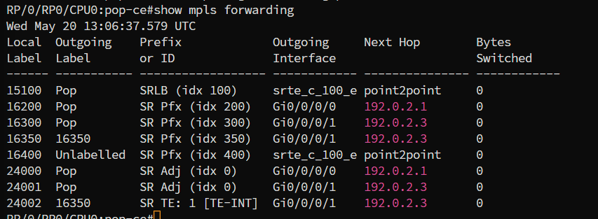
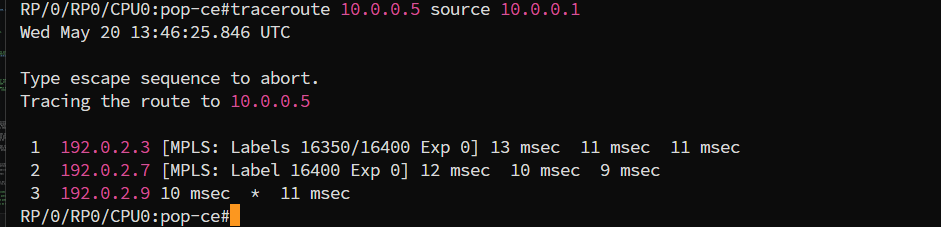

# SR-TE: Explicit Policy sobre a Rede Ipê

> Pré-requisitos: [conceitos de SR-TE](../../../../../docs/concepts/sr-mpls/sr-te.md), [base Cisco](../../00-base/) e [ambiente XRd](../../../setup.md).

## O que este lab demonstra

O caminho IGP entre Fortaleza (CE) e Rio de Janeiro (RJ) passa pelo hub em São Paulo (SP), custo 20, ~40ms de latência. Existe um caminho alternativo via Salvador (BA) e Belo Horizonte (MG), custo 38, ~26ms - mais longo em custo IGP, mais curto em latência real. O IGP nunca escolheria essa rota sozinho.

Uma SR Policy no PoP-CE força o tráfego sensível a latência (videoconferência, VoIP) por CE -> BA -> MG -> RJ via segment list explícita, enquanto o tráfego best-effort continua pelo caminho padrão CE -> SP -> RJ. Os dois caminhos coexistem: o IGP não é alterado, e apenas o headend (PoP-CE) carrega a policy.

> As métricas OSPF deste lab são deliberadamente opostas ao delay real (custo baixo no caminho de maior latência), para reproduzir de forma determinística um cenário onde o caminho de menor custo IGP não é o de menor latência - situação comum quando um hub tem capacidade/prioridade de roteamento mas não é o mais próximo fisicamente.

## Conceitos aplicados

- **Waypoint**: nó intermediário incluído explicitamente na segment list. Aqui, PoP-BA e PoP-MG.
- **DSCP EF / Color**: em produção a policy seria selecionada por Color BGP e o tráfego direcionado por marcação DSCP; este lab simplifica o steering via rota estática `sr-policy`.
- **SRGB compartilhado**: SRGB 16000-23999 em todos os PoPs. Label = `16000 + SID index`.

## Topologia


Caminho em destaque (CE -> BA -> MG -> RJ): forçado pela SR Policy. Caminho padrão (CE -> SP -> RJ): ativo para tráfego best-effort.

| PoP | Papel | Localização | Loopback0 | SID index | Label |
|---|---|---|---|---:|---:|
| PoP-CE | Headend | Fortaleza | 10.0.0.1/32 | 100 | 16100 |
| PoP-SP | Hub IGP | São Paulo | 10.0.0.2/32 | 200 | 16200 |
| PoP-BA | Waypoint 1 | Salvador | 10.0.0.3/32 | 300 | 16300 |
| PoP-MG | Waypoint 2 | Belo Horizonte | 10.0.0.4/32 | 350 | 16350 |
| PoP-RJ | Egress | Rio de Janeiro | 10.0.0.5/32 | 400 | 16400 |

| Enlace | IP A | IP B | Custo OSPF | Delay real (simulado) |
|---|---|---|---:|---:|
| CE <-> SP | 192.0.2.0/31 | 192.0.2.1/31 | 10 | ~30ms |
| CE <-> BA | 192.0.2.2/31 | 192.0.2.3/31 | 20 | ~8ms |
| SP <-> RJ | 192.0.2.4/31 | 192.0.2.5/31 | 10 | ~10ms |
| BA <-> MG | 192.0.2.6/31 | 192.0.2.7/31 | 8 | ~8ms |
| MG <-> RJ | 192.0.2.8/31 | 192.0.2.9/31 | 10 | ~10ms |

Caminho IGP (best-path): CE-SP-RJ, custo 20, ~40ms. Caminho SR-TE (forçado): CE-BA-MG-RJ, custo 38, ~26ms.

Os SID index saltam de 100 em 100 (100/200/300/350/400) de propósito - reserva faixa para SIDs por algoritmo (Flex-Algo) ou por serviço sem precisar renumerar os PoPs existentes.

## Deploy

```bash
git clone https://github.com/rnpbr/LabRedes-segmentrouting.git
cd LabRedes-segmentrouting
cd labs/cisco/sr-mpls/sr-te/explicit-policy
sudo clab deploy -t lab.clab.yml
```

Cinco nós pedem de 6 a 8 GB de RAM. Gerência de `172.20.20.11` a `172.20.20.15`, na ordem CE, SP, BA, MG, RJ.

A SR Policy está só em `configs/pop-ce.cfg`. Os outros PoPs sobem com a base SR-MPLS e as métricas ajustadas.

Acesso: `ssh clab@172.20.20.11`, senha `clab@123`. Ou `sudo docker exec -it clab-sr-te-explicit-policy-pop-ce /pkg/bin/xr_cli.sh`.


> A captura é de uma execução anterior, quando o arquivo se chamava `sr-te-rede-ipe.clab.yml`. Rede de gerência, nomes de nó e IPs são os mesmos.

```bash
# Derrubar o lab
sudo clab destroy -t lab.clab.yml --cleanup
```


## A policy, em detalhe

Trecho relevante de `configs/pop-ce.cfg` (o restante segue a [base SR-MPLS no IOS-XR](../../00-base/)):

```text
segment-routing
 traffic-eng
  segment-list SR-BEST-PATH
   index 10 mpls label 16300
   index 20 mpls label 16350
   index 30 mpls label 16400
  !
  policy LATENCIA-BAIXA
   color 100 end-point ipv4 10.0.0.5
   binding-sid mpls 15100
   candidate-paths
    preference 100
     explicit segment-list SR-BEST-PATH
!
router static
 address-family ipv4 unicast
  10.0.0.5/32 sr-policy srte_c_100_ep_10.0.0.5
```

A segment list `[16300, 16350, 16400]` é literalmente a sequência de Node-SIDs de BA, MG e RJ - o headend empilha os três, e cada nó intermediário faz pop do seu próprio label e encaminha nativamente para o próximo. A rota estática redireciona `10.0.0.5/32` (loopback de PoP-RJ) para a policy pelo nome gerado automaticamente pelo IOS-XR (`srte_c_<color>_ep_<endpoint>`).

## Verificação

Executar em PoP-CE.

**Adjacências OSPF**

```
show ospf neighbor
```


Esperado: PoP-SP e PoP-BA em `FULL`.

**Policy ativa**

```
show segment-routing traffic-eng policy color 100
```


Esperado: `Admin: up, Oper: up`, segment list `[16300, 16350, 16400]`.

**Forwarding**

```
show mpls forwarding
```



A entrada do label `16400` (PoP-RJ) aponta para `srte_c_100_e...` (a policy), não para PoP-SP como o IGP nativo escolheria - confirma que o steering está ativo.

**Caminho de dados**

```
traceroute 10.0.0.5 source 10.0.0.1
```



Esperado: caminho via PoP-BA e PoP-MG, nunca via PoP-SP. A rota estática já força `10.0.0.5/32` para a policy, então mesmo um traceroute IP comum reflete o caminho de TE.

`traceroute sr-mpls policy name` requer MPLS OAM completo, indisponível na imagem control-plane usada aqui - os comandos acima são o equivalente funcional para este lab.

## Referências

- [Panorama Rede Ipê](https://redeipe.rnp.br/panorama)
- [Containerlab - Cisco XRd kind](https://containerlab.dev/manual/kinds/xrd/)
- RFC 9256 - *Segment Routing Policy Architecture*: <https://datatracker.ietf.org/doc/html/rfc9256>
- [Cisco IOS-XR SR-TE Configuration Guide](https://www.cisco.com/c/en/us/td/docs/iosxr/cisco8000/segment-routing/710x/configuration/guide/b-segment-routing-cg-cisco8000-710x/configure-sr-te-policies.html)
- [Segment Routing Traffic Engineering Tutorial](https://www.segment-routing.net/tutorials/2017-03-06-segment-routing-traffic-engineering-srte/)
