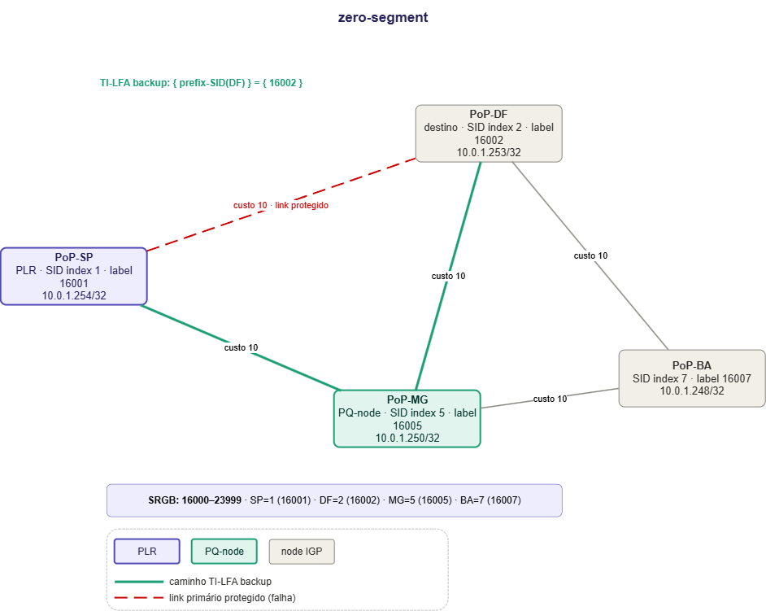
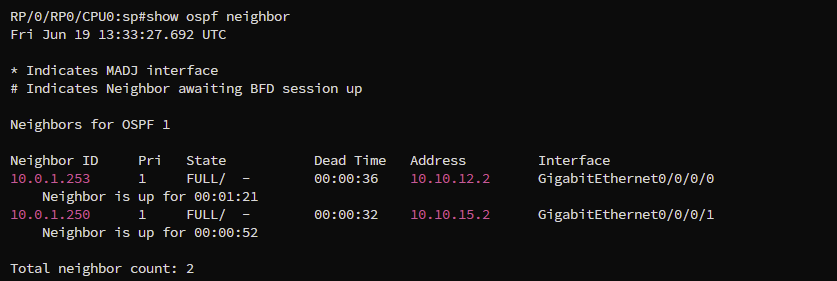
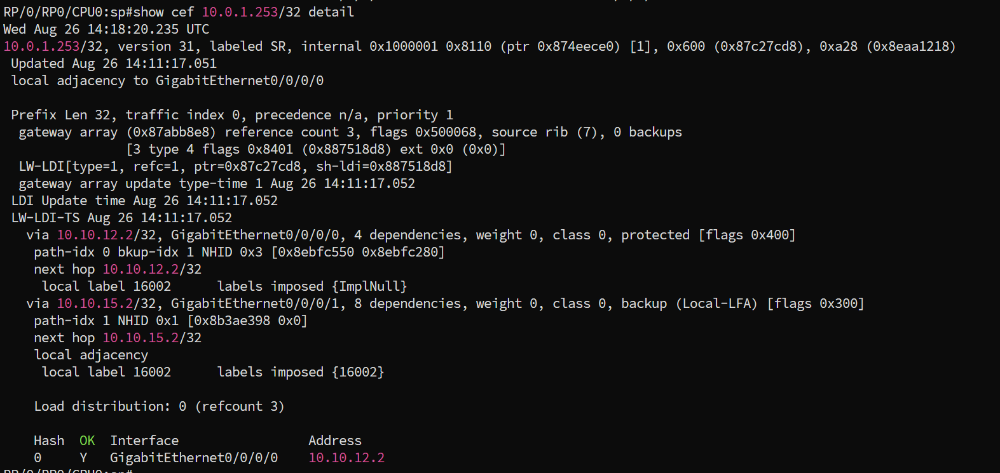
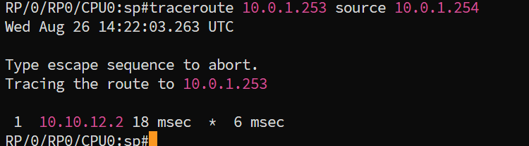
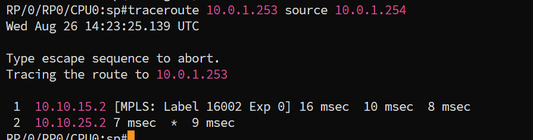

# TI-LFA Zero-Segment

## Contexto

> Pré-requisitos: [conceitos de TI-LFA](../../../../../docs/concepts/sr-mpls/ti-lfa.md), [base Cisco](../../00-base/) e [ambiente XRd](../../../setup.md).

Primeiro lab da trilha de TI-LFA. Mostra o caso mais simples de backup: o PQ-node é vizinho direto do PLR, então o PLR não precisa empilhar nenhum label além do label do destino.

Vale lembrar o essencial antes de seguir:

- **LFA** usa um vizinho como backup, desde que o caminho dele até o destino não volte pelo PLR. Nem sempre existe um vizinho assim.
- **rLFA** alcança um nó mais distante por um túnel LDP. Cobre mais casos, mas exige LDP.
- **TI-LFA** alcança o nó de reparo com uma pilha de labels SR. Sem LDP, sem estado nos nós do meio, e o caminho escolhido é o pós-convergência.

O número de labels extras define o cenário: zero, single ou double-segment. Este lab é o zero.

## Este lab

Lab de simulação do cenário Zero-Segment do TI-LFA sobre SR-MPLS com roteadores Cisco XRd via Containerlab. Quatro nós representando PoPs da Rede Ipê: SP como PLR, DF como destino, MG como PQ-node e BA como node de trânsito.

SP tem link direto com DF (link protegido) e com MG. MG conecta-se a SP, DF e BA. BA conecta-se a MG e DF. Não existe link direto entre SP e BA.

Quando o link SP-DF falha, os caminhos possíveis sem cruzar SP-DF são:

```
SP -> MG -> DF        custo 10 + 10 = 20
SP -> MG -> BA -> DF  custo 10 + 10 + 10 = 30
```

O TI-LFA calcula o P-space de SP sem o link SP-DF: MG é vizinho direto, BA é alcançável via MG. P-space = {MG, BA}. O Q-space de DF sem cruzar SP-DF: MG alcança DF diretamente, BA alcança DF diretamente. Q-space = {MG, BA}.

A interseção é {MG, BA}. BA não é vizinho direto do SP: chegar até ele já exigiria um segmento extra, o que tira BA da categoria zero-segment de saída. MG, por ser vizinho direto do SP e também estar no Q-space, é o PQ-node mais próximo possível: o TI-LFA não precisa empilhar nenhum label além do Node-SID do destino. MG é o PQ-node. Stack = `{ 16002 }`.

> Todos os links têm custo 10, incluindo SP-DF. Isso já basta para o SP-DF ser o caminho mais curto até DF (um salto, custo 10, contra dois saltos, custo 20, via MG), não é preciso mexer em custo nenhum para isso. O backup calculado pelo TI-LFA fica pré-instalado no CEF assim que o SPF converge, esteja o link protegido ativo ou não; é essa pré-instalação que permite a troca de caminho em milissegundos quando o link cai, sem esperar um novo SPF. A seção de Verificação mostra essa entrada de backup já presente com o link ainda no ar (passo 3) e a troca de caminho de fato acontecendo depois do shutdown (passo 4).
>
> Vale registrar: como o PQ-node aqui é vizinho direto tanto do PLR quanto do destino, a condição clássica de loop-free alternate já é satisfeita sozinha. O backup que aparece no CEF é do tipo Local-LFA, não uma pilha de labels TI-LFA: o Node-SID do DF (16002) só entra porque MG não é o destino final, então o pacote ainda precisa ser roteado por label até chegar lá. Uma pilha de TI-LFA de verdade (SID de nó + SID de adjacência) só aparece a partir do single-segment.

---

## Topologia



MG é vizinho direto de SP e alcança DF sem cruzar SP-DF, portanto MG é PQ-node. O caminho de backup em verde é SP -> MG -> DF com label `{ 16002 }` imposta pelo SP. O link SP-DF em vermelho tracejado é o link protegido.

---

## Endereçamento

| No | Loopback | SID index | Label | Mgmt |
|----|----------|-----------|-------|------|
| SP (PLR) | 10.0.1.254/32 | 1 | 16001 | 172.20.21.11 |
| DF (destino) | 10.0.1.253/32 | 2 | 16002 | 172.20.21.12 |
| MG (PQ-node) | 10.0.1.250/32 | 5 | 16005 | 172.20.21.15 |
| BA | 10.0.1.248/32 | 7 | 16007 | 172.20.21.17 |

O label de cada node é calculado como base do SRGB + SID index. Com SRGB 16000-23999 e SID index 2, o DF tem label 16002. Esse label tem significado global: qualquer roteador que receba um pacote com label 16002 encaminha para DF pelo seu caminho mais curto local.

| Link | Subnet | Custo |
|------|--------|-------|
| SP-DF | 10.10.12.0/30 | 10 |
| SP-MG | 10.10.15.0/30 | 10 |
| MG-DF | 10.10.25.0/30 | 10 |
| MG-BA | 10.10.57.0/30 | 10 |
| BA-DF | 10.10.27.0/30 | 10 |

---

## Deploy

```bash
git clone https://github.com/rnpbr/LabRedes-segmentrouting.git
cd LabRedes-segmentrouting
cd labs/cisco/sr-mpls/ti-lfa/00-zero-segment
sudo clab deploy -t lab.clab.yml
```

Quatro nós pedem cerca de 6 GB de RAM. O boot leva uns 5 minutos.

Acesso: `ssh clab@172.20.21.11`, senha `clab@123`. Ou `sudo docker exec -it clab-tilfa-zero-segment-sp /pkg/bin/xr_cli.sh`.

```bash
# Derrubar o lab
sudo clab destroy -t lab.clab.yml --cleanup
```

---

## Configurações

```
configs/
├── sp.cfg
├── df.cfg
├── mg.cfg
└── ba.cfg
```

Cada arquivo é um startup-config completo de IOS-XR, com o bloco base do Containerlab junto. Ver o [setup Cisco](../../../setup.md).

| Nó | Mgmt | Config |
|---|---|---|
| SP | `172.20.21.11` | `configs/sp.cfg` |
| DF | `172.20.21.12` | `configs/df.cfg` |
| MG | `172.20.21.15` | `configs/mg.cfg` |
| BA | `172.20.21.17` | `configs/ba.cfg` |

---

## Verificação

### 1. Vizinhanças OSPF

```
show ospf neighbor
```



O OSPF precisa ter adjacência com todos os vizinhos antes de qualquer coisa funcionar. Sem vizinhanças em estado FULL, o roteador não tem visibilidade completa da topologia e o TI-LFA não consegue calcular os backups.

O SP forma adjacência com dois vizinhos: DF via Gi0/0/0/0 (custo 10, link protegido, caminho primário) e MG via Gi0/0/0/1 (custo 10, caminho de backup). O estado `FULL/-` significa que a adjacência está completa e o banco de dados de topologia está sincronizado. O `-` indica ausência de eleição de DR/BDR porque as interfaces estão em modo `point-to-point`, correto para links entre dois roteadores.

O campo `Dead Time` conta regressivamente. Se chegar a zero sem receber um Hello do vizinho, o OSPF declara o vizinho inativo e inicia reconvergência. No TI-LFA, a detecção de falha via sinalização de hardware acontece em milissegundos, antes do Dead Time expirar.

---

### 2. Adjacency-SIDs e backups TI-LFA

```
show ospf segment-routing adjacency-sids
```


Este comando mostra os Adjacency-SIDs alocados dinamicamente pelo OSPF para cada enlace do SP e confirma que o TI-LFA calculou e instalou o backup para cada adjacência.

Um Adjacency-SID é um label que representa um link específico. Enquanto o Node-SID 16002 significa "encaminhe para DF pelo caminho mais curto", um Adjacency-SID significa "saia por este link específico". Isso é necessário nos cenários mais complexos de TI-LFA onde o backup precisa forçar um caminho que o IGP não escolheria naturalmente.

Cada enlace aparece em duas linhas. A primeira é o Adjacency-SID sem proteção (`U` = unprotected, `N` = no backup path). A segunda é o Adjacency-SID protegido (`P` = protected, `B` = has backup path) com o próximo salto e interface de backup calculados.

`24001 / 10.0.1.253 / Gi0/0/0/0 / D P B / backup: 10.10.15.2 / Gi0/0/0/1`: adj-SID protegido para o link SP-DF. Se esse link cair, o SP desvia via MG (10.10.15.2) pela Gi0/0/0/1.

`24003 / 10.0.1.250 / Gi0/0/0/1 / D P B / backup: 10.10.12.2 / Gi0/0/0/0`: adj-SID protegido para o link SP-MG. Se esse link cair, o backup vai pelo link SP-DF. Como os dois links têm o mesmo custo, essa proteção não depende de um caminho ser mais caro que o outro; é só uma alternativa loop-free válida para essa adjacência específica.

A presença de entradas com `P B` e backup nexthop preenchido confirma que o TI-LFA concluiu o cálculo e a proteção está ativa antes de qualquer falha.

---

### 3. CEF e a entrada de backup para o destino

O CEF (Cisco Express Forwarding) é a tabela de encaminhamento de alta velocidade do IOS-XR. Diferente da tabela de roteamento convencional processada pela CPU, o CEF é programado diretamente no hardware de encaminhamento. Quando um pacote chega, o hardware consulta o CEF e toma a decisão sem envolver a CPU, o que permite velocidades de linha e latências mínimas.

É no CEF que o backup do TI-LFA fica pré-instalado. Quando o link cai e o hardware detecta a falha, a comutação para o próximo salto de backup acontece consultando o CEF diretamente, sem processamento adicional. Isso é o que garante o sub-50ms.

```
show cef 10.0.1.253/32 detail
```



`10.0.1.253/32, labeled SR` confirma que a entrada é para o prefixo do DF tratado como SR.

`local adjacency to GigabitEthernet0/0/0/0` indica o próximo salto preferido no momento, DF direto via Gi0/0/0/0.

O bloco `via 10.10.12.2/32, GigabitEthernet0/0/0/0`: caminho primário, direto para DF, marcado como `protected`. `labels imposed {ImplNull}` indica PHP (Penultimate Hop Popping): sem label, porque DF é vizinho direto.

O bloco `via 10.10.15.2/32, GigabitEthernet0/0/0/1`: caminho via MG, marcado como `backup (Local-LFA)`. `labels imposed {16002}` é a SID-list imposta: como MG não é o destino final, o pacote precisa do Node-SID do DF para ser encaminhado depois de chegar lá. Isso caracteriza o Zero-Segment: um único label, sem segmento extra.

A tabela de distribuição ao final mostra o tráfego concentrado em Gi0/0/0/0 (DF direto), com Gi0/0/0/1 (MG) como backup instalado.

---

### 4. Simulação de falha

Antes de mexer em qualquer coisa, o caminho para DF já passa direto pela Gi0/0/0/0:

```
traceroute 10.0.1.253 source 10.0.1.254
```



Um salto só, sem label MPLS. O pacote sai como IP puro porque o próximo salto já é o próprio destino (PHP).

Derrubar o link SP-DF:

```
conf t
interface GigabitEthernet0/0/0/0
 shutdown
commit
end
```

Verificar o caminho depois da falha:

```
traceroute 10.0.1.253 source 10.0.1.254
```


`1  10.10.15.2 [MPLS: Label 16002 Exp 0]`: primeiro salto, MG (10.10.15.2). O campo `[MPLS: Label 16002]` confirma que o label está presente no pacote neste ponto. `Exp 0` é o campo de QoS do cabeçalho MPLS, sem uso aqui.

`2  10.10.25.2`: segundo salto, DF (10.10.25.2). MG encaminha diretamente para DF pelo link MG-DF. DF faz pop do label e entrega o pacote. O `*` indica que uma das três sondas não respondeu, comportamento normal no XRd.

Antes da falha, um salto sem label. Depois, dois saltos com o label `{ 16002 }` saindo do SP e presente até MG. A diferença entre os dois traceroutes é a prova de que o caminho mudou de verdade, e não só de que ele já era esse desde o início. MG consulta a LFIB local, vê que 16002 aponta para DF e encaminha sem nenhuma instrução adicional. Nenhum roteador intermediário sabe que houve uma falha. Toda a decisão de caminho está no PLR. Os intermediários são stateless.
