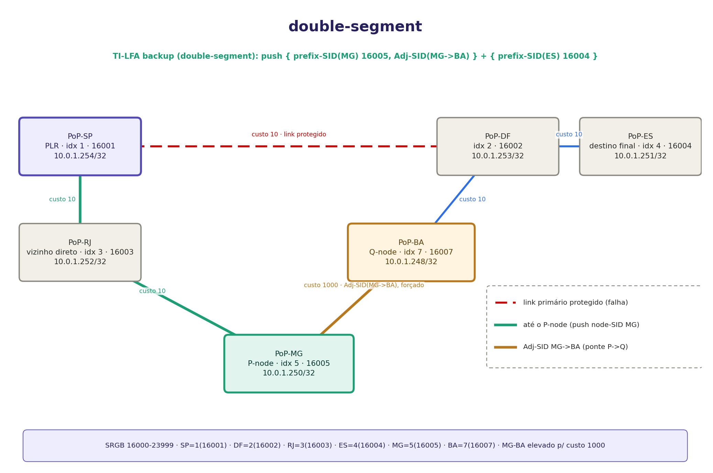
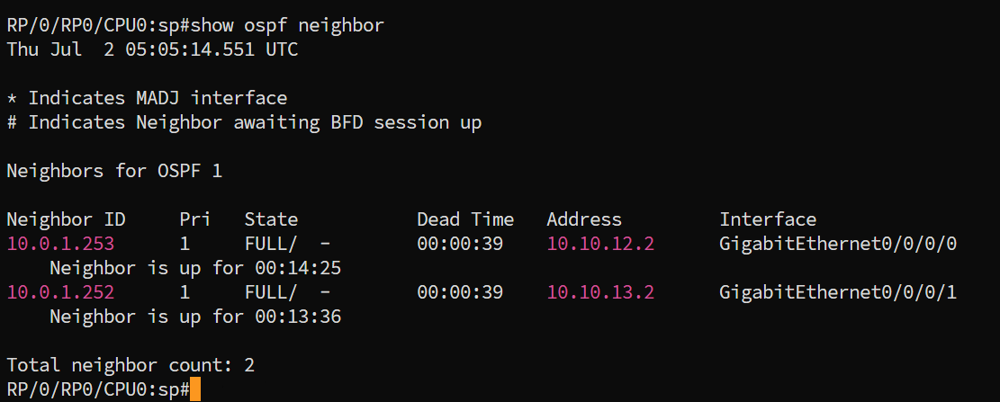
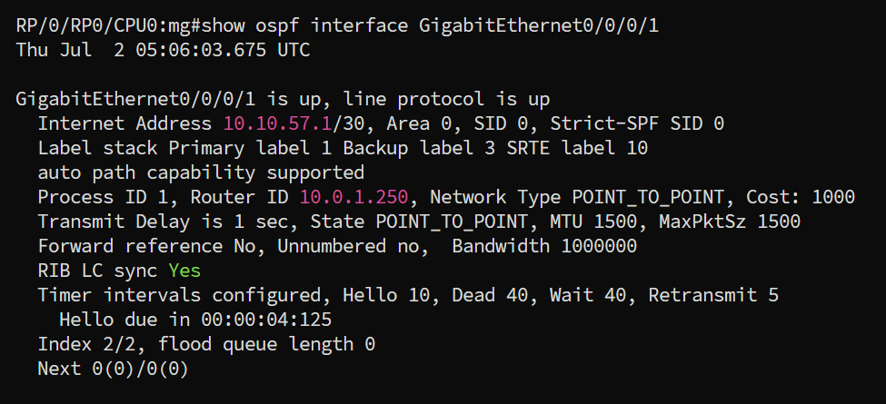
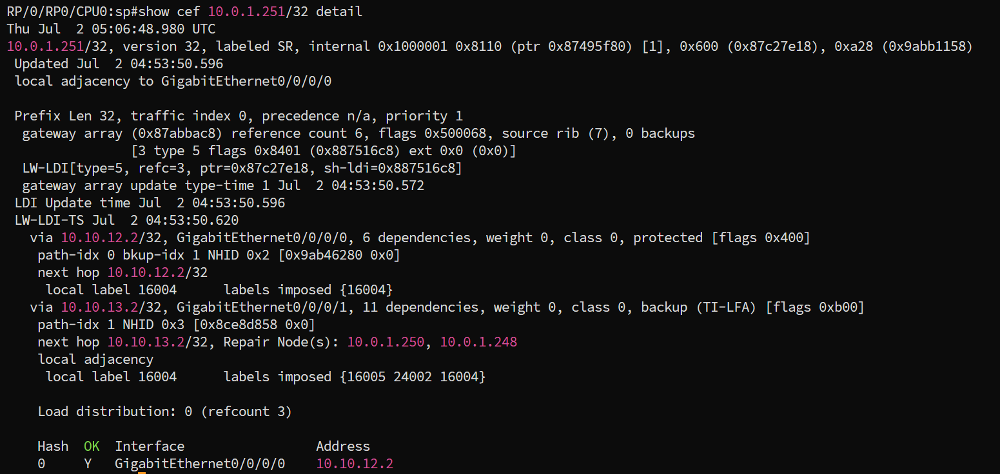
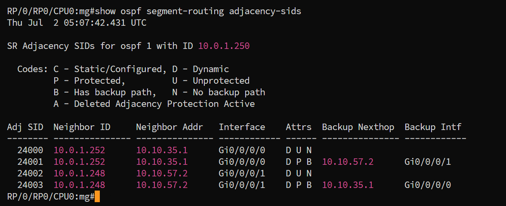

# TI-LFA Double-Segment

## Contexto

Continuação direta do [single-segment](../01-single-segment/): mesma rede, mesmos seis PoPs, mesmo PLR (SP) protegendo o mesmo link (SP-DF) para o mesmo destino final (ES). A única mudança é um único parâmetro: o custo do enlace MG-BA sobe de `10` para `1000`.

Essa mudança é suficiente para quebrar a interseção entre P-space e Q-space que existia no single-segment. Quando isso acontece, não existe mais um único PQ-node. O backup precisa "costurar" um nó do P-space a um nó do Q-space usando um enlace explícito entre os dois, endereçado por um **Adjacency-SID**. Dois labels adicionais em vez de um: por isso *double*-segment.

---

## Este lab

Mesma topologia física do single-segment. SP tem dois links, um direto para DF (o protegido) e um para RJ. A partir de RJ existe um caminho de volta até DF passando por MG e BA. ES está pendurado atrás de DF, com um único link. Adjacências: `SP<->DF` (protegido), `SP<->RJ`, `RJ<->MG`, `MG<->BA`, `BA<->DF`, `DF<->ES`.

Muda só um número: o enlace MG-BA sobe de custo 10 para **1000**. Todos os demais enlaces, incluindo o link protegido SP-DF, seguem custo 10.

### Por que o double-segment aparece

Refazendo o cálculo de P-space (estendido, via o vizinho RJ) e Q-space com o novo custo:

**P-space estendido(SP, SP-DF)**, nós cujo caminho mais curto, a partir de SP ou de RJ, não usa o link protegido:

| Nó | Caminho mais curto | No P-space? |
|---|---|:-:|
| RJ | `SP-RJ` (10) | **sim** (direto) |
| MG | `SP-RJ-MG` (20) | **sim** (direto) |
| BA | de SP: `SP-DF-BA` (20, usa o link protegido). De RJ: `RJ-SP-DF-BA` (30, usa o link) contra `RJ-MG-BA` (1010) | **não**, o caminho mais curto de RJ até BA também acaba usando o link protegido, já que `RJ-MG-BA` ficou caro demais com o novo custo |

**Q-space(ES, SP-DF)**, aqui o custo 1000 em MG-BA muda tudo:

| Nó | Caminho mais curto até ES | Usa SP-DF? | No Q-space? |
|---|---|:-:|:-:|
| BA | `BA-DF-ES` (20) | não | **sim** |
| MG | `MG-BA-DF-ES` (1020) contra `MG-RJ-SP-DF-ES` (40, usa o link protegido) | o mais barato usa o link protegido | **não** |
| RJ | `RJ-SP-DF-ES` (30, usa o link protegido) | sim | não |

Com MG-BA custando 1000, o caminho de MG até ES que evita o link protegido (`MG-BA-DF-ES`, custo 1020) deixou de ser competitivo: o caminho mais curto real de MG passa a ser via SP, isto é, via o próprio link que caiu. MG sai do Q-space.

O mesmo enlace caro derruba BA do P-space estendido, só que pelo lado oposto do cálculo. Do ponto de vista de RJ, alcançar BA por `RJ-MG-BA` custa 1010, então o caminho mais curto de RJ até BA volta a ser via SP e o link protegido.

**P-space ∩ Q-space = ∅.** P-space estendido = `{RJ, MG}`, Q-space = `{BA}`, nenhum nó comum aos dois. Mas MG é vizinho físico direto de BA, e essa adjacência é o que permite ao TI-LFA ainda calcular um backup, pulando de P-space para Q-space por um enlace específico em vez de por caminho mais curto. Diferente do single-segment, aqui só existe um candidato possível de cada lado (MG do P-space, BA do Q-space), sem ambiguidade.

Backup calculado: `push { prefix-SID(MG) 16005, Adj-SID(MG->BA) }` abaixo do `prefix-SID(ES) 16004`. O Adj-SID força a travessia do enlace MG-BA especificamente, ignorando seu custo IGP de 1000, porque Adj-SID não é uma instrução de "caminho mais curto", é uma instrução de "saia exatamente por este enlace".

---

## Topologia



MG (verde, **P-node**) é o nó mais distante do P-space que o TI-LFA consegue alcançar de forma barata. BA (âmbar, **Q-node**) é o nó do Q-space adjacente a ele. O enlace entre os dois (dourado, rotulado com o Adj-SID forçado) é fisicamente o mesmo MG-BA de sempre, só que agora o SR o atravessa por indicação explícita, não por ser o caminho mais barato.

---

## Endereçamento

Idêntico ao single-segment, com uma exceção:

| PoP | Papel | Loopback0 | SID index | Label | Mgmt |
|---|---|---|---:|---:|---|
| SP | PLR | `10.0.1.254/32` | 1 | 16001 | 172.20.23.11 |
| DF | trânsito | `10.0.1.253/32` | 2 | 16002 | 172.20.23.12 |
| RJ | P-space (vizinho direto) | `10.0.1.252/32` | 3 | 16003 | 172.20.23.13 |
| ES | destino final | `10.0.1.251/32` | 4 | 16004 | 172.20.23.14 |
| MG | **P-node** | `10.0.1.250/32` | 5 | 16005 | 172.20.23.15 |
| BA | **Q-node** | `10.0.1.248/32` | 7 | 16007 | 172.20.23.17 |

| Link | Subnet | Custo |
|---|---|---:|
| SP-DF (protegido) | 10.10.12.0/30 | 10 |
| SP-RJ | 10.10.13.0/30 | 10 |
| RJ-MG | 10.10.35.0/30 | 10 |
| **MG-BA** | 10.10.57.0/30 | **1000** |
| BA-DF | 10.10.27.0/30 | 10 |
| DF-ES | 10.10.24.0/30 | 10 |

O mgmt subnet muda para `172.20.23.0/24` para permitir rodar este lab em paralelo ao single-segment sem colisão de rede de gerência.

---

## Deploy

```bash
git clone https://github.com/rnpbr/LabRedes-segmentrouting.git
cd LabRedes-segmentrouting
cd labs/cisco/sr-mpls/ti-lfa/02-double-segment
sudo clab deploy -t lab.clab.yml
```

Seis nós, de 10 a 12 GB de RAM. A rede de gerência é `172.20.23.0/24`, diferente da do single-segment, então os dois labs rodam juntos no mesmo host.

Acesso: `ssh clab@172.20.23.11`, senha `clab@123`. Ou `sudo docker exec -it clab-tilfa-double-segment-sp /pkg/bin/xr_cli.sh`.


```bash
# Derrubar o lab
sudo clab destroy -t lab.clab.yml --cleanup
```

---

## Verificação

### 1. Adjacências OSPF

**Em SP:**

```
show ospf neighbor
```



Igual ao single-segment. SP deve ter exatamente dois vizinhos, DF e RJ, ambos `FULL/-`. A interface MG-BA continua formando adjacência normalmente: custo alto não impede a adjacência OSPF, apenas torna o enlace pouco atrativo para SPF.

### 2. Confirmar o custo elevado

Em MG, na interface do enlace MG-BA:

```
show ospf interface GigabitEthernet0/0/0/1
```



Esperado: `Cost: 1000`.

### 3. Backup TI-LFA para ES

**Em SP:**

```
show cef 10.0.1.251/32 detail
```



O campo `labels imposed` na entrada de backup deve mostrar **três** labels. Na execução capturada acima:

```text
via 10.10.13.2/32, GigabitEthernet0/0/0/1, ..., backup (TI-LFA)
  next hop 10.10.13.2/32, Repair Node(s): 10.0.1.250, 10.0.1.248
  local label 16004   labels imposed {16005 24002 16004}
```

`16005` é o prefix-SID de MG, `24002` é um Adjacency-SID dinâmico representando o enlace MG para BA, e `16004` é o prefix-SID de ES. O Adj-SID sai da faixa acima de `24000` porque este projeto não configura `local-block` separado, então o valor exato pode variar entre execuções.

Repare no campo `Repair Node(s)`: aqui ele lista **dois** nós, `10.0.1.250` (MG) e `10.0.1.248` (BA). É a diferença mais direta em relação ao single-segment, onde a mesma linha traz um nó só.

**Em MG**, para identificar exatamente qual Adjacency-SID é esse:

```
show ospf segment-routing adjacency-sids
```



Esperado: linhas com `Neighbor ID 10.0.1.248` (BA) na `Interface Gi0/0/0/1`. Na captura acima:

```text
24002  10.0.1.248  10.10.57.2  Gi0/0/0/1  D U N
24003  10.0.1.248  10.10.57.2  Gi0/0/0/1  D P B  10.10.35.1  Gi0/0/0/0
```

Aparecem duas entradas para o mesmo vizinho: uma desprotegida (`U N`, unprotected / no backup path) e uma protegida com backup (`P B`, protected / has backup path). O `24002` da primeira linha é exatamente o label do meio da pilha vista no `show cef` de SP.

O TI-LFA usa a entrada **desprotegida**, e não a protegida. O motivo é que o pacote que carrega essa pilha já está trafegando por um caminho de reparo. Proteger o segmento de reparo com um segundo backup criaria recursão: um desvio dentro do desvio, com risco de loop e sem garantia de convergência. O Adj-SID desprotegido diz apenas "saia por este enlace", sem plano alternativo, que é exatamente o que o cálculo de reparo precisa.

Isso fecha a prova: o segmento do meio do backup é a adjacência MG para BA, e não um caminho calculado por custo.

### 4. Diferença de comportamento vs. single-segment

Compare com o `show cef` do single-segment, rodado em SP também:

| | single-segment | double-segment |
|---|---|---|
| Labels impostos | `{16007, 16004}` (2) | `{16005, 24002, 16004}` (3) |
| `Repair Node(s)` | `10.0.1.248` (só BA) | `10.0.1.250, 10.0.1.248` (MG e BA) |
| Nó intermediário participa como | PQ-node (P∩Q) | P-node apenas, precisa do Adj-SID pra alcançar o Q-node |
| Enlace até o Q-node | usado por custo (parte do caminho nativo) | usado por Adj-SID (custo do enlace irrelevante) |

---

## Quando isso acontece na prática

Em produção, um custo de 1000 artificial não é o gatilho real. A situação double-segment aparece organicamente em topologias com poucos caminhos alternativos entre certas regiões da rede: anéis metropolitanos, redes regionais com poucos backbones de trânsito, ou domínios onde uma falha anterior já consumiu o caminho alternativo mais óbvio e sobrou apenas uma rota cara.

O padrão comum a esses casos é sempre o mesmo. O caminho de reparo existe fisicamente, mas o custo IGP de algum trecho dele é alto o suficiente para que nenhum nó o escolha por SPF. Sem o Adj-SID, o TI-LFA não teria como costurar P-space e Q-space, porque tudo o que o prefix-SID sabe dizer é "vá pelo caminho mais curto", e o caminho mais curto é justamente o que não serve.

Vale notar também que o custo alto não é o único gatilho possível. Afinidades de link, restrições de Flex-Algo e enlaces com atributos administrativos que os excluam do SPF produzem o mesmo efeito: um enlace que existe, forma adjacência e encaminha normalmente, mas que o cálculo de caminho mais curto nunca elege. O Adj-SID é o que dá acesso a ele.

O próximo cenário da trilha, [`node-srlg-protection`](../03-node-srlg-protection/), muda a pergunta: em vez de "como alcançar o Q-space", passa a ser "entre vários backups válidos, qual deles protege de verdade".
