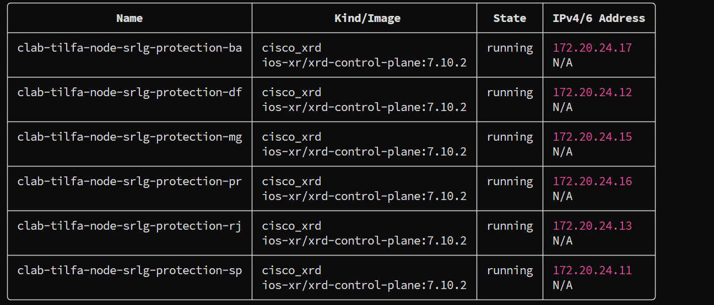
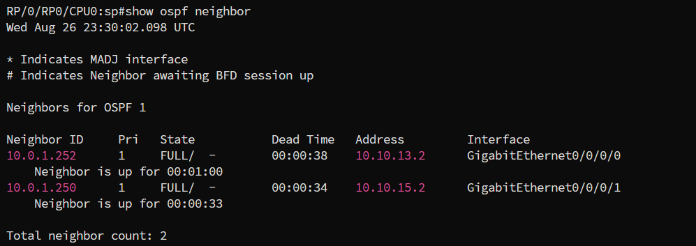
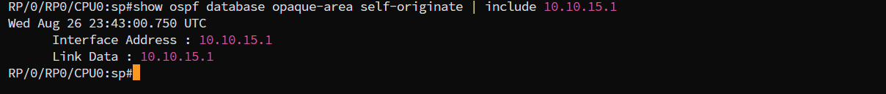
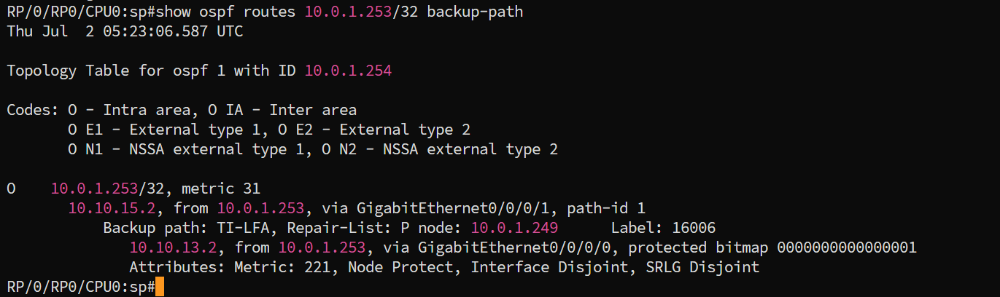
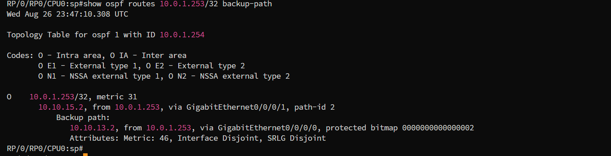
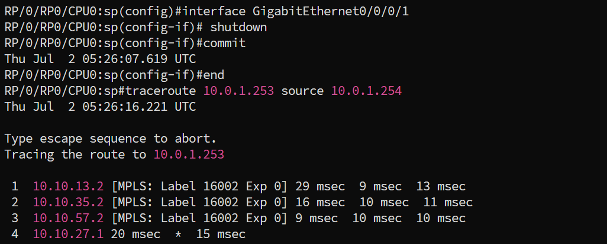
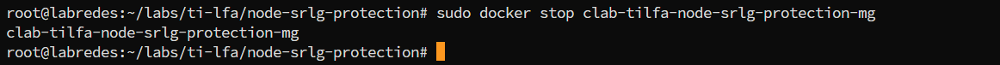
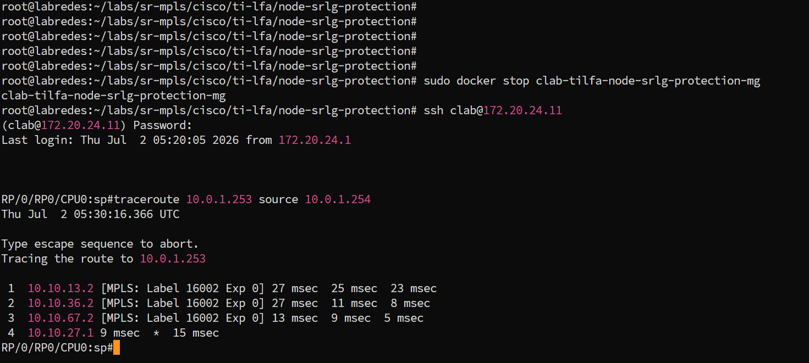

# TI-LFA Node and SRLG (Shared Risk Link Group) Protection

## Contexto

Os labs anteriores (Zero/Single/Double-Segment) tratam todos do mesmo tipo de falha: **queda de um link**. TI-LFA calcula, por padrão, um backup que só garante desviar daquele link específico. Se o problema real for o **nó** do outro lado caindo por completo, ou se o próprio backup escolhido compartilhar risco físico com o link original (mesma rota de fibra, mesmo duto, mesmo cartão), a proteção de link sozinha não é suficiente.

Este lab configura os dois níveis adicionais de proteção que o TI-LFA oferece a partir do IOS-XR 6.1.1: **node protection** (o backup contorna o nó inteiro, não só o link até ele) e **local SRLG protection** (o backup evita enlaces que compartilham grupo de risco com o enlace protegido). Leia os [conceitos de TI-LFA](../../../../../docs/concepts/sr-mpls/ti-lfa.md) antes de seguir.

---

## Este lab

Topologia com seis PoPs: uma cadeia primária de três saltos (SP -> MG -> BA -> DF) e uma ponte alta de dois PoPs adicionais (RJ, PR) que oferece rotas alternativas de qualidades diferentes.

SP é o PLR e protege o enlace SP-MG. O interesse deste lab não é só esse link: é o que acontece quando o **nó MG inteiro** cai, e quando o backup escolhido por padrão acaba compartilhando infraestrutura física com o próprio recurso que deveria proteger.

### O atalho armadilha: RJ-MG

Além da cadeia principal e da ponte alta, existe um enlace direto RJ-MG, custo 15, mais barato que qualquer alternativa via PR. Esse enlace **compartilha a mesma canaleta física** do link SP-MG (ambos saem da região de SP em direção a MG pela mesma rota de fibra), daí o nome do grupo SRLG usado neste lab, `ipe-mg-duct`.

Sem nenhuma configuração de tiebreaker, o TI-LFA em SP escolhe o backup mais barato que for loop-free, e `SP -> RJ -> MG` (custo 10+15=25) vence facilmente. Para efeito de comparação, o caminho que contorna MG por completo (`SP -> RJ -> PR -> BA`) custa 210, oito vezes mais caro. Esse backup pelo atalho:

- protege corretamente contra a queda do **link** SP-MG (é um caminho fisicamente distinto até MG);
- **não** protege contra a queda do **nó** MG (o backup termina exatamente em MG);
- **não** protege contra uma falha de **SRLG** que derrube tanto SP-MG quanto RJ-MG ao mesmo tempo (ambos passam pela mesma canaleta), embora, como o passo 3 da verificação mostra, o atributo `SRLG Disjoint` reportado pelo IOS-XR não capture isso de forma limpa neste caso específico.

### A alternativa segura: SP -> RJ -> PR -> BA

Existe um caminho que resolve os dois problemas ao mesmo tempo: `SP -> RJ -> PR -> BA` (custo 10+100+100=210), que contorna MG por completo e não toca em nenhum enlace do grupo `ipe-mg-duct`. É mais caro que o atalho RJ-MG, então só é escolhido se o TI-LFA for instruído a preferir proteção de nó sobre custo bruto, exatamente o papel dos **tiebreakers**.

---

## Configuração dos tiebreakers

Aplicada em todas as interfaces de core de todos os nós (política uniforme, como seria em produção):

```text
router ospf 1
 area 0
  interface GigabitEthernet0/0/0/X
   fast-reroute per-prefix
   fast-reroute per-prefix ti-lfa enable
   fast-reroute per-prefix tiebreaker node-protecting index 200
   fast-reroute per-prefix tiebreaker srlg-disjoint index 100
```

Índice maior significa maior preferência. Aqui `node-protecting` (200) é preferido sobre `srlg-disjoint` (100) quando as duas propriedades não puderem ser satisfeitas pelo mesmo caminho.

## Declaração do grupo SRLG

SRLG (Shared Risk Link Group) é um atributo de enlace, declarado localmente em cada roteador dono de uma ponta:

```text
srlg
 interface GigabitEthernet0/0/0/X
  name ipe-mg-duct
 !
 name ipe-mg-duct value 100
!
```

Neste lab, `ipe-mg-duct` é declarado em quatro interfaces: as duas pontas do link protegido SP-MG (em SP e em MG) e as duas pontas do atalho RJ-MG (em RJ e em MG). MG participa de dois links do grupo, então aparece duas vezes: uma para a interface que dá em SP, outra para a que dá em RJ. Ver `configs/sp.cfg`, `configs/mg.cfg` e `configs/rj.cfg` para o bloco completo.

---

## Topologia


Em vermelho, o enlace/nó sob teste (SP-MG). Em dourado tracejado, as duas alternativas que existem fisicamente mas são descartadas pelo tiebreaker: o atalho RJ-MG (barato, mas SRLG-compartilhado) e o enlace PR-MG (contorna o link, mas não o nó MG). Em verde, o backup realmente instalado quando os tiebreakers estão ativos: `SP -> RJ -> PR -> BA`, que contorna MG inteiro e não toca a SRLG `ipe-mg-duct`.

---

## Endereçamento

| PoP | Papel | Loopback0 | SID index | Label | Mgmt |
|---|---|---|---:|---:|---|
| SP | PLR | `10.0.1.254/32` | 1 | 16001 | 172.20.24.11 |
| DF | destino final | `10.0.1.253/32` | 2 | 16002 | 172.20.24.12 |
| RJ | ponte (P-space) | `10.0.1.252/32` | 3 | 16003 | 172.20.24.13 |
| MG | **nó sob proteção** | `10.0.1.250/32` | 5 | 16005 | 172.20.24.15 |
| PR | waypoint node+SRLG-safe | `10.0.1.249/32` | 6 | 16006 | 172.20.24.16 |
| BA | trânsito / Q-side | `10.0.1.248/32` | 7 | 16007 | 172.20.24.17 |

| Link | Subnet | Custo | SRLG |
|---|---|---:|---|
| SP-MG (protegido) | 10.10.15.0/30 | 10 | `ipe-mg-duct` |
| MG-BA | 10.10.57.0/30 | 10 | - |
| BA-DF | 10.10.27.0/30 | 10 | - |
| SP-RJ | 10.10.13.0/30 | 10 | - |
| RJ-PR | 10.10.36.0/30 | 100 | - |
| PR-MG | 10.10.56.0/30 | 100 | - |
| PR-BA | 10.10.67.0/30 | 100 | - |
| RJ-MG (atalho) | 10.10.35.0/30 | 15 | `ipe-mg-duct` |

---

## Deploy

```bash
git clone https://github.com/rnpbr/LabRedes-segmentrouting.git
cd LabRedes-segmentrouting
cd labs/cisco/sr-mpls/ti-lfa/03-node-srlg-protection
sudo clab deploy -t lab.clab.yml
```

Seis nós e oito enlaces, de 10 a 12 GB de RAM.

Acesso: `ssh clab@172.20.24.11`, senha `clab@123`. Ou `sudo docker exec -it clab-tilfa-node-srlg-protection-sp /pkg/bin/xr_cli.sh`.



```bash
# Derrubar o lab
sudo clab destroy -t lab.clab.yml --cleanup
```

---

## Verificação

### 1. Adjacências e SRLG anunciada

```
show ospf neighbor

show ospf database opaque-area self-originate
```



Em SP, procurar pela LSA da interface `10.10.15.1` (SP->MG): deve conter um bloco `GMPLS Shared Risked Link Group` com `[1]: 100`. Sim, "Risked", não "Risk": é a grafia real do IOS-XR nessa saída, não erro de digitação deste projeto. Confirma que o grupo `ipe-mg-duct` está sendo distribuído via IGP, não só configurado localmente.

Duas pegadinhas neste passo:

A LSA do SP-MG pode demorar alguns segundos a mais para aparecer que a do SP-RJ. Se o dump vier incompleto, ou faltando a entrada de `10.0.1.250`, espere um pouco e rode o comando de novo.

O nome do grupo (`ipe-mg-duct`) nunca é anunciado pelo OSPF, só o valor numérico (`100`). É um rótulo local de configuração, não um atributo distribuído pela rede. Filtrar por `include ipe-mg-duct` não retorna nada em nenhum roteador, porque essa string não existe fora do `running-config` de quem configurou o link. Filtrar por `include SRLG` também não ajuda aqui: a frase "Number of SRLGs" aparece duas vezes para o mesmo link (uma no formato antigo de LSA, outra no formato novo usado por Segment Routing), sem nenhum contexto ao redor que diga a qual link pertence. Use o IP da interface em vez disso:

```
show ospf database opaque-area self-originate | include 10.10.15.1
```



### 2. Backup instalado com os tiebreakers ativos

Em SP:

```
show ospf routes 10.0.1.253/32 backup-path
```

Esperado:



`P node: 10.0.1.249` é PR, exatamente o waypoint esperado, não MG nem o atalho. `Node Protect` na lista de atributos confirma que o backup contorna o nó inteiro, não só o link.

### 3. Comparando com e sem tiebreaker

Para ver a diferença concretamente, remova temporariamente as duas linhas de tiebreaker da interface SP->MG:

```
conf t
router ospf 1
 area 0
  interface GigabitEthernet0/0/0/1
   no fast-reroute per-prefix tiebreaker node-protecting index 200
   no fast-reroute per-prefix tiebreaker srlg-disjoint index 100
commit
```

Saia do modo de configuração antes do próximo comando (`end`, ou prefixe o show com `do` se quiser rodar direto do modo de configuração). Repita o `show ospf routes 10.0.1.253/32 backup-path`. Esperado agora:



A diferença não é só de custo. SP só tem um vizinho físico alternativo, RJ, então o próximo salto nunca muda, com ou sem tiebreaker. O que muda é o mecanismo por trás desse salto.

Com o tiebreaker, SP impõe o label de PR (`16006`) e força RJ a desviar do próprio caminho nativo dele, entregando o pacote a um repair path calculado explicitamente. É TI-LFA remoto de verdade, por isso a `Repair-List` aparece preenchida.

Sem o tiebreaker, SP não impõe nenhum label. RJ recebe o pacote e decide sozinho por onde mandar, usando o próprio caminho mais curto dele até DF, que é justamente o atalho RJ-MG. Isso é LFA clássico, não TI-LFA: por isso a `Repair-List` fica vazia e `Node Protect` desaparece.

`SRLG Disjoint` continua aparecendo mesmo aqui, sem o tiebreaker configurado. Esse atributo parece ser calculado sobre o par local de interfaces do próprio SP (a protegida contra a de backup), não sobre a SRLG do caminho inteiro até o destino. Por isso ele não captura sozinho que o atalho RJ-MG, mais à frente, reusa a mesma canaleta física do link protegido. `Node Protect` é o atributo que de fato prova a diferença neste teste. `SRLG Disjoint` não é confiável como prova isolada nesse formato de saída.

Reaplique as duas linhas antes de continuar:

```
conf t
router ospf 1
 area 0
  interface GigabitEthernet0/0/0/1
   fast-reroute per-prefix tiebreaker node-protecting index 200
   fast-reroute per-prefix tiebreaker srlg-disjoint index 100
commit
```

### 4. Simulação: falha apenas do link SP-MG

```
conf t
interface GigabitEthernet0/0/0/1
 shutdown
commit
end
```

```
traceroute 10.0.1.253 source 10.0.1.254
```



Atenção ao timing. Se o traceroute rodar alguns segundos depois do shutdown, a rede já reconvergiu de verdade, e nesse caso o caminho novo tende a reusar o atalho RJ-MG (custo mais barato), não passar por PR:

```text
1  10.10.13.2   (RJ)
2  10.10.35.2   (MG)
3  10.10.57.2   (BA)
4  10.10.27.1   (DF)
```

Isso não é falha do lab, é esperado. MG continua vivo (só o *link* SP-MG caiu), então uma vez reconvergida, a rede não tem motivo pra evitar MG. O tiebreaker de node-protection só controla o **backup pré-instalado**, ativo apenas na janela entre a falha e a reconvergência completa, não a rota nova depois que tudo se acomoda. A prova de que a proteção de nó funcionou já está no passo 2, capturada com o link ainda ativo.

Religue antes do próximo passo:

```
conf t
interface GigabitEthernet0/0/0/1
 no shutdown
commit
end
```

### 5. Simulação: falha do nó MG inteiro

Aqui sim, derrubando o nó inteiro (não só uma interface), MG deixa de existir como opção, e o caminho reconvergido é forçado a passar por PR de verdade:

```bash
sudo docker stop clab-tilfa-node-srlg-protection-mg
```



Em SP:

```
traceroute 10.0.1.253 source 10.0.1.254
```



Esperado:

```text
1  10.10.13.2   (RJ)
2  10.10.36.2   (PR)
3  10.10.67.2   (BA)
4  10.10.27.1   (DF)
```

Diferente do passo 4: aqui não existe alternativa mais barata que reuse MG, porque MG não existe mais. O caminho por PR é o único disponível, então esse teste isola de forma limpa o que a proteção de nó realmente resolve, uma falha onde o nó protegido simplesmente não está mais lá para ser reusado.

Religue o nó depois:

```bash
sudo docker start clab-tilfa-node-srlg-protection-mg
```

---

## Node xor SRLG: quando as duas propriedades entram em conflito

Este lab foi desenhado para que **um único caminho** (`SP-RJ-PR-BA`) satisfaça node protection e SRLG protection ao mesmo tempo, o caso mais comum na prática. Mas as duas propriedades nem sempre coincidem: é possível existir um caminho que contorna o nó protegido mas ainda usa um link da mesma SRLG, e outro caminho que evita a SRLG mas ainda atravessa o nó protegido. Quando isso acontece e nenhum caminho único satisfaz as duas propriedades, o `node-protecting index` e o `srlg-disjoint index` decidem qual delas prevalece: o maior índice vence. Vale revisitar a configuração acima e considerar: se o índice de `srlg-disjoint` fosse maior que o de `node-protecting`, qual das duas propriedades este domínio passaria a priorizar em um cenário de conflito?
