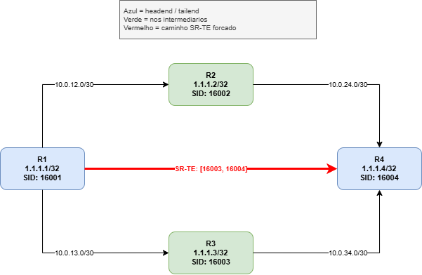

> Uso interno — material em desenvolvimento.


# Lab 01 | SR-TE 

## O que é

Segment Routing Traffic Engineering (SR-TE) é a evolução do RSVP-TE. Em vez de sinalizar um caminho hop-by-hop pela rede e manter estado em cada nó intermediário, o SR-TE codifica o caminho diretamente no cabeçalho do pacote como um stack de labels MPLS.

O resultado é uma rede stateless: apenas o node de entrada (headend) precisa ser configurado.

Nenhum roteador intermediário sabe que o caminho existe.

## O que este lab cobre

- Configuração base de SR-MPLS com OSPF
- Criação de SR Policy com Segment List explícita
- Binding-SID como representação abstrata da policy
- Diferença entre caminho IGP (ECMP) e caminho forçado via SR-TE
- Steering de tráfego via rota estática apontando para a SR Policy
- Validação do caminho via traceroute MPLS

## Objetivos

1. Configurar SR-MPLS com OSPF em IOS-XR
2. Criar uma SR Policy com caminho explícito via Segment List
3. Verificar o estado da policy e o Binding-SID na LFIB
4. Direcionar tráfego para a policy e validar o caminho efetivo
5. Compreender a diferença entre o encaminhamento IGP e o encaminhamento SR-TE

## Topologia


| Node | Loopback0  | Prefix-SID | Label |
|------|------------|------------|-------|
| R1   | 1.1.1.1/32 | index 1    | 16001 |
| R2   | 1.1.1.2/32 | index 2    | 16002 |
| R3   | 1.1.1.3/32 | index 3    | 16003 |
| R4   | 1.1.1.4/32 | index 4    | 16004 |

O OSPF elege ECMP (Equal-Cost Multi-Path) entre R2 e R3 para alcançar R4. A SR Policy força 100% do tráfego pelo caminho R1 → R3 → R4, ignorando o ECMP do IGP.

---
## Deploy

##### Pre-requisitos
Siga os passos do arquivo `labs-cisco.md` para baixar os recursos necessários para prosseguir com o laboratório.


##### 1. Criar a pasta do lab
 
```bash
mkdir -p ~/labs/sr-mpls/cisco/lab01_sr-te
cd ~/labs/sr-mpls/cisco/lab01_sr-te
```
 

##### 2. Criar o arquivo de topologia
 
```bash
nano lab01_sr-te.clab.yml 
```
Cole:
```bash
name: lab01-sr-te
 
mgmt:
  network: mgmt-lab01-sr-te
  ipv4-subnet: 172.20.20.0/24
 
topology:
  kinds:
    cisco_xrd:
      image: sbezverk/xrd-control-plane:7.10.2
 
  nodes:
    R1:
      kind: cisco_xrd
      mgmt-ipv4: 172.20.20.11
    R2:
      kind: cisco_xrd
      mgmt-ipv4: 172.20.20.12
    R3:
      kind: cisco_xrd
      mgmt-ipv4: 172.20.20.13
    R4:
      kind: cisco_xrd
      mgmt-ipv4: 172.20.20.14
 
  links:
    - endpoints: ["R1:Gi0-0-0-0", "R2:Gi0-0-0-0"]
    - endpoints: ["R1:Gi0-0-0-1", "R3:Gi0-0-0-0"]
    - endpoints: ["R2:Gi0-0-0-1", "R4:Gi0-0-0-0"]
    - endpoints: ["R3:Gi0-0-0-1", "R4:Gi0-0-0-1"]
```
 
##### 3. Subir o lab
 
```bash
containerlab deploy -t lab01_sr-te.clab.yml
```


##### 4. Acesso e configuração dos nodes criados:
Credenciais de acesso: 
usuario: `clab` 
senha: `clab@123`
 

- R1

    Acesso:

    ```bash
    ssh clab@172.20.20.11
    ```
    Configuração:
    ```bash
    conf t
    interface Loopback0
     ipv4 address 1.1.1.2 255.255.255.255
    !
    interface GigabitEthernet0/0/0/0
     description R2-to-R1
     ipv4 address 10.0.12.2 255.255.255.252
     no shutdown
    !
    interface GigabitEthernet0/0/0/1
     description R2-to-R4
     ipv4 address 10.0.24.1 255.255.255.252
     no shutdown
    !
    segment-routing
     global-block 16000 23999
    !
    router ospf 1
     router-id 1.1.1.2
     segment-routing mpls
     segment-routing forwarding mpls
     area 0
      interface Loopback0
       passive enable
       prefix-sid index 2
      !
      interface GigabitEthernet0/0/0/0
       network point-to-point
      !
      interface GigabitEthernet0/0/0/1
       network point-to-point
      !
     !
    !
    commit
    end
    ```

 - R2

    Acesso:

    ```bash
    ssh clab@172.20.20.12
    ```

    Configuração:
    ```bash
    conf t
    interface Loopback0
     ipv4 address 1.1.1.2 255.255.255.255
    !
    interface GigabitEthernet0/0/0/0
     description R2-to-R1
     ipv4 address 10.0.12.2 255.255.255.252
     no shutdown
    !
    interface GigabitEthernet0/0/0/1
     description R2-to-R4
     ipv4 address 10.0.24.1 255.255.255.252
     no shutdown
    !
    segment-routing
     global-block 16000 23999
    !
    router ospf 1
     router-id 1.1.1.2
     segment-routing mpls
     segment-routing forwarding mpls
     area 0
      interface Loopback0
       passive enable
       prefix-sid index 2
      !
      interface GigabitEthernet0/0/0/0
       network point-to-point
      !
      interface GigabitEthernet0/0/0/1
       network point-to-point
      !
     !
    !
    commit
    end
    ```

  - R3

    Acesso:

    ```bash
    ssh clab@172.20.20.13
    ```
    Configuração:

    ```bash
    conf t
    interface Loopback0
     ipv4 address 1.1.1.3 255.255.255.255
    !
    interface GigabitEthernet0/0/0/0
     description R3-to-R1
     ipv4 address 10.0.13.2 255.255.255.252
     no shutdown
    !
    interface GigabitEthernet0/0/0/1
     description R3-to-R4
     ipv4 address 10.0.34.1 255.255.255.252
     no shutdown
    !
    segment-routing
     global-block 16000 23999
    !
    router ospf 1
     router-id 1.1.1.3
     segment-routing mpls
     segment-routing forwarding mpls
     area 0
      interface Loopback0
       passive enable
       prefix-sid index 3
      !
      interface GigabitEthernet0/0/0/0
       network point-to-point
      !
      interface GigabitEthernet0/0/0/1
       network point-to-point
      !
     !
    !
    commit
    end
    ```

  - R4 

    Acesso:

    ```bash
    ssh clab@172.20.20.14
    ```
    Configuração:


    ```bash
    conf t
    interface Loopback0
     ipv4 address 1.1.1.4 255.255.255.255
    !
    interface GigabitEthernet0/0/0/0
     description R4-to-R2
     ipv4 address 10.0.24.2 255.255.255.252
     no shutdown
    !
    interface GigabitEthernet0/0/0/1
     description R4-to-R3
     ipv4 address 10.0.34.2 255.255.255.252
     no shutdown
    !
    segment-routing
     global-block 16000 23999
    !
    router ospf 1
     router-id 1.1.1.4
     segment-routing mpls
     segment-routing forwarding mpls
     area 0
      interface Loopback0
       passive enable
       prefix-sid index 4
      !
      interface GigabitEthernet0/0/0/0
       network point-to-point
      !
      interface GigabitEthernet0/0/0/1
       network point-to-point
      !
     !
    !
    commit
    end

    ```

##### 5. Testando as configurações de Segment Routing Traffic Engineering 

No R1:

Teste dos vizinhos OSPF formaods
```bash
show ospf neighbor
```
> Esperado: R2 e R3 em estado FULL.

SIDs distribuídos pelo OSPF
```bash
show ospf segment-routing sid-database
```
>Esperado: labels 16001, 16002, 16003, 16004 presentes.

LFIB - encaminhamento MPLS

```bash
show mpls forwarding
```
> Esperado: entradas para 16002, 16003, 16004 com next-hop correto.

SR Policy ativa
```bash
show segment-routing traffic-eng policy color 100
```
>Esperado: Admin: up, Oper: up com Segment List [16003, 16004].


Binding-SID na LFIB

```bash
show mpls forwarding labels 15100
```
>Esperado: label 15100 apontando para o Segment List da policy.


Traceroute IGP - mostra ECMP

```bash
traceroute 1.1.1.4 source 1.1.1.1
```
>Esperado: alguns probes via R2, outros via R3.

Traceroute SR-TE — comprova o caminho forçado
```bash
traceroute mpls sr-policy name srte_c_100_ep_1.1.1.4 verbose
```
>Esperado: caminho passa apenas por R3, nunca por R2.


##### 6. Como derrubar o lab
 
```bash
cd ~/labs/sr-mpls/cisco/lab01_sr-te
containerlab destroy -t lab01_sr-te.clab.yml
```


## Referências
- Containerlab XRd Kind: https://containerlab.dev/manual/kinds/xrd/#__tabbed_1_1
- Cisco XRd Docs: https://xrdocs.io/virtual-routing/tutorials/2022-08-22-setting-up-host-environment-to-run-xrd#making-suggested-corrections-to-the-host-machine
- WWT Multi-Domain SR-TE Lab: https://www.wwt.com/lab/multi-domain-sr-te-lab
- RFC 9256 - Segment Routing Policy Architecture: https://datatracker.ietf.org/doc/html/rfc9256
- Cisco IOS-XR SR-TE Configuration Guide: https://www.cisco.com/c/en/us/td/docs/iosxr/cisco8000/segment-routing/710x/configuration/guide/b-segment-routing-cg-cisco8000-710x/configure-sr-te-policies.html

---
> AVISO: A imagem `sbezverk/xrd-control-plane:7.10.2` utilizada neste lab não é oficial
> da Cisco. Trata-se de uma imagem de terceiro disponibilizada publicamente no Docker Hub
> para fins educacionais. Sua disponibilidade não é garantida e pode ser removida a qualquer
> momento. Esta imagem não deve ser utilizada fora de ambientes de teste isolados.